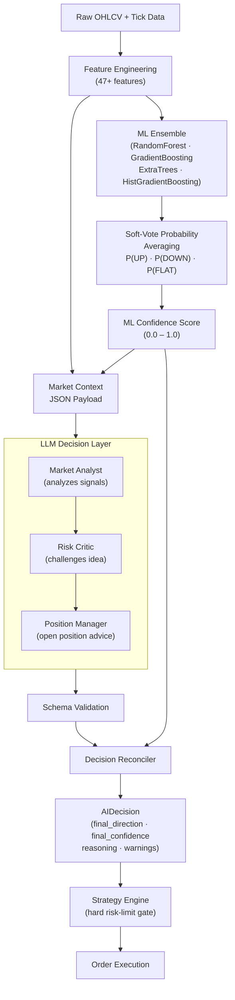
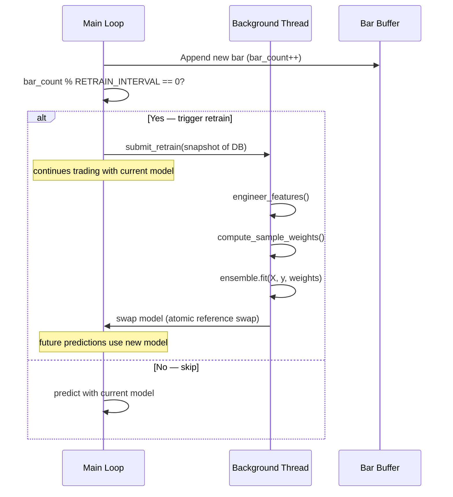
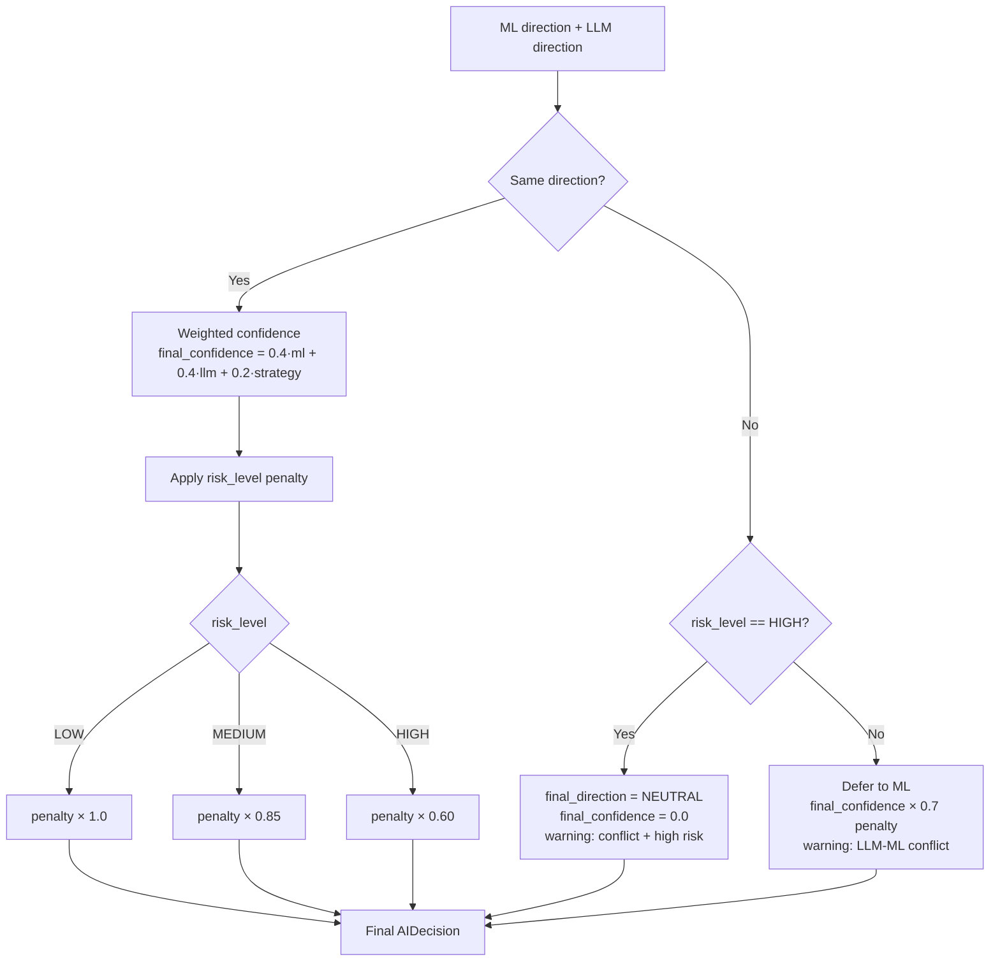
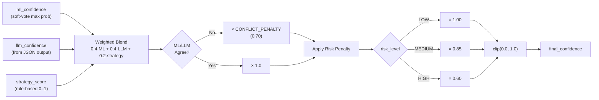
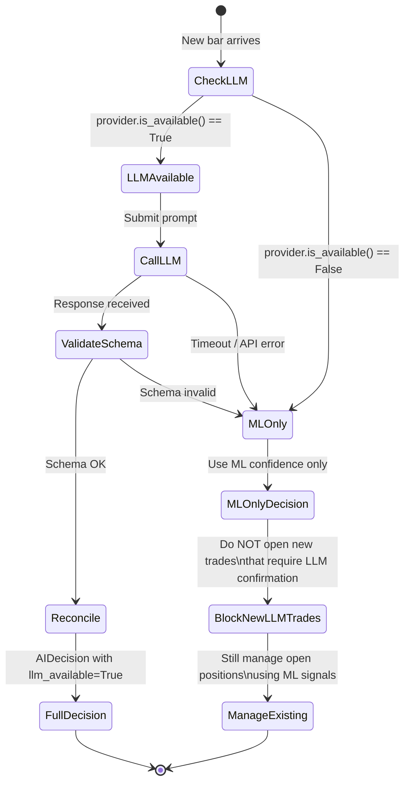

# AI Engine — Technical Reference

> **Project:** Trading-gold · **Module:** `ai_engine`  
> **Status:** Production · **Last Updated:** 2025

---

## Table of Contents

1. [Architecture Overview](#1-architecture-overview)
2. [ML Ensemble Design](#2-ml-ensemble-design)
3. [Engineered Features (47+)](#3-engineered-features-47)
4. [Recency-Weighted Training](#4-recency-weighted-training)
5. [Background Retraining](#5-background-retraining)
6. [Label Generation](#6-label-generation)
7. [LLM Decision Layer](#7-llm-decision-layer)
8. [AI Decision Reconciliation](#8-ai-decision-reconciliation)
9. [AI Trader Persona & Reasoning Chain](#9-ai-trader-persona--reasoning-chain)
10. [Confidence Scoring](#10-confidence-scoring)
11. [LLM Fallback Strategy](#11-llm-fallback-strategy)
12. [AIDecision Schema](#12-aidecision-schema)

---

## 1. Architecture Overview

The AI Engine is composed of two cooperating layers that work sequentially to produce a final trading decision:

- **Layer 1 — ML Ensemble:** A classical machine-learning ensemble that ingests 47+ engineered features and produces a directional probability vector `[P(DOWN), P(FLAT), P(UP)]`.
- **Layer 2 — LLM Decision Layer:** A large-language-model layer that receives the current market context plus the ML output and applies higher-order reasoning through three specialist agent roles (Market Analyst, Risk Critic, Position Manager) to confirm, challenge, or veto the ML recommendation.



> [!IMPORTANT]
> The LLM layer operates **inside** the strategy engine's hard risk limits. No LLM response — regardless of confidence — can override position-sizing caps, max drawdown thresholds, or margin requirements. Those checks are enforced deterministically **after** the AI decision is produced.

---

## 2. ML Ensemble Design

### 2.1 Constituent Models

The ensemble pools four scikit-learn estimators, each contributing an independent probability estimate over the three classes `{DOWN=-1, FLAT=0, UP=+1}`.

| # | Estimator | Key Hyperparameters | Strengths |
|---|-----------|---------------------|-----------|
| 1 | `RandomForestClassifier` | `n_estimators=300`, `max_depth=12`, `min_samples_leaf=5` | High variance tolerance, feature importance |
| 2 | `GradientBoostingClassifier` | `n_estimators=200`, `learning_rate=0.05`, `max_depth=5` | Sequential error correction, handles imbalanced classes |
| 3 | `ExtraTreesClassifier` | `n_estimators=300`, `max_features="sqrt"`, `bootstrap=True` | Faster, lower variance, good for noisy data |
| 4 | `HistGradientBoostingClassifier` | `max_iter=200`, `learning_rate=0.05`, `l2_regularization=0.1` | Native NaN handling, efficient on large datasets |

### 2.2 Soft Voting — Probability Averaging

Rather than a hard majority vote, the ensemble uses **soft voting**: each model's `predict_proba()` output is averaged across all estimators:

```python
import numpy as np
from sklearn.ensemble import (
    RandomForestClassifier,
    GradientBoostingClassifier,
    ExtraTreesClassifier,
    HistGradientBoostingClassifier,
)

class MLEnsemble:
    """Four-model soft-voting ensemble for next-bar direction classification."""

    CLASSES = [-1, 0, 1]  # DOWN, FLAT, UP

    def __init__(self):
        self.models = [
            RandomForestClassifier(
                n_estimators=300, max_depth=12, min_samples_leaf=5,
                class_weight="balanced", random_state=42, n_jobs=-1
            ),
            GradientBoostingClassifier(
                n_estimators=200, learning_rate=0.05, max_depth=5,
                subsample=0.8, random_state=42
            ),
            ExtraTreesClassifier(
                n_estimators=300, max_features="sqrt", bootstrap=True,
                class_weight="balanced", random_state=42, n_jobs=-1
            ),
            HistGradientBoostingClassifier(
                max_iter=200, learning_rate=0.05, l2_regularization=0.1,
                random_state=42
            ),
        ]

    def predict_proba(self, X: np.ndarray) -> np.ndarray:
        """
        Returns averaged probability vector [P(DOWN), P(FLAT), P(UP)].
        Shape: (n_samples, 3)
        """
        proba_stack = np.array([m.predict_proba(X) for m in self.models])
        return proba_stack.mean(axis=0)  # average across estimators

    def predict(self, X: np.ndarray) -> np.ndarray:
        """Argmax of averaged probabilities → class label."""
        proba = self.predict_proba(X)
        indices = np.argmax(proba, axis=1)
        return np.array(self.CLASSES)[indices]

    def ml_confidence(self, X: np.ndarray) -> float:
        """
        Scalar confidence for the top predicted class on a single sample.
        Returns max(averaged_proba) for the winning class.
        """
        proba = self.predict_proba(X.reshape(1, -1))[0]
        return float(np.max(proba))
```

### 2.3 Class Imbalance Handling

Gold markets are strongly directional for short periods, creating natural class imbalance. The ensemble addresses this through:

- `class_weight="balanced"` on tree estimators.
- **SMOTE** oversampling applied during training when any class represents less than 15% of labels.
- Minimum sample guard: training is skipped and the model is not updated if fewer than 200 labeled bars are available.

---

## 3. Engineered Features (47+)

All features are computed from a rolling window of OHLCV bars. Every feature is **standardized** (zero-mean, unit-variance) before being passed to the ML ensemble using a per-feature `StandardScaler` fitted on the training window.

### 3.1 Feature Engineering Pipeline

```python
import pandas as pd
import numpy as np
from ta.momentum import RSIIndicator, StochasticOscillator, WilliamsRIndicator
from ta.trend import MACD, EMAIndicator, ADXIndicator, CCIIndicator
from ta.volatility import BollingerBands, AverageTrueRange, KeltnerChannel
from ta.volume import OnBalanceVolumeIndicator

def engineer_features(df: pd.DataFrame) -> pd.DataFrame:
    """
    Compute all 47+ engineered features from raw OHLCV data.

    Parameters
    ----------
    df : pd.DataFrame
        Must contain columns: open, high, low, close, volume.

    Returns
    -------
    pd.DataFrame
        Original DataFrame plus all feature columns. NaN rows at the start
        are expected and dropped by the caller before training.
    """
    feat = df.copy()
    c = feat["close"]
    h = feat["high"]
    l = feat["low"]
    o = feat["open"]
    v = feat["volume"]
    rng = (h - l).replace(0, np.nan)

    # ── 1. Price Returns ────────────────────────────────────────────────────
    feat["ret_1"]  = c.pct_change(1)
    feat["ret_5"]  = c.pct_change(5)
    feat["ret_10"] = c.pct_change(10)
    feat["ret_20"] = c.pct_change(20)

    # ── 2. Candle Body & Wick Ratios ────────────────────────────────────────
    body = (c - o).abs()
    feat["body_ratio"]       = body / rng
    feat["upper_wick_ratio"] = (h - c.combine(o, max)) / rng
    feat["lower_wick_ratio"] = (c.combine(o, min) - l) / rng

    # ── 3. EMA Distances ────────────────────────────────────────────────────
    ema20  = EMAIndicator(c, window=20).ema_indicator()
    ema50  = EMAIndicator(c, window=50).ema_indicator()
    ema200 = EMAIndicator(c, window=200).ema_indicator()
    feat["dist_ema20"]  = (c - ema20)  / c
    feat["dist_ema50"]  = (c - ema50)  / c
    feat["dist_ema200"] = (c - ema200) / c

    # ── 4. MACD ─────────────────────────────────────────────────────────────
    macd_obj = MACD(c, window_slow=26, window_fast=12, window_sign=9)
    feat["macd_line"]   = macd_obj.macd()
    feat["macd_signal"] = macd_obj.macd_signal()
    feat["macd_hist"]   = macd_obj.macd_diff()

    # ── 5. RSI ──────────────────────────────────────────────────────────────
    feat["rsi_14"] = RSIIndicator(c, window=14).rsi()
    feat["rsi_7"]  = RSIIndicator(c, window=7).rsi()

    # ── 6. Stochastic ───────────────────────────────────────────────────────
    stoch = StochasticOscillator(h, l, c, window=14, smooth_window=3)
    feat["stoch_k"] = stoch.stoch()
    feat["stoch_d"] = stoch.stoch_signal()

    # ── 7. ADX / DI ─────────────────────────────────────────────────────────
    adx_obj = ADXIndicator(h, l, c, window=14)
    feat["adx"]    = adx_obj.adx()
    feat["adx_di_pos"] = adx_obj.adx_pos()
    feat["adx_di_neg"] = adx_obj.adx_neg()

    # ── 8. Bollinger Bands ──────────────────────────────────────────────────
    bb = BollingerBands(c, window=20, window_dev=2)
    feat["bb_width"]  = bb.bollinger_wband()
    feat["bb_pct_b"]  = bb.bollinger_pband()

    # ── 9. ATR ──────────────────────────────────────────────────────────────
    atr_obj = AverageTrueRange(h, l, c, window=14)
    feat["atr_14"]        = atr_obj.average_true_range()
    feat["atr_normalized"] = feat["atr_14"] / c

    # ── 10. Volume Ratio ────────────────────────────────────────────────────
    feat["volume_ratio"] = v / v.rolling(20).mean()

    # ── 11. Structure Distances (Swing High / Low) ──────────────────────────
    feat["swing_high_20"] = h.rolling(20).max()
    feat["swing_low_20"]  = l.rolling(20).min()
    feat["dist_swing_high"] = (feat["swing_high_20"] - c) / c
    feat["dist_swing_low"]  = (c - feat["swing_low_20"])  / c

    # ── 12. CCI ─────────────────────────────────────────────────────────────
    feat["cci_20"] = CCIIndicator(h, l, c, window=20).cci()

    # ── 13. Williams %R ─────────────────────────────────────────────────────
    feat["williams_r"] = WilliamsRIndicator(h, l, c, lbp=14).williams_r()

    # ── 14. OBV Slope (linear regression over 5 bars) ───────────────────────
    obv = OnBalanceVolumeIndicator(c, v).on_balance_volume()
    feat["obv_slope"] = _rolling_linreg_slope(obv, window=5)

    # ── 15. ATR Slope ────────────────────────────────────────────────────────
    feat["atr_slope"] = _rolling_linreg_slope(feat["atr_14"], window=5)

    # ── 16. EMA Slope ────────────────────────────────────────────────────────
    feat["ema20_slope"] = _rolling_linreg_slope(ema20, window=5)

    # ── 17. Keltner Channel Width ────────────────────────────────────────────
    kc = KeltnerChannel(h, l, c, window=20, window_atr=10)
    feat["keltner_width"] = kc.keltner_channel_wband()

    # ── 18. Price Acceleration (second derivative of close) ──────────────────
    feat["price_accel"] = c.diff().diff()

    return feat


def _rolling_linreg_slope(series: pd.Series, window: int) -> pd.Series:
    """Compute rolling linear-regression slope over `window` bars."""
    slopes = series.copy() * np.nan
    x = np.arange(window, dtype=float)
    x -= x.mean()
    denom = (x ** 2).sum()
    vals = series.values
    for i in range(window - 1, len(vals)):
        y = vals[i - window + 1 : i + 1].astype(float)
        if np.isnan(y).any():
            continue
        y -= y.mean()
        slopes.iloc[i] = float(np.dot(x, y) / denom)
    return slopes
```

### 3.2 Full Feature Catalogue

| # | Feature Name | Formula / Source | Description |
|---|--------------|-----------------|-------------|
| 1 | `ret_1` | `close.pct_change(1)` | 1-bar log return |
| 2 | `ret_5` | `close.pct_change(5)` | 5-bar return — short momentum |
| 3 | `ret_10` | `close.pct_change(10)` | 10-bar return — medium momentum |
| 4 | `ret_20` | `close.pct_change(20)` | 20-bar return — swing context |
| 5 | `body_ratio` | `abs(close-open) / range` | Candle conviction (0=doji, 1=marubozu) |
| 6 | `upper_wick_ratio` | `(high - max(c,o)) / range` | Upper wick pressure — selling at top |
| 7 | `lower_wick_ratio` | `(min(c,o) - low) / range` | Lower wick support — buying at bottom |
| 8 | `dist_ema20` | `(close - EMA20) / close` | Price distance from 20-bar EMA (%) |
| 9 | `dist_ema50` | `(close - EMA50) / close` | Price distance from 50-bar EMA (%) |
| 10 | `dist_ema200` | `(close - EMA200) / close` | Price distance from 200-bar EMA (%) |
| 11 | `macd_line` | MACD(12,26) | Raw MACD line |
| 12 | `macd_signal` | Signal(9) of MACD | MACD signal line |
| 13 | `macd_hist` | `macd_line - macd_signal` | MACD histogram (momentum cross) |
| 14 | `rsi_14` | RSI(14) | Classic 14-period RSI |
| 15 | `rsi_7` | RSI(7) | Fast 7-period RSI — short-term extremes |
| 16 | `stoch_k` | Stochastic K(14,3) | Raw stochastic oscillator |
| 17 | `stoch_d` | 3-period SMA of K | Smoothed stochastic signal line |
| 18 | `adx` | ADX(14) | Trend strength (0–100) |
| 19 | `adx_di_pos` | +DI(14) | Bullish directional indicator |
| 20 | `adx_di_neg` | -DI(14) | Bearish directional indicator |
| 21 | `bb_width` | (upper-lower)/middle | Bollinger Band width — volatility proxy |
| 22 | `bb_pct_b` | (close-lower)/(upper-lower) | %B — position within Bollinger Bands |
| 23 | `atr_14` | ATR(14) | 14-period Average True Range |
| 24 | `atr_normalized` | `atr_14 / close` | ATR as fraction of price |
| 25 | `volume_ratio` | `volume / SMA(volume,20)` | Current volume vs 20-bar average |
| 26 | `dist_swing_high` | `(swing_high20 - close) / close` | Distance below 20-bar swing high |
| 27 | `dist_swing_low` | `(close - swing_low20) / close` | Distance above 20-bar swing low |
| 28 | `cci_20` | CCI(20) | Commodity Channel Index |
| 29 | `williams_r` | Williams %R(14) | Overbought/oversold oscillator |
| 30 | `obv_slope` | LinReg slope of OBV over 5 bars | OBV trend momentum |
| 31 | `atr_slope` | LinReg slope of ATR over 5 bars | Volatility expansion / contraction |
| 32 | `ema20_slope` | LinReg slope of EMA20 over 5 bars | Short-term trend slope |
| 33 | `keltner_width` | (upper_kc - lower_kc) / middle_kc | Keltner Channel normalized width |
| 34 | `price_accel` | `close.diff().diff()` | Second derivative — acceleration |
| 35 | `swing_high_20` | `high.rolling(20).max()` | 20-bar rolling swing high level |
| 36 | `swing_low_20` | `low.rolling(20).min()` | 20-bar rolling swing low level |
| 37–47+ | *(derived / cross-features)* | Various combinations | E.g., RSI × ADX, BB%B × volume_ratio, MACD hist sign change, Stoch crossover flag, DI crossover flag, body_ratio × volume_ratio, ATR percentile rank, etc. |

> [!NOTE]
> Features 37–47+ are computed as interaction terms and binary flags (e.g., `stoch_cross = (stoch_k > stoch_d) & (stoch_k.shift(1) <= stoch_d.shift(1))`). These are generated in the `_compute_cross_features()` method of `FeatureEngineer`.

---

## 4. Recency-Weighted Training

Financial data is non-stationary. To prevent the model from being dominated by stale historical patterns, the training procedure applies **exponential decay sample weights** so that recent bars receive higher influence than older bars.

### 4.1 Decay Formula

$$w_i = e^{-\lambda \cdot (T - t_i)}$$

Where:
- $T$ = index of the most recent training bar
- $t_i$ = index of bar $i$
- $\lambda$ = decay constant (default: `0.001`)

A smaller $\lambda$ weights history more uniformly; a larger $\lambda$ makes the model near-memoryless beyond a few hundred bars.

### 4.2 Implementation

```python
import numpy as np

def compute_sample_weights(n_samples: int, decay: float = 0.001) -> np.ndarray:
    """
    Exponential decay weights for training samples.

    The last sample has weight 1.0; earlier samples decay exponentially.

    Parameters
    ----------
    n_samples : int
        Total number of training samples.
    decay : float
        Decay constant λ. Larger → sharper recency emphasis.

    Returns
    -------
    np.ndarray
        Weight vector of shape (n_samples,), normalized to sum to n_samples
        so that sklearn's internal averaging is not distorted.
    """
    indices = np.arange(n_samples, dtype=float)
    weights = np.exp(-decay * (n_samples - 1 - indices))
    # Normalize so sum == n_samples (preserve effective sample size semantics)
    weights = weights / weights.mean()
    return weights


# Usage inside ensemble training:
def fit(self, X: np.ndarray, y: np.ndarray) -> None:
    sample_weights = compute_sample_weights(len(y), decay=0.001)
    for model in self.models:
        if hasattr(model, "fit"):
            try:
                model.fit(X, y, sample_weight=sample_weights)
            except TypeError:
                # HistGradientBoosting supports sample_weight in newer sklearn
                model.fit(X, y, sample_weight=sample_weights)
```

> [!TIP]
> The optimal `decay` value depends on your timeframe. For M5 bars on gold, `λ ≈ 0.0005–0.002` has been found effective. For H1 bars, decrease λ to retain more history.

---

## 5. Background Retraining

To keep the model fresh without blocking the main trading loop, retraining is executed in a **background thread** triggered every `RETRAIN_EVERY_N_BARS` new bars.

### 5.1 Retraining Flow



### 5.2 Implementation

```python
import threading
import copy
from concurrent.futures import ThreadPoolExecutor

class BackgroundRetrainer:
    """
    Manages asynchronous retraining of the ML ensemble.

    Thread safety: the active model reference is replaced atomically.
    In-flight predictions use the old model; subsequent predictions use
    the new model. No locks are held during inference.
    """

    RETRAIN_EVERY_N_BARS: int = 50  # configurable via settings

    def __init__(self, ensemble: MLEnsemble):
        self._ensemble = ensemble
        self._executor = ThreadPoolExecutor(max_workers=1, thread_name_prefix="retrain")
        self._bar_count = 0
        self._is_training = threading.Event()

    def on_new_bar(self, bar_buffer: pd.DataFrame) -> None:
        """Call this once per closed bar. Triggers retrain when due."""
        self._bar_count += 1
        if (self._bar_count % self.RETRAIN_EVERY_N_BARS == 0
                and not self._is_training.is_set()):
            snapshot = bar_buffer.copy()  # snapshot before submission
            self._executor.submit(self._retrain_task, snapshot)

    def _retrain_task(self, data: pd.DataFrame) -> None:
        """Runs in background thread. Builds features, trains, swaps model."""
        self._is_training.set()
        try:
            features = engineer_features(data).dropna()
            if len(features) < 200:
                return  # not enough data
            X, y = extract_X_y(features)
            weights = compute_sample_weights(len(y))
            new_ensemble = copy.deepcopy(self._ensemble)
            new_ensemble.fit(X, y, weights)
            # Atomic swap — GIL ensures reference assignment is atomic in CPython
            self._ensemble.__dict__.update(new_ensemble.__dict__)
        except Exception as exc:
            import logging
            logging.getLogger("retrain").exception("Retraining failed: %s", exc)
        finally:
            self._is_training.clear()
```

> [!WARNING]
> The atomic swap relies on CPython's GIL. If porting to a GIL-free Python runtime or a multi-process architecture, replace the dict-update swap with a proper `threading.Lock`-protected pointer swap.

---

## 6. Label Generation

Labels encode the **next-bar direction** as a three-class variable: `UP (+1)`, `FLAT (0)`, `DOWN (-1)`.

### 6.1 Classification Thresholds

The label for bar $i$ is determined from the percentage change of the *next* bar's close relative to bar $i$'s close:

$$\text{ret}_{i+1} = \frac{\text{close}_{i+1} - \text{close}_i}{\text{close}_i}$$

| Condition | Label | Value |
|-----------|-------|-------|
| $\text{ret}_{i+1} > +\theta$ | UP | `+1` |
| $\text{ret}_{i+1} < -\theta$ | DOWN | `-1` |
| $|\text{ret}_{i+1}| \leq \theta$ | FLAT | `0` |

Default threshold $\theta = 0.0002$ (2 basis points, tunable per instrument).

### 6.2 Implementation

```python
def generate_labels(
    close: pd.Series,
    threshold: float = 0.0002,
) -> pd.Series:
    """
    Generate next-bar direction labels.

    Parameters
    ----------
    close : pd.Series
        Closing prices.
    threshold : float
        Minimum return magnitude to classify as directional (not flat).

    Returns
    -------
    pd.Series
        Integer series with values in {-1, 0, 1}. Last bar is NaN
        (no next bar available).
    """
    fwd_ret = close.shift(-1) / close - 1.0
    labels = pd.Series(0, index=close.index, dtype=float)
    labels[fwd_ret >  threshold] =  1
    labels[fwd_ret < -threshold] = -1
    labels.iloc[-1] = np.nan  # last bar has no future
    return labels
```

---

## 7. LLM Decision Layer

### 7.1 Provider Abstraction

All LLM providers share a single `BaseLLMProvider` interface, making the system agnostic to the underlying model or API.

```python
from abc import ABC, abstractmethod
from dataclasses import dataclass
from typing import Any

@dataclass
class LLMResponse:
    """Normalized response from any LLM provider."""
    raw_text: str
    parsed_json: dict[str, Any] | None
    provider: str
    model: str
    tokens_used: int
    latency_ms: float


class BaseLLMProvider(ABC):
    """Pluggable LLM provider interface."""

    @abstractmethod
    def complete(self, system_prompt: str, user_prompt: str) -> LLMResponse:
        """Send a prompt and return a structured LLMResponse."""
        ...

    @abstractmethod
    def is_available(self) -> bool:
        """Health-check: returns True if provider is reachable."""
        ...


class OpenAIProvider(BaseLLMProvider):
    """OpenAI GPT-4o / GPT-4-turbo provider."""

    def __init__(self, api_key: str, model: str = "gpt-4o"):
        import openai
        self._client = openai.OpenAI(api_key=api_key)
        self._model = model

    def complete(self, system_prompt: str, user_prompt: str) -> LLMResponse:
        import time, json
        t0 = time.monotonic()
        resp = self._client.chat.completions.create(
            model=self._model,
            messages=[
                {"role": "system", "content": system_prompt},
                {"role": "user",   "content": user_prompt},
            ],
            response_format={"type": "json_object"},
            temperature=0.1,
        )
        latency = (time.monotonic() - t0) * 1000
        text = resp.choices[0].message.content
        return LLMResponse(
            raw_text=text,
            parsed_json=json.loads(text),
            provider="openai",
            model=self._model,
            tokens_used=resp.usage.total_tokens,
            latency_ms=latency,
        )

    def is_available(self) -> bool:
        try:
            self._client.models.list()
            return True
        except Exception:
            return False


class AnthropicProvider(BaseLLMProvider):
    """Anthropic Claude provider."""

    def __init__(self, api_key: str, model: str = "claude-3-5-sonnet-20241022"):
        import anthropic
        self._client = anthropic.Anthropic(api_key=api_key)
        self._model = model

    def complete(self, system_prompt: str, user_prompt: str) -> LLMResponse:
        import time, json
        t0 = time.monotonic()
        msg = self._client.messages.create(
            model=self._model,
            max_tokens=1024,
            system=system_prompt,
            messages=[{"role": "user", "content": user_prompt}],
        )
        latency = (time.monotonic() - t0) * 1000
        text = msg.content[0].text
        return LLMResponse(
            raw_text=text,
            parsed_json=json.loads(text),
            provider="anthropic",
            model=self._model,
            tokens_used=msg.usage.input_tokens + msg.usage.output_tokens,
            latency_ms=latency,
        )

    def is_available(self) -> bool:
        try:
            self._client.models.list()
            return True
        except Exception:
            return False


class OllamaProvider(BaseLLMProvider):
    """Local Ollama provider (e.g., mistral, llama3)."""

    def __init__(self, base_url: str = "http://localhost:11434", model: str = "mistral"):
        import requests
        self._base_url = base_url
        self._model = model
        self._requests = requests

    def complete(self, system_prompt: str, user_prompt: str) -> LLMResponse:
        import time, json
        t0 = time.monotonic()
        payload = {
            "model": self._model,
            "prompt": f"{system_prompt}\n\n{user_prompt}",
            "stream": False,
            "format": "json",
        }
        resp = self._requests.post(f"{self._base_url}/api/generate", json=payload, timeout=60)
        resp.raise_for_status()
        data = resp.json()
        text = data["response"]
        latency = (time.monotonic() - t0) * 1000
        return LLMResponse(
            raw_text=text,
            parsed_json=json.loads(text),
            provider="ollama",
            model=self._model,
            tokens_used=data.get("eval_count", 0),
            latency_ms=latency,
        )

    def is_available(self) -> bool:
        try:
            r = self._requests.get(f"{self._base_url}/api/tags", timeout=5)
            return r.status_code == 200
        except Exception:
            return False
```

### 7.2 Agent Roles

The LLM layer uses three sequential roles within a single API call (or as chained calls for complex workflows):

#### 7.2.1 Market Analyst

Analyzes the current market context, ML output, and indicator signals to form a primary directional view.

**System prompt excerpt:**
```
You are a senior gold (XAUUSD) market analyst. Your role is to assess the
current trading environment using the provided market context JSON. You must:
1. Evaluate trend direction and strength from EMA, ADX, and MACD signals.
2. Identify key support/resistance levels from swing highs/lows.
3. Assess momentum from RSI, Stochastic, and CCI.
4. Weigh the ML ensemble's probability distribution.
5. Produce a clear directional bias: BUY, SELL, or NEUTRAL.
Output your analysis in the required JSON schema only. No prose outside JSON.
```

#### 7.2.2 Risk Critic

Acts as a devil's advocate: challenges the Market Analyst's directional bias, identifies conditions that would invalidate the trade idea.

**System prompt excerpt:**
```
You are a professional risk manager reviewing a proposed gold trade.
Your role is to challenge the Market Analyst's recommendation. You must:
1. Identify any indicators that CONTRADICT the proposed direction.
2. Flag confluence gaps (e.g., trend says UP but RSI diverges).
3. Assess volatility risk (ATR spike, Bollinger squeeze breakout risk).
4. Check for proximity to major resistance/support that limits upside.
5. Output a risk_level (LOW/MEDIUM/HIGH) and list specific warnings.
Output only in the required JSON schema.
```

#### 7.2.3 Position Manager

Advises on managing any currently open position: hold, scale, reduce, or exit.

**System prompt excerpt:**
```
You are a position manager for an active gold trade. Evaluate the current
open position (if any) in light of new market conditions. You must:
1. Recommend: HOLD, SCALE_IN, REDUCE, or EXIT.
2. Provide rationale referencing specific indicator changes since entry.
3. Flag if any originally stated trade conditions have been invalidated.
Output only in the required JSON schema.
```

### 7.3 Structured JSON Input Schema

The following payload is serialized and sent as the `user_prompt` to the LLM on each decision cycle:

```json
{
  "timestamp": "2025-07-14T10:35:00Z",
  "symbol": "XAUUSD",
  "timeframe": "M5",
  "current_bar": {
    "open": 3342.50,
    "high": 3348.20,
    "low": 3340.10,
    "close": 3347.80,
    "volume": 1245
  },
  "indicators": {
    "ema_20": 3341.15,
    "ema_50": 3335.40,
    "ema_200": 3290.60,
    "macd_line": 3.21,
    "macd_signal": 2.85,
    "macd_histogram": 0.36,
    "rsi_14": 58.4,
    "rsi_7": 63.1,
    "stoch_k": 72.3,
    "stoch_d": 68.1,
    "adx": 28.5,
    "adx_di_pos": 24.1,
    "adx_di_neg": 14.3,
    "bb_width": 0.0042,
    "bb_pct_b": 0.78,
    "atr_14": 12.40,
    "atr_normalized": 0.0037,
    "volume_ratio": 1.32,
    "cci_20": 82.5,
    "williams_r": -28.4
  },
  "structure": {
    "swing_high_20": 3356.00,
    "swing_low_20": 3318.50,
    "dist_swing_high_pct": 0.0025,
    "dist_swing_low_pct": 0.0088
  },
  "ml_ensemble": {
    "prob_up": 0.62,
    "prob_flat": 0.21,
    "prob_down": 0.17,
    "predicted_direction": "UP",
    "ml_confidence": 0.62,
    "model_version": "v20250714_103000"
  },
  "open_position": {
    "exists": true,
    "direction": "BUY",
    "entry_price": 3330.00,
    "current_pnl_pct": 0.0053,
    "bars_held": 14,
    "stop_loss": 3318.00,
    "take_profit": 3360.00
  },
  "account": {
    "balance": 10000.00,
    "equity": 10053.00,
    "used_margin": 663.00,
    "free_margin": 9390.00
  },
  "strategy_score": 0.74,
  "request_roles": ["market_analyst", "risk_critic", "position_manager"]
}
```

### 7.4 Structured JSON Output Schema

The LLM **must** return exactly the following schema. Any response that does not conform is rejected and logged.

```json
{
  "market_analyst": {
    "direction": "BUY",
    "confidence": 0.71,
    "trend_assessment": "Bullish. Price above EMA20/50/200. MACD histogram positive and expanding. ADX=28.5 indicates moderate trend strength.",
    "key_levels": {
      "nearest_resistance": 3356.00,
      "nearest_support": 3335.40,
      "comment": "0.25% to resistance — acceptable risk/reward for continuation."
    },
    "signal_confluence": ["EMA stack bullish", "MACD cross above signal", "RSI in bullish zone (58)", "Volume ratio elevated (1.32x)"],
    "reasoning_steps": [
      "1. Trend: EMA20 > EMA50 > EMA200 — confirmed bullish alignment.",
      "2. Momentum: MACD hist positive (+0.36), expanding — bulls in control.",
      "3. RSI(14)=58.4 — room to run before overbought at 70.",
      "4. Stoch K=72.3 > D=68.1 — bullish cross, not yet extreme.",
      "5. ML ensemble P(UP)=0.62 — corroborates bullish bias."
    ]
  },
  "risk_critic": {
    "risk_level": "MEDIUM",
    "contradicting_signals": [
      "Stoch K approaching overbought (>80) within 1–2 bars.",
      "CCI=82.5 — elevated, watch for reversal near 100.",
      "Only 0.25% distance to swing high 3356 — limited upside buffer."
    ],
    "invalidation_conditions": [
      "Close below EMA20 (3341.15) on this or next bar.",
      "MACD histogram turns negative.",
      "RSI(7) crosses below 50."
    ],
    "volatility_comment": "ATR=12.40 is within normal range. No extreme volatility spike detected.",
    "recommendation": "PROCEED_WITH_CAUTION"
  },
  "position_manager": {
    "action": "HOLD",
    "rationale": "Existing BUY at 3330.00 is profitable (+0.53%). Trade thesis intact — trend has not invalidated. Hold toward TP at 3360.",
    "stop_adjustment": {
      "suggested_new_stop": 3335.00,
      "reason": "Trail stop to EMA50 level to lock in partial profit."
    },
    "scale_recommendation": null
  },
  "llm_direction": "BUY",
  "llm_confidence": 0.68,
  "warnings": [
    "Stoch approaching overbought — monitor closely.",
    "Swing high proximity limits upside. Tight TP management recommended."
  ],
  "schema_version": "1.0"
}
```

### 7.5 Schema Validation

Every LLM response is validated against a JSON Schema before being consumed. Responses that fail validation are **rejected**, logged at `WARNING` level, and the system falls back to ML-only mode for that decision cycle.

```python
import json
import jsonschema
import logging

logger = logging.getLogger("llm.validation")

LLM_RESPONSE_SCHEMA = {
    "type": "object",
    "required": ["market_analyst", "risk_critic", "position_manager",
                 "llm_direction", "llm_confidence", "warnings", "schema_version"],
    "properties": {
        "llm_direction": {"type": "string", "enum": ["BUY", "SELL", "NEUTRAL"]},
        "llm_confidence": {"type": "number", "minimum": 0.0, "maximum": 1.0},
        "warnings": {"type": "array", "items": {"type": "string"}},
        "schema_version": {"type": "string"},
        "market_analyst": {
            "type": "object",
            "required": ["direction", "confidence", "trend_assessment", "reasoning_steps"],
            "properties": {
                "direction": {"type": "string", "enum": ["BUY", "SELL", "NEUTRAL"]},
                "confidence": {"type": "number", "minimum": 0.0, "maximum": 1.0},
                "trend_assessment": {"type": "string"},
                "reasoning_steps": {"type": "array", "items": {"type": "string"}},
            },
        },
        "risk_critic": {
            "type": "object",
            "required": ["risk_level", "contradicting_signals", "invalidation_conditions"],
            "properties": {
                "risk_level": {"type": "string", "enum": ["LOW", "MEDIUM", "HIGH"]},
                "contradicting_signals": {"type": "array", "items": {"type": "string"}},
                "invalidation_conditions": {"type": "array", "items": {"type": "string"}},
                "recommendation": {
                    "type": "string",
                    "enum": ["PROCEED", "PROCEED_WITH_CAUTION", "DO_NOT_TRADE"]
                },
            },
        },
        "position_manager": {
            "type": "object",
            "required": ["action", "rationale"],
            "properties": {
                "action": {
                    "type": "string",
                    "enum": ["HOLD", "SCALE_IN", "REDUCE", "EXIT"]
                },
                "rationale": {"type": "string"},
            },
        },
    },
}


def validate_llm_response(response: dict) -> bool:
    """
    Validate LLM JSON response against the required schema.

    Returns True if valid, False if invalid (caller should use ML-only fallback).
    """
    try:
        jsonschema.validate(instance=response, schema=LLM_RESPONSE_SCHEMA)
        return True
    except jsonschema.ValidationError as exc:
        logger.warning(
            "LLM response schema validation failed: %s | path=%s",
            exc.message, list(exc.absolute_path)
        )
        return False
    except jsonschema.SchemaError as exc:
        logger.error("LLM response schema itself is malformed: %s", exc.message)
        return False
```

### 7.6 Hard Risk Limit Enforcement

> [!CAUTION]
> The LLM **cannot** override hard risk limits. This is not a soft convention — it is enforced by deterministic code that runs **after** the `AIDecision` is produced, before any order is submitted.

Hard limits enforced regardless of LLM output:

| Limit | Enforcement Point |
|-------|------------------|
| Max position size (% of balance) | `RiskManager.check_position_size()` |
| Max daily drawdown | `RiskManager.check_daily_drawdown()` |
| Max open positions | `RiskManager.check_position_count()` |
| Margin requirement | `RiskManager.check_margin()` |
| Spread threshold | `RiskManager.check_spread()` |
| Session trading hours | `SessionFilter.is_tradeable()` |

```python
class RiskManager:
    """Hard risk guardrails — LLM decisions are always filtered through here."""

    def approve_decision(self, decision: "AIDecision", account: Account) -> bool:
        """
        Returns True only if ALL hard limits pass.
        The AI decision is respected only within these constraints.
        """
        checks = [
            self.check_position_size(decision.suggested_lot_size, account),
            self.check_daily_drawdown(account),
            self.check_position_count(account),
            self.check_margin(decision.suggested_lot_size, account),
            self.check_spread(account.current_spread),
        ]
        if not all(checks):
            import logging
            logging.getLogger("risk").warning(
                "AIDecision BLOCKED by hard risk limits. direction=%s confidence=%.2f",
                decision.final_direction, decision.final_confidence
            )
            return False
        return True
```

---

## 8. AI Decision Reconciliation

The final trading decision is produced by reconciling three independent signals:

| Signal | Weight | Source |
|--------|--------|--------|
| ML Confidence | 40% | `ml_confidence` from ensemble soft-vote |
| LLM Confidence | 40% | `llm_confidence` from validated JSON |
| Strategy Score | 20% | Rule-based signal score from strategy engine |

### 8.1 Direction Agreement Logic



### 8.2 Reconciliation Code

```python
from dataclasses import dataclass, field
from typing import Literal

Direction = Literal["BUY", "SELL", "NEUTRAL"]
RiskLevel = Literal["LOW", "MEDIUM", "HIGH"]

RISK_PENALTIES = {"LOW": 1.0, "MEDIUM": 0.85, "HIGH": 0.60}
CONFLICT_PENALTY = 0.70

@dataclass
class AIDecision:
    """Final reconciled AI trading decision."""
    ml_confidence: float
    ml_direction: Direction
    llm_direction: Direction
    llm_confidence: float
    strategy_score: float
    risk_level: RiskLevel
    final_direction: Direction
    final_confidence: float
    reasoning: str
    warnings: list[str] = field(default_factory=list)
    llm_available: bool = True
    schema_version: str = "1.0"


def reconcile_decision(
    ml_direction: Direction,
    ml_confidence: float,
    llm_direction: Direction,
    llm_confidence: float,
    strategy_score: float,
    risk_level: RiskLevel,
    llm_warnings: list[str],
) -> AIDecision:
    """Combine ML + LLM + strategy signals into a final AIDecision."""

    warnings = list(llm_warnings)

    if ml_direction == llm_direction:
        # Agreement: blend confidences
        raw_confidence = (
            0.40 * ml_confidence
            + 0.40 * llm_confidence
            + 0.20 * strategy_score
        )
        final_direction = ml_direction
        reasoning = f"ML and LLM agree on {ml_direction}. Blended confidence applied."
    else:
        # Conflict
        warnings.append(f"Direction conflict: ML={ml_direction} vs LLM={llm_direction}.")
        if risk_level == "HIGH":
            final_direction = "NEUTRAL"
            raw_confidence = 0.0
            reasoning = "ML/LLM conflict under HIGH risk — decision suppressed to NEUTRAL."
        else:
            final_direction = ml_direction  # defer to ML
            raw_confidence = ml_confidence * CONFLICT_PENALTY
            reasoning = f"ML/LLM conflict. Deferring to ML={ml_direction} with penalty."

    # Apply risk-level penalty
    penalty = RISK_PENALTIES[risk_level]
    final_confidence = min(1.0, raw_confidence * penalty)

    return AIDecision(
        ml_confidence=ml_confidence,
        ml_direction=ml_direction,
        llm_direction=llm_direction,
        llm_confidence=llm_confidence,
        strategy_score=strategy_score,
        risk_level=risk_level,
        final_direction=final_direction,
        final_confidence=final_confidence,
        reasoning=reasoning,
        warnings=warnings,
    )
```

---

## 9. AI Trader Persona & Reasoning Chain

The LLM operates under a strict **15-step reasoning chain** embedded in the system prompt. This chain enforces systematic, disciplined analysis before any directional opinion is formed.

```
AI TRADER PERSONA — GOLD SPECIALIST
====================================
You are a disciplined, data-driven gold trader with 15 years of experience
in XAUUSD on intraday timeframes. You are methodical, never impulsive, and
always acknowledge uncertainty.

MANDATORY 15-STEP REASONING CHAIN
(Complete each step internally before outputting JSON)

Step  1: TREND DIRECTION    — What does the EMA stack (20/50/200) say?
Step  2: TREND STRENGTH     — What does ADX say? Is there a trending regime?
Step  3: MOMENTUM           — MACD line vs signal: expanding or contracting?
Step  4: MACD HISTOGRAM     — Is the histogram growing or shrinking?
Step  5: OSCILLATORS        — RSI(14) and RSI(7): overbought/oversold/diverging?
Step  6: STOCHASTIC         — Stoch K vs D: crossover? Extreme zone?
Step  7: CCI & WILLIAMS     — Confirming or contradicting oscillator signals?
Step  8: STRUCTURE          — Where are swing highs/lows? Distance to each?
Step  9: VOLATILITY         — ATR vs baseline: expanding? BB width: squeeze?
Step 10: VOLUME             — Is volume supporting the move (ratio > 1.0)?
Step 11: ML ENSEMBLE        — What is the ML probability distribution saying?
Step 12: CONFLUENCE COUNT   — How many signals align? Majority rules.
Step 13: INVALIDATION       — What specific conditions would break this thesis?
Step 14: RISK ASSESSMENT    — What is the honest risk level: LOW/MEDIUM/HIGH?
Step 15: FINAL DECISION     — After all steps: BUY, SELL, or NEUTRAL?

RULES:
- Never skip a step.
- If fewer than 5 signals agree, output NEUTRAL.
- If risk_level is HIGH, reduce confidence by at least 0.30.
- Always list at least 2 invalidation conditions.
- Never recommend a position size; that is handled externally.
```

---

## 10. Confidence Scoring

The final `final_confidence` scalar (range `0.0–1.0`) summarizes the engine's conviction in its decision. Here is the complete calculation pipeline:



### 10.1 Confidence Thresholds for Trading

| `final_confidence` Range | Interpretation | Action |
|--------------------------|----------------|--------|
| `< 0.40` | Low conviction | No new trade opened |
| `0.40 – 0.55` | Moderate conviction | Minimum lot size only |
| `0.55 – 0.70` | Good conviction | Standard lot size |
| `0.70 – 0.85` | High conviction | Standard + optional scale |
| `> 0.85` | Very high conviction | Maximum allowed lot size |

---

## 11. LLM Fallback Strategy

When the LLM provider is unavailable (network error, API timeout, quota exceeded, schema validation failure), the system operates in **ML-only mode**:



### 11.1 Fallback Rules

```python
def make_decision_with_fallback(
    ml_ensemble: MLEnsemble,
    llm_provider: BaseLLMProvider,
    context: dict,
    strategy_score: float,
) -> AIDecision:
    """
    Attempt full AI decision; fall back to ML-only if LLM unavailable.
    """
    ml_proba = ml_ensemble.predict_proba(context["features"])
    ml_direction = proba_to_direction(ml_proba)
    ml_confidence = float(ml_proba.max())

    llm_available = llm_provider.is_available()

    if llm_available:
        try:
            llm_response = llm_provider.complete(
                system_prompt=build_system_prompt(),
                user_prompt=build_user_prompt(context, ml_proba),
            )
            if llm_response.parsed_json and validate_llm_response(llm_response.parsed_json):
                return reconcile_decision(
                    ml_direction=ml_direction,
                    ml_confidence=ml_confidence,
                    llm_direction=llm_response.parsed_json["llm_direction"],
                    llm_confidence=llm_response.parsed_json["llm_confidence"],
                    strategy_score=strategy_score,
                    risk_level=llm_response.parsed_json["risk_critic"]["risk_level"],
                    llm_warnings=llm_response.parsed_json["warnings"],
                )
        except Exception as exc:
            logging.getLogger("ai").warning("LLM call failed: %s — using ML-only fallback", exc)

    # ── ML-ONLY FALLBACK ────────────────────────────────────────────────────
    # Key rule: do NOT open NEW trades that normally require LLM confirmation.
    # Allow management of existing positions using ML direction signals only.
    return AIDecision(
        ml_confidence=ml_confidence,
        ml_direction=ml_direction,
        llm_direction="NEUTRAL",          # LLM not available → treat as neutral
        llm_confidence=0.0,
        strategy_score=strategy_score,
        risk_level="MEDIUM",              # conservative default when LLM absent
        final_direction=ml_direction if ml_confidence >= 0.65 else "NEUTRAL",
        final_confidence=ml_confidence * 0.70,   # 30% discount for missing LLM layer
        reasoning="LLM unavailable — ML-only mode. No new LLM-dependent trades.",
        warnings=["LLM unavailable. Confidence discounted by 30%. No new entries unless ML confidence ≥ 0.65."],
        llm_available=False,
    )
```

> [!NOTE]
> When `llm_available=False`, the strategy engine checks this flag and suppresses any trade entry that has `final_confidence < 0.65`. Position management (stop-loss trailing, partial TP) continues unaffected using pure ML signals.

---

## 12. AIDecision Schema

The `AIDecision` dataclass is the canonical output of the entire AI Engine. It is the only object passed from the AI layer to the strategy engine.

### 12.1 Field Reference

| Field | Type | Range | Description |
|-------|------|-------|-------------|
| `ml_confidence` | `float` | 0.0–1.0 | Raw ML ensemble confidence (max of soft-vote probabilities) |
| `ml_direction` | `Direction` | BUY/SELL/NEUTRAL | ML ensemble predicted direction |
| `llm_direction` | `Direction` | BUY/SELL/NEUTRAL | LLM recommended direction (`NEUTRAL` if LLM unavailable) |
| `llm_confidence` | `float` | 0.0–1.0 | LLM self-reported confidence (`0.0` if LLM unavailable) |
| `strategy_score` | `float` | 0.0–1.0 | Rule-based strategy signal score |
| `risk_level` | `RiskLevel` | LOW/MEDIUM/HIGH | Risk Critic's assessed risk level |
| `final_direction` | `Direction` | BUY/SELL/NEUTRAL | Reconciled final direction |
| `final_confidence` | `float` | 0.0–1.0 | Reconciled final confidence after all penalties |
| `reasoning` | `str` | — | Human-readable summary of the reconciliation logic |
| `warnings` | `list[str]` | — | List of risk warnings from LLM and reconciliation |
| `llm_available` | `bool` | — | Whether LLM was reachable and returned a valid response |
| `schema_version` | `str` | — | Schema version for forward-compatibility |

### 12.2 Serialized Example

```json
{
  "ml_confidence": 0.62,
  "ml_direction": "BUY",
  "llm_direction": "BUY",
  "llm_confidence": 0.68,
  "strategy_score": 0.74,
  "risk_level": "MEDIUM",
  "final_direction": "BUY",
  "final_confidence": 0.588,
  "reasoning": "ML and LLM agree on BUY. Blended confidence applied. MEDIUM risk penalty (×0.85) applied.",
  "warnings": [
    "Stoch approaching overbought — monitor closely.",
    "Swing high proximity limits upside. Tight TP management recommended."
  ],
  "llm_available": true,
  "schema_version": "1.0"
}
```

### 12.3 Confidence Calculation Trace (Example)

```
ml_confidence    = 0.62
llm_confidence   = 0.68
strategy_score   = 0.74

Weighted blend   = 0.40×0.62 + 0.40×0.68 + 0.20×0.74
                 = 0.248 + 0.272 + 0.148
                 = 0.668

Conflict penalty = 1.0 (directions agree → no penalty)

Risk penalty     = 0.85 (MEDIUM risk)

final_confidence = 0.668 × 1.0 × 0.85
                 = 0.568  → clipped to 0.568
```

---

## Appendix A — Configuration Reference

```python
# ai_engine/config.py

class AIEngineConfig:
    # ML Ensemble
    RETRAIN_EVERY_N_BARS: int = 50
    MIN_TRAINING_SAMPLES: int = 200
    LABEL_THRESHOLD: float = 0.0002       # 2 bps flat-zone boundary
    SAMPLE_WEIGHT_DECAY: float = 0.001    # λ for exponential recency weighting

    # Feature Engineering
    EMA_FAST: int = 20
    EMA_MID: int = 50
    EMA_SLOW: int = 200
    RSI_SLOW: int = 14
    RSI_FAST: int = 7
    ATR_WINDOW: int = 14
    BB_WINDOW: int = 20
    STOCH_WINDOW: int = 14
    ADX_WINDOW: int = 14
    CCI_WINDOW: int = 20
    WILLIAMS_WINDOW: int = 14
    OBV_SLOPE_WINDOW: int = 5
    SWING_WINDOW: int = 20

    # Confidence Thresholds
    MIN_CONFIDENCE_FOR_ENTRY: float = 0.40
    ML_ONLY_MIN_CONFIDENCE: float = 0.65
    ML_ONLY_CONFIDENCE_DISCOUNT: float = 0.30

    # Reconciliation Weights
    ML_WEIGHT: float = 0.40
    LLM_WEIGHT: float = 0.40
    STRATEGY_WEIGHT: float = 0.20
    CONFLICT_PENALTY: float = 0.70

    # Risk Penalties
    RISK_PENALTY_LOW: float = 1.00
    RISK_PENALTY_MEDIUM: float = 0.85
    RISK_PENALTY_HIGH: float = 0.60

    # LLM
    LLM_TIMEOUT_SECONDS: int = 30
    LLM_MAX_RETRIES: int = 2
    LLM_SCHEMA_VERSION: str = "1.0"
```

---

## Appendix B — Module Structure

```
ai_engine/
├── __init__.py
├── config.py                  # AIEngineConfig
├── features/
│   ├── __init__.py
│   ├── engineer.py            # engineer_features(), FeatureEngineer
│   └── labels.py              # generate_labels()
├── ensemble/
│   ├── __init__.py
│   ├── models.py              # MLEnsemble (4 estimators)
│   ├── weights.py             # compute_sample_weights()
│   └── retrainer.py           # BackgroundRetrainer
├── llm/
│   ├── __init__.py
│   ├── base.py                # BaseLLMProvider, LLMResponse
│   ├── openai_provider.py     # OpenAIProvider
│   ├── anthropic_provider.py  # AnthropicProvider
│   ├── ollama_provider.py     # OllamaProvider
│   ├── prompts.py             # System & user prompt builders
│   ├── schema.py              # LLM_RESPONSE_SCHEMA, validate_llm_response()
│   └── roles.py               # MarketAnalyst, RiskCritic, PositionManager
├── decision/
│   ├── __init__.py
│   ├── reconciler.py          # reconcile_decision()
│   ├── ai_decision.py         # AIDecision dataclass
│   └── fallback.py            # make_decision_with_fallback()
└── risk/
    ├── __init__.py
    └── manager.py             # RiskManager (hard limits)
```

---

*Documentation generated for Trading-gold AI Engine. For issues or contributions, refer to the project's contribution guidelines.*
