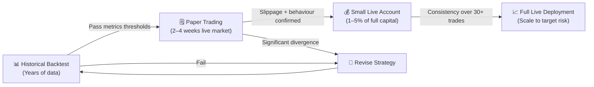
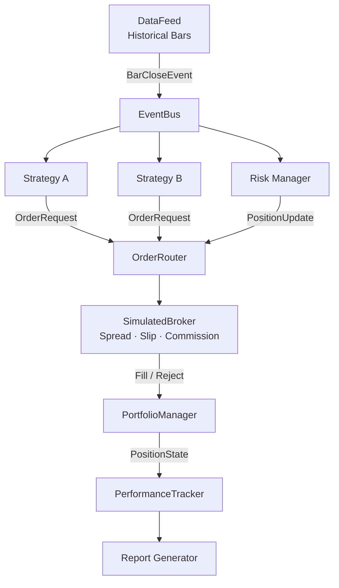
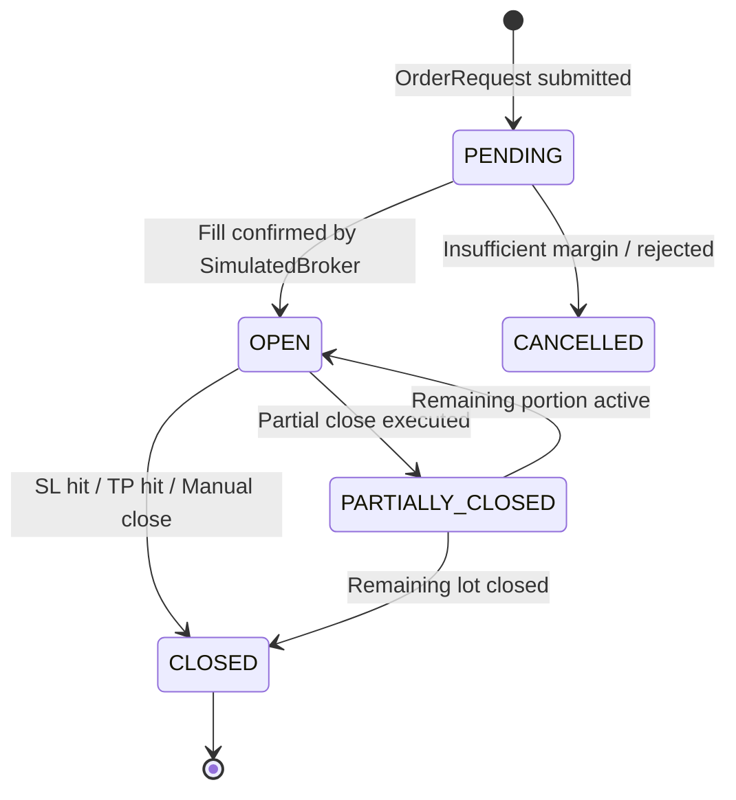
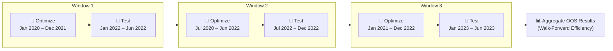
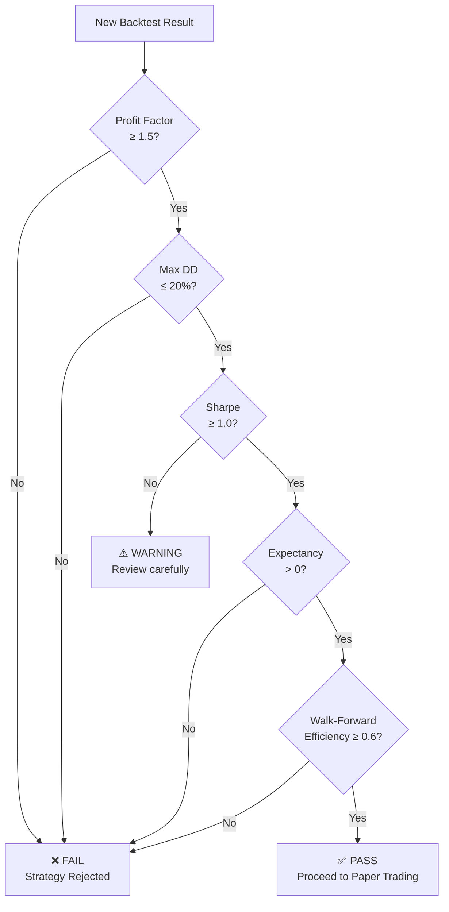
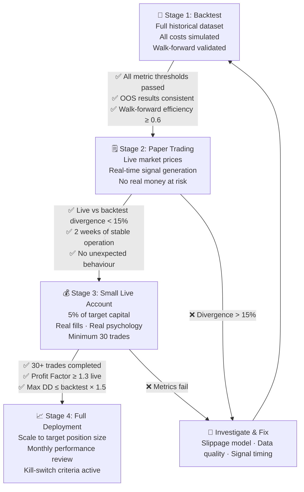

# BACKTESTING — Trading-Gold

> Comprehensive guide to the backtesting framework: philosophy, engine design,
> realistic simulation, bias avoidance, performance measurement, and the
> progression from backtest through paper trading to live deployment.

---

## Table of Contents

1. [Philosophy](#1-philosophy)
2. [Backtest Engine Design](#2-backtest-engine-design)
3. [Historical Data Sourcing from MT5](#3-historical-data-sourcing-from-mt5)
4. [Realistic Cost Simulation](#4-realistic-cost-simulation)
5. [Position Sizing](#5-position-sizing)
6. [SL / TP Simulation](#6-sl--tp-simulation)
7. [Trailing Stop Simulation](#7-trailing-stop-simulation)
8. [Partial Close Simulation](#8-partial-close-simulation)
9. [Multi-Strategy Backtesting](#9-multi-strategy-backtesting)
10. [Walk-Forward Testing](#10-walk-forward-testing)
11. [Out-of-Sample Testing](#11-out-of-sample-testing)
12. [Performance Metrics](#12-performance-metrics)
13. [Avoiding Look-Ahead Bias](#13-avoiding-look-ahead-bias)
14. [Avoiding Survivorship Bias](#14-avoiding-survivorship-bias)
15. [Avoiding Overfitting](#15-avoiding-overfitting)
16. [Backtest Report Format](#16-backtest-report-format)
17. [Progression: Backtest → Paper → Live → Scale](#17-progression-backtest--paper--live--scale)

---

## 1. Philosophy

### 1.1 Test Before You Risk Real Money

Every strategy deployed on the Trading-Gold system **must** pass through a
rigorous testing funnel before a single cent of real capital is committed.
The cost of skipping this step is not just monetary loss — it erodes confidence
and forces reactive, emotional decision-making under pressure.

The guiding principle is simple:

> *"If it doesn't work in the past, it won't work in the future.  
>  If it only works in the past, it still might not work in the future."*

Backtesting gives you **necessary but not sufficient** evidence of viability.
Paper trading closes the gap between simulation and reality.

### 1.2 The Test → Paper → Live Progression



Each gate in the progression is controlled by **quantitative criteria** defined
in [Section 17](#17-progression-backtest--paper--live--scale). No manual
override — the numbers decide.

### 1.3 Why Backtests Lie (and How We Minimise It)

| Lie | Root Cause | Our Mitigation |
|-----|-----------|----------------|
| **Overfitting** | Too many parameters tuned to historical noise | Walk-forward validation, parameter sensitivity checks |
| **Look-ahead bias** | Accidentally using future prices in signals | Strict bar-indexing convention, closed-bar-only signals |
| **Survivorship bias** | Data missing instruments/periods that failed | Full continuous XAUUSD data from verified broker feeds |
| **Ideal fill prices** | Assuming best-case execution | Spread + slippage model applied to every fill |
| **Missing costs** | Ignoring swap, commission, slippage | Full cost model (see §4) |
| **Wishful discretion** | Manually excluding "bad" trades | Fully automated, rule-based strategy execution |
| **Data snooping** | Evaluating on data used for design | Held-out out-of-sample test period, never touched during dev |

---

## 2. Backtest Engine Design

### 2.1 Event-Driven Architecture

The backtest engine is **event-driven**, mirroring the live MetaTrader 5
execution environment. Rather than operating on vectorised arrays, the engine
processes one bar (or one tick) at a time, firing events that strategies
subscribe to.



**Why event-driven?**

- Guarantees temporal ordering — no future data leakage.
- Matches the `on_tick` / `on_bar` callback model used in live MT5 EAs.
- Supports multiple simultaneous strategies on the same capital pool.
- Makes position management, risk checks, and SL/TP triggers explicit and testable.

### 2.2 Bar-by-Bar Processing Loop

```python
# engine/backtest_engine.py

from dataclasses import dataclass, field
from typing import List, Dict, Any
import pandas as pd
import numpy as np

@dataclass
class BacktestConfig:
    symbol: str = "XAUUSD"
    timeframe: str = "H1"
    initial_capital: float = 10_000.0
    spread_points: float = 30.0          # typical XAUUSD spread in points
    slippage_points_max: float = 15.0    # max random slippage per fill
    commission_per_lot: float = 7.0      # USD per round-trip lot
    swap_long_daily: float = -3.50       # USD per lot per night, long
    swap_short_daily: float = -1.20      # USD per lot per night, short
    partial_fill_prob: float = 0.05      # 5% chance of partial fill
    point_value: float = 0.01            # 1 point = $0.01 for XAUUSD

class BacktestEngine:
    """
    Bar-by-bar event-driven backtest engine.

    Usage:
        engine = BacktestEngine(config, strategies=[MyStrategy()])
        result = engine.run(data)
    """

    def __init__(self, config: BacktestConfig, strategies: List[Any]):
        self.cfg = config
        self.strategies = strategies
        self.portfolio = PortfolioManager(config.initial_capital)
        self.broker = SimulatedBroker(config)
        self.tracker = PerformanceTracker()
        self._bar_index = 0

    def run(self, data: pd.DataFrame) -> "BacktestResult":
        """
        Main simulation loop. `data` must be sorted ascending by time.
        Only CLOSED bars are exposed to strategies — the current forming
        bar is NEVER accessible (prevents look-ahead bias).
        """
        for i in range(1, len(data)):          # start at 1: need at least 1 prior bar
            self._bar_index = i
            closed_bar = data.iloc[i - 1]      # the most recently CLOSED bar
            current_bar = data.iloc[i]         # opening of the bar being formed

            # 1. Process any pending SL/TP against the current bar's OHLC
            self.broker.check_sl_tp(current_bar, self.portfolio)

            # 2. Calculate daily swap for any open positions held overnight
            self.broker.apply_overnight_swap(closed_bar, self.portfolio)

            # 3. Feed closed bar to each strategy — strategies see only past bars
            history = data.iloc[: i]           # slice up to but NOT including current
            for strategy in self.strategies:
                orders = strategy.on_bar(closed_bar, history, self.portfolio)
                for order in orders:
                    fill = self.broker.execute(order, current_bar)
                    if fill:
                        self.portfolio.apply_fill(fill)

            # 4. Mark-to-market equity snapshot
            equity = self.portfolio.equity(current_bar["close"])
            self.tracker.record(current_bar.name, equity)

        return self.tracker.build_result(self.portfolio)
```

> [!IMPORTANT]
> The slice `data.iloc[:i]` passed to strategies contains **only bars that have
> fully closed**. The current bar (`data.iloc[i]`) is used **only** by the
> broker to check SL/TP hits — strategies never see it.

### 2.3 Position State Machine

Every simulated position moves through well-defined states:



```python
# engine/position.py

from enum import Enum, auto
from dataclasses import dataclass, field
from datetime import datetime

class PositionState(Enum):
    PENDING           = auto()
    OPEN              = auto()
    PARTIALLY_CLOSED  = auto()
    CLOSED            = auto()
    CANCELLED         = auto()

@dataclass
class Position:
    ticket:        int
    symbol:        str
    direction:     str          # "BUY" | "SELL"
    lots:          float
    open_price:    float
    open_time:     datetime
    sl:            float
    tp:            float
    state:         PositionState = PositionState.OPEN
    close_price:   float = 0.0
    close_time:    datetime = None
    pnl:           float = 0.0
    swap_accrued:  float = 0.0
    commission:    float = 0.0
    partial_closes: list = field(default_factory=list)

    def unrealised_pnl(self, current_price: float, point_value: float) -> float:
        direction_sign = 1 if self.direction == "BUY" else -1
        price_diff = (current_price - self.open_price) * direction_sign
        return price_diff * self.lots * (1 / point_value) * point_value * 100
```

---

## 3. Historical Data Sourcing from MT5

### 3.1 Fetching Rates with `copy_rates_range()`

```python
# data/mt5_data_loader.py

import MetaTrader5 as mt5
import pandas as pd
from datetime import datetime
import pytz
import os
import logging

logger = logging.getLogger(__name__)

TIMEFRAME_MAP = {
    "M1":  mt5.TIMEFRAME_M1,
    "M5":  mt5.TIMEFRAME_M5,
    "M15": mt5.TIMEFRAME_M15,
    "M30": mt5.TIMEFRAME_M30,
    "H1":  mt5.TIMEFRAME_H1,
    "H4":  mt5.TIMEFRAME_H4,
    "D1":  mt5.TIMEFRAME_D1,
}

def fetch_mt5_data(
    symbol: str,
    timeframe: str,
    date_from: datetime,
    date_to: datetime,
    cache_dir: str = "data/cache",
) -> pd.DataFrame:
    """
    Fetch OHLCV bars from MT5 for the given symbol and timeframe.
    Results are cached locally as Parquet files to avoid repeated broker requests.

    Parameters
    ----------
    symbol      : MT5 symbol string, e.g. "XAUUSD"
    timeframe   : one of TIMEFRAME_MAP keys
    date_from   : start datetime (UTC)
    date_to     : end datetime (UTC)
    cache_dir   : local directory for Parquet cache files

    Returns
    -------
    pd.DataFrame with columns: time, open, high, low, close, tick_volume, spread
    """
    tf_key = timeframe.upper()
    if tf_key not in TIMEFRAME_MAP:
        raise ValueError(f"Unsupported timeframe '{timeframe}'. Choose from {list(TIMEFRAME_MAP)}")

    # ── Cache hit ──────────────────────────────────────────────────────────────
    os.makedirs(cache_dir, exist_ok=True)
    cache_file = os.path.join(
        cache_dir,
        f"{symbol}_{tf_key}_{date_from:%Y%m%d}_{date_to:%Y%m%d}.parquet",
    )
    if os.path.exists(cache_file):
        logger.info("Loading cached data from %s", cache_file)
        df = pd.read_parquet(cache_file)
        return validate_ohlcv(df, symbol)

    # ── MT5 connection ─────────────────────────────────────────────────────────
    if not mt5.initialize():
        raise RuntimeError(f"MT5 initialisation failed: {mt5.last_error()}")

    utc = pytz.utc
    date_from_utc = date_from.replace(tzinfo=utc)
    date_to_utc   = date_to.replace(tzinfo=utc)

    rates = mt5.copy_rates_range(symbol, TIMEFRAME_MAP[tf_key], date_from_utc, date_to_utc)
    mt5.shutdown()

    if rates is None or len(rates) == 0:
        raise RuntimeError(
            f"No data returned for {symbol} {tf_key} "
            f"[{date_from:%Y-%m-%d} → {date_to:%Y-%m-%d}]. "
            f"MT5 error: {mt5.last_error()}"
        )

    df = pd.DataFrame(rates)
    df["time"] = pd.to_datetime(df["time"], unit="s", utc=True)
    df.set_index("time", inplace=True)
    df.sort_index(inplace=True)

    validated = validate_ohlcv(df, symbol)
    validated.to_parquet(cache_file)
    logger.info("Saved %d bars to cache: %s", len(validated), cache_file)
    return validated


def validate_ohlcv(df: pd.DataFrame, symbol: str) -> pd.DataFrame:
    """
    Run integrity checks on OHLCV data. Raises ValueError on critical failures.
    Logs warnings for non-critical anomalies and removes bad rows.
    """
    required_cols = {"open", "high", "low", "close", "tick_volume"}
    missing = required_cols - set(df.columns)
    if missing:
        raise ValueError(f"Data missing required columns: {missing}")

    original_len = len(df)

    # 1. Remove rows where high < low (corrupt candles)
    bad_hl = df["high"] < df["low"]
    if bad_hl.any():
        logger.warning("[%s] Dropping %d bars with high < low", symbol, bad_hl.sum())
        df = df[~bad_hl]

    # 2. Remove rows where close is outside [low, high]
    bad_close = (df["close"] < df["low"]) | (df["close"] > df["high"])
    if bad_close.any():
        logger.warning("[%s] Dropping %d bars with close outside HL range", symbol, bad_close.sum())
        df = df[~bad_close]

    # 3. Remove zero-volume bars (gaps / weekends leaking through)
    zero_vol = df["tick_volume"] == 0
    if zero_vol.any():
        logger.warning("[%s] Dropping %d zero-volume bars", symbol, zero_vol.sum())
        df = df[~zero_vol]

    # 4. Check for duplicate timestamps
    dupes = df.index.duplicated()
    if dupes.any():
        logger.warning("[%s] Dropping %d duplicate timestamps", symbol, dupes.sum())
        df = df[~dupes]

    # 5. Check for price spikes (close > 5σ from rolling mean)
    rolling_mean = df["close"].rolling(50, min_periods=10).mean()
    rolling_std  = df["close"].rolling(50, min_periods=10).std()
    spikes = (df["close"] - rolling_mean).abs() > 5 * rolling_std
    if spikes.any():
        logger.warning("[%s] %d potential price spikes detected (not removed — verify manually)", symbol, spikes.sum())

    removed = original_len - len(df)
    if removed > 0:
        logger.info("[%s] Validation removed %d / %d rows (%.1f%%)", symbol, removed, original_len, 100 * removed / original_len)

    if len(df) < 100:
        raise ValueError(f"[{symbol}] Too few valid bars after cleaning ({len(df)}). Check date range and symbol.")

    return df
```

### 3.2 Local Storage Strategy

| Concern | Decision |
|---------|----------|
| **Format** | Apache Parquet (columnar, compressed, fast I/O) |
| **Naming convention** | `SYMBOL_TF_YYYYMMDD_YYYYMMDD.parquet` |
| **Cache invalidation** | Files are immutable; re-fetch only by changing date range |
| **Version control** | `.parquet` files listed in `.gitignore`; commit only the fetch script |
| **Timezone** | Always stored in UTC; converted to broker local only for display |

---

## 4. Realistic Cost Simulation

Every backtest trade must pay the same costs as a live trade. Underestimating
costs is one of the most common reasons profitable backtests fail in live trading.

### 4.1 Spread — Bid/Ask Simulation

In live XAUUSD trading, you **buy at ask** and **sell at bid**. The difference
is the spread, which is an immediate loss on every position opened.

```python
# engine/simulated_broker.py

class SimulatedBroker:
    def __init__(self, cfg: BacktestConfig):
        self.cfg = cfg

    def _ask(self, mid_price: float) -> float:
        """Simulated ask price (used for BUY entries and SELL exits)."""
        half_spread = (self.cfg.spread_points * self.cfg.point_value) / 2
        return mid_price + half_spread

    def _bid(self, mid_price: float) -> float:
        """Simulated bid price (used for SELL entries and BUY exits)."""
        half_spread = (self.cfg.spread_points * self.cfg.point_value) / 2
        return mid_price - half_spread

    def _apply_slippage(self, price: float, direction: str) -> float:
        """
        Random slippage within [0, slippage_points_max].
        For BUY orders, slippage increases the fill price (worse).
        For SELL orders, slippage decreases the fill price (worse).
        """
        slip_pts = np.random.uniform(0, self.cfg.slippage_points_max)
        slip_price = slip_pts * self.cfg.point_value
        return price + slip_price if direction == "BUY" else price - slip_price
```

> [!NOTE]
> During high-volatility events (e.g., NFP, FOMC), real spreads on XAUUSD can
> widen to 5× the typical spread. The `volatility_multiplier` hook below handles
> this optionally.

### 4.2 Slippage — Realistic Fill Degradation

```python
    def _apply_slippage(self, price: float, direction: str, bar: pd.Series) -> float:
        """
        Slippage model:
        - Base: uniform random in [0, slippage_points_max]
        - Volatility multiplier: if bar range > 2× average range, slippage doubles
        """
        avg_range = self.cfg.avg_bar_range_points  # pre-computed rolling average
        bar_range = (bar["high"] - bar["low"]) / self.cfg.point_value
        volatility_mult = 2.0 if bar_range > 2 * avg_range else 1.0

        slip_pts = np.random.uniform(0, self.cfg.slippage_points_max * volatility_mult)
        slip_price = slip_pts * self.cfg.point_value
        return price + slip_price if direction == "BUY" else price - slip_price
```

### 4.3 Commission — Per-Lot Fee

```python
    def _commission(self, lots: float) -> float:
        """Round-trip commission deducted at open."""
        return self.cfg.commission_per_lot * lots
```

### 4.4 Swap / Overnight Financing

Positions held past the broker's daily rollover time incur a swap charge.
For XAUUSD, swaps are typically negative on both sides (cost to hold).

```python
    def apply_overnight_swap(self, bar: pd.Series, portfolio: "PortfolioManager"):
        """
        Called once per day at rollover (detected by date change between bars).
        Applies swap debit/credit to all open positions.
        """
        for position in portfolio.open_positions:
            if position.direction == "BUY":
                swap_per_night = self.cfg.swap_long_daily * position.lots
            else:
                swap_per_night = self.cfg.swap_short_daily * position.lots

            position.swap_accrued += swap_per_night
            portfolio.cash += swap_per_night   # realised immediately
```

> [!WARNING]
> Wednesday swap is typically **triple** on XAUUSD (covering the weekend). Make
> sure to detect Wednesday rollovers and multiply by 3.

### 4.5 Partial Fills

Some orders — especially large lot sizes or orders placed during thin markets —
will not fill entirely in one go.

```python
    def execute(self, order: "Order", bar: pd.Series) -> "Fill | None":
        """
        Simulate order execution with partial fill probability.
        Returns a Fill object or None if the order is rejected.
        """
        if np.random.random() < self.cfg.partial_fill_prob:
            # Fill only 50–99% of requested lots
            fill_ratio = np.random.uniform(0.5, 0.99)
            actual_lots = round(order.lots * fill_ratio, 2)
            order.remaining_lots = order.lots - actual_lots
        else:
            actual_lots = order.lots
            order.remaining_lots = 0.0

        mid_price = bar["open"]   # fill at next bar's open (realistic)
        if order.direction == "BUY":
            fill_price = self._ask(mid_price)
        else:
            fill_price = self._bid(mid_price)

        fill_price = self._apply_slippage(fill_price, order.direction, bar)
        commission = self._commission(actual_lots)

        return Fill(
            order_ticket=order.ticket,
            direction=order.direction,
            lots=actual_lots,
            price=fill_price,
            commission=commission,
            timestamp=bar.name,
        )
```

### 4.6 Cost Summary Table

| Cost Component | Applied When | Typical Value (XAUUSD) |
|----------------|-------------|------------------------|
| Spread | Every entry AND exit | ~30 points (~$0.30) |
| Slippage | Every fill | 0–15 points random |
| Commission | Every open (round-trip) | $7.00 / lot |
| Swap (long) | Each night position held | −$3.50 / lot / night |
| Swap (short) | Each night position held | −$1.20 / lot / night |
| Wednesday swap | Wednesday rollover | 3× the daily rate |

---

## 5. Position Sizing

The backtest uses **exactly the same formula** as the live trading engine.
Any divergence between backtest and live sizing would invalidate the backtest's
risk-adjusted performance metrics.

```python
# engine/position_sizer.py

def calculate_lot_size(
    account_balance: float,
    risk_percent: float,
    sl_points: float,
    point_value: float = 0.01,
    lot_step: float = 0.01,
    min_lot: float = 0.01,
    max_lot: float = 100.0,
) -> float:
    """
    Risk-based position sizing — identical to the live trading formula.

    Risk amount  = account_balance × (risk_percent / 100)
    Lot size     = Risk amount / (sl_points × point_value × 100)

    Parameters
    ----------
    account_balance : current equity in account currency (USD)
    risk_percent    : percentage of equity to risk on this trade
    sl_points       : stop-loss distance in points
    point_value     : value of 1 point per 1 lot (XAUUSD = $0.01)
    lot_step        : broker minimum lot increment
    min_lot / max_lot : broker limits

    Returns
    -------
    float : rounded lot size within broker constraints
    """
    if sl_points <= 0:
        raise ValueError("SL distance must be > 0")

    risk_amount = account_balance * (risk_percent / 100.0)
    # For XAUUSD: 1 lot = 100 oz; 1 point = $0.01/oz → $1.00/lot/point
    pip_value_per_lot = point_value * 100.0    # $1.00 per point per lot
    raw_lots = risk_amount / (sl_points * pip_value_per_lot)

    # Snap to lot_step grid
    lots = round(raw_lots / lot_step) * lot_step
    lots = max(min_lot, min(max_lot, lots))
    return lots
```

> [!TIP]
> During backtesting, pass `account_balance = portfolio.equity(current_price)`
> (floating equity) rather than the starting capital. This correctly compounds
> returns as the account grows or shrinks — a key driver of realistic long-term
> performance curves.

---

## 6. SL / TP Simulation

### 6.1 Bar-Level vs Tick-Level Precision

| Method | Accuracy | Performance | When to Use |
|--------|----------|-------------|-------------|
| **Bar-level** | ±1 bar | Fast | H1+ timeframes, initial strategy exploration |
| **Tick-level** | High | Slow | M1/M5, final validation, scalping strategies |

### 6.2 Bar-Level Simulation (Worst-Case Assumption)

When using bar OHLC data, we cannot know the intra-bar sequence of high/low.
To avoid optimistic assumptions, we apply the **worst-case** rule: if **both**
SL and TP are within the bar's range, the SL is assumed to have been hit first.

```python
# engine/simulated_broker.py

    def check_sl_tp(self, bar: pd.Series, portfolio: "PortfolioManager"):
        """
        Bar-level SL/TP check. Processes all open positions against the bar OHLC.
        Worst-case assumption: SL fires before TP if both are within the bar range.
        """
        for pos in list(portfolio.open_positions):
            bar_low  = bar["low"]
            bar_high = bar["high"]

            if pos.direction == "BUY":
                sl_hit = bar_low  <= pos.sl
                tp_hit = bar_high >= pos.tp
            else:  # SELL
                sl_hit = bar_high >= pos.sl
                tp_hit = bar_low  <= pos.tp

            # Worst-case: if both triggered, SL wins (pessimistic)
            if sl_hit and tp_hit:
                self._close_position(pos, pos.sl, bar.name, "SL_HIT", portfolio)
            elif sl_hit:
                self._close_position(pos, pos.sl, bar.name, "SL_HIT", portfolio)
            elif tp_hit:
                self._close_position(pos, pos.tp, bar.name, "TP_HIT", portfolio)

    def _close_position(
        self,
        pos: Position,
        close_price: float,
        timestamp,
        reason: str,
        portfolio: "PortfolioManager",
    ):
        """Apply spread and slippage on close, then finalise the position."""
        if pos.direction == "BUY":
            actual_close = self._bid(close_price)   # selling at bid
        else:
            actual_close = self._ask(close_price)   # buying back at ask

        direction_sign = 1 if pos.direction == "BUY" else -1
        price_diff = (actual_close - pos.open_price) * direction_sign
        pnl = price_diff * pos.lots * 100.0         # $1 per point per lot

        pos.pnl        = pnl + pos.swap_accrued - pos.commission
        pos.close_price = actual_close
        pos.close_time  = timestamp
        pos.state       = PositionState.CLOSED
        pos.close_reason = reason

        portfolio.open_positions.remove(pos)
        portfolio.closed_positions.append(pos)
        portfolio.cash += pos.pnl
```

---

## 7. Trailing Stop Simulation

Trailing stops adjust the SL as the market moves in the trade's favour,
locking in profit while giving room to run.

```python
# engine/trailing_stop.py

def update_trailing_stop(
    position: Position,
    current_price: float,
    trail_points: float,
    point_value: float = 0.01,
    activation_profit_points: float = 0.0,
) -> bool:
    """
    Update the SL of an open position using a fixed-point trailing stop.

    Parameters
    ----------
    position              : the open Position to update
    current_price         : current mid-price (close of the latest closed bar)
    trail_points          : distance in points to trail behind current price
    activation_profit_points : profit (in points) required before trailing activates

    Returns
    -------
    bool : True if SL was updated, False otherwise
    """
    trail_distance = trail_points * point_value

    if position.direction == "BUY":
        profit_points = (current_price - position.open_price) / point_value
        if profit_points < activation_profit_points:
            return False   # not yet activated

        new_sl = current_price - trail_distance
        if new_sl > position.sl:
            position.sl = new_sl
            return True

    else:  # SELL
        profit_points = (position.open_price - current_price) / point_value
        if profit_points < activation_profit_points:
            return False

        new_sl = current_price + trail_distance
        if new_sl < position.sl:
            position.sl = new_sl
            return True

    return False
```

> [!NOTE]
> In bar-level simulation, the trailing stop is updated once per bar using the
> bar's **close** price. This is conservative — in reality the trailing stop
> would update continuously intra-bar. The net effect is a slightly wider trail
> than live, making the backtest slightly pessimistic (desirable).

---

## 8. Partial Close Simulation

Partial closes lock in a portion of profit at an intermediate target, letting
the remainder run toward the full TP.

```python
# strategies/base_strategy.py

def execute_partial_close(
    position: Position,
    close_lots: float,
    close_price: float,
    broker: SimulatedBroker,
    portfolio: "PortfolioManager",
    bar: pd.Series,
    reason: str = "PARTIAL_CLOSE",
):
    """
    Close `close_lots` of an open position at the current bar's price.
    The remaining lots remain open with the original SL/TP.

    The position's commission is pro-rated based on closed lots.
    """
    if close_lots >= position.lots:
        raise ValueError("Partial close lots must be < position lots")

    # Apply spread on the partial close price
    if position.direction == "BUY":
        actual_price = broker._bid(close_price)
    else:
        actual_price = broker._ask(close_price)

    direction_sign = 1 if position.direction == "BUY" else -1
    price_diff     = (actual_price - position.open_price) * direction_sign
    partial_pnl    = price_diff * close_lots * 100.0
    partial_commission = broker._commission(close_lots)

    # Record the partial close event
    position.partial_closes.append({
        "lots":       close_lots,
        "price":      actual_price,
        "pnl":        partial_pnl - partial_commission,
        "timestamp":  bar.name,
        "reason":     reason,
    })

    # Update the position's remaining lots and bookkeeping
    position.lots -= close_lots
    portfolio.cash += partial_pnl - partial_commission

    # Transition state
    position.state = PositionState.PARTIALLY_CLOSED
```

---

## 9. Multi-Strategy Backtesting

The engine supports running multiple strategies simultaneously on a **shared
capital pool**, which more accurately reflects how a real account is managed.

### 9.1 Capital Allocation

```python
# engine/portfolio_manager.py

@dataclass
class AllocationConfig:
    strategy_name: str
    max_allocation_pct: float    # max % of total equity this strategy can use
    max_open_positions: int      # concurrent position limit

class PortfolioManager:
    def __init__(self, initial_capital: float, allocations: List[AllocationConfig] = None):
        self.initial_capital = initial_capital
        self.cash = initial_capital
        self.open_positions: List[Position] = []
        self.closed_positions: List[Position] = []
        self.allocations = {a.strategy_name: a for a in (allocations or [])}

    def equity(self, current_price: float) -> float:
        """Total account equity = cash + unrealised P&L of all open positions."""
        unrealised = sum(p.unrealised_pnl(current_price, 0.01) for p in self.open_positions)
        return self.cash + unrealised

    def can_open_position(self, strategy_name: str, required_margin: float) -> bool:
        """Check allocation limits before opening a new position."""
        if strategy_name not in self.allocations:
            return True   # no limit set

        alloc = self.allocations[strategy_name]
        strategy_positions = [p for p in self.open_positions if p.strategy == strategy_name]
        if len(strategy_positions) >= alloc.max_open_positions:
            return False

        strategy_exposure = sum(p.lots for p in strategy_positions)
        # Simplified margin check — extend with real margin calculation as needed
        return True
```

### 9.2 Execution in the Main Loop

```python
# Inside BacktestEngine.run():

for strategy in self.strategies:
    if portfolio.can_open_position(strategy.name, required_margin=0):
        orders = strategy.on_bar(closed_bar, history, portfolio)
        for order in orders:
            order.strategy = strategy.name
            fill = broker.execute(order, current_bar)
            if fill:
                portfolio.apply_fill(fill)
```

---

## 10. Walk-Forward Testing

Walk-forward testing is the **gold standard** for validating a parameter-tuned
strategy. It prevents the optimizer from perfectly fitting to a fixed data set
by repeatedly re-optimizing on a rolling window and then testing on unseen data.

### 10.1 Methodology



### 10.2 Walk-Forward Parameters

| Parameter | Recommended Value | Notes |
|-----------|------------------|-------|
| In-sample window | 18–24 months | Long enough to capture multiple market regimes |
| Out-of-sample window | 3–6 months | ~20–25% of in-sample length |
| Step size | Equal to OOS window | Anchored or rolling — rolling preferred |
| Minimum windows | 5 | Fewer gives insufficient statistical confidence |

### 10.3 Walk-Forward Implementation

```python
# backtesting/walk_forward.py

from dataclasses import dataclass
from typing import Callable, List, Tuple
import pandas as pd

@dataclass
class WFWindow:
    in_sample_start:  pd.Timestamp
    in_sample_end:    pd.Timestamp
    oos_start:        pd.Timestamp
    oos_end:          pd.Timestamp

def build_wf_windows(
    data: pd.DataFrame,
    in_sample_months: int = 18,
    oos_months: int = 6,
) -> List[WFWindow]:
    """
    Build a list of walk-forward windows over the full dataset.
    """
    windows = []
    start = data.index[0]
    end   = data.index[-1]

    is_delta  = pd.DateOffset(months=in_sample_months)
    oos_delta = pd.DateOffset(months=oos_months)

    is_start = start
    while True:
        is_end   = is_start + is_delta
        oos_end  = is_end   + oos_delta
        if oos_end > end:
            break
        windows.append(WFWindow(is_start, is_end, is_end, oos_end))
        is_start += oos_delta   # rolling: shift by OOS window each step

    return windows


def run_walk_forward(
    data: pd.DataFrame,
    optimize_fn: Callable,   # returns best params given in-sample data
    backtest_fn: Callable,   # runs backtest given data + params, returns metrics
    in_sample_months: int = 18,
    oos_months: int = 6,
) -> pd.DataFrame:
    """
    Execute a complete walk-forward test.

    Returns a DataFrame with OOS metrics for each window.
    """
    windows = build_wf_windows(data, in_sample_months, oos_months)
    records = []

    for i, w in enumerate(windows):
        print(f"Walk-forward window {i+1}/{len(windows)}: "
              f"IS [{w.in_sample_start:%Y-%m-%d} – {w.in_sample_end:%Y-%m-%d}] | "
              f"OOS [{w.oos_start:%Y-%m-%d} – {w.oos_end:%Y-%m-%d}]")

        is_data  = data.loc[w.in_sample_start : w.in_sample_end]
        oos_data = data.loc[w.oos_start       : w.oos_end]

        # Step 1: Optimize parameters on in-sample data
        best_params = optimize_fn(is_data)

        # Step 2: Run a clean backtest on OOS data with optimized parameters
        oos_metrics = backtest_fn(oos_data, best_params)

        records.append({
            "window":          i + 1,
            "is_start":        w.in_sample_start,
            "is_end":          w.in_sample_end,
            "oos_start":       w.oos_start,
            "oos_end":         w.oos_end,
            "params":          best_params,
            **oos_metrics,
        })

    results = pd.DataFrame(records)

    # Walk-Forward Efficiency = Aggregate OOS profit / What in-sample would have given
    print("\n=== Walk-Forward Summary ===")
    print(f"Windows: {len(results)}")
    print(f"OOS Win Rate: {(results['net_profit'] > 0).mean():.1%}")
    print(f"Total OOS Net Profit: ${results['net_profit'].sum():,.2f}")

    return results
```

### 10.4 Walk-Forward Efficiency (WFE)

The WFE ratio compares the aggregate out-of-sample performance to the in-sample
performance:

```
WFE = (Sum of OOS Net Profits) / (Sum of IS Net Profits)
```

| WFE Range | Interpretation |
|-----------|---------------|
| > 0.80 | Excellent — strategy generalises well |
| 0.60 – 0.80 | Good — minor overfitting, acceptable |
| 0.40 – 0.60 | Moderate — parameters are fragile |
| < 0.40 | Poor — strategy is curve-fitted |

---

## 11. Out-of-Sample Testing

### 11.1 The Sacred Hold-Out Rule

Before any development begins, **20% of the total dataset is permanently
reserved** as the final out-of-sample (OOS) test set. This data is:

- **Never used** for strategy development, indicator tuning, or parameter optimization.
- **Never inspected** to guide design decisions (no "peeking").
- **Only touched once**: as the final validation gate before live deployment.

```python
# backtesting/data_split.py

def split_dataset(
    data: pd.DataFrame,
    oos_fraction: float = 0.20,
) -> Tuple[pd.DataFrame, pd.DataFrame]:
    """
    Split data into in-sample (development) and out-of-sample (final test) sets.

    The OOS set is always the LAST `oos_fraction` of the data (chronologically).
    Never shuffle — time-series data must remain in temporal order.

    Returns
    -------
    (in_sample, out_of_sample) DataFrames
    """
    split_idx = int(len(data) * (1.0 - oos_fraction))
    in_sample     = data.iloc[:split_idx]
    out_of_sample = data.iloc[split_idx:]

    print(f"In-sample  : {in_sample.index[0]:%Y-%m-%d} → {in_sample.index[-1]:%Y-%m-%d} "
          f"({len(in_sample):,} bars)")
    print(f"Out-of-sample: {out_of_sample.index[0]:%Y-%m-%d} → {out_of_sample.index[-1]:%Y-%m-%d} "
          f"({len(out_of_sample):,} bars)")

    return in_sample, out_of_sample
```

> [!CAUTION]
> If you ever look at OOS results and then modify your strategy based on what
> you see, the OOS set is **contaminated** and is no longer a valid test.
> You must fetch a completely new, unseen data period for final validation.

### 11.2 OOS Acceptance Criteria

| Metric | Minimum Threshold |
|--------|------------------|
| Net Profit (OOS) | > 0 |
| Profit Factor (OOS) | ≥ 1.3 |
| Max Drawdown (OOS) | ≤ IS drawdown × 1.5 |
| Win Rate (OOS) | Within ±10% of IS win rate |
| Sharpe Ratio (OOS) | ≥ 0.8 |

---

## 12. Performance Metrics

### 12.1 Full Metrics Reference

| Metric | Formula | Interpretation |
|--------|---------|---------------|
| **Net Profit** | `Σ(all closed trade P&L)` | Total USD gain after all costs |
| **ROI %** | `(Net Profit / Initial Capital) × 100` | Return relative to starting equity |
| **Max Drawdown (abs)** | `max(Peak Equity − Trough Equity)` | Worst peak-to-trough loss in USD |
| **Max Drawdown %** | `Max DD (abs) / Peak Equity × 100` | Worst drawdown as % of peak; keep < 20% |
| **Win Rate %** | `Winning Trades / Total Trades × 100` | % of trades that closed positive |
| **Profit Factor** | `Gross Profit / Gross Loss` | > 1.5 strong; > 2.0 excellent |
| **Sharpe Ratio** | `(Mean Return − Rf) / Std(Returns)` | Risk-adjusted return; > 1.0 good |
| **Sortino Ratio** | `(Mean Return − Rf) / Std(Negative Returns)` | Sharpe penalising only downside; > 1.5 good |
| **Expectancy** | `(Win Rate × Avg Win) − (Loss Rate × Avg Loss)` | Expected $ per trade; must be > 0 |
| **Avg Trade P&L** | `Net Profit / Total Trades` | Average profit/loss per trade |
| **Recovery Factor** | `Net Profit / Max Drawdown (abs)` | How much profit per unit of drawdown; > 3 good |
| **Max Losing Streak** | `max consecutive losing trades` | Psychological and capital stress test |
| **Calmar Ratio** | `Annualised Return / Max Drawdown %` | > 2.0 excellent; < 1.0 poor |

### 12.2 Metric Calculation Code

```python
# backtesting/metrics.py

import numpy as np
import pandas as pd
from dataclasses import dataclass
from typing import List

@dataclass
class TradeRecord:
    pnl:       float
    open_time: pd.Timestamp
    close_time: pd.Timestamp

@dataclass
class BacktestMetrics:
    net_profit:         float
    roi_pct:            float
    max_drawdown_abs:   float
    max_drawdown_pct:   float
    win_rate_pct:       float
    profit_factor:      float
    sharpe_ratio:       float
    sortino_ratio:      float
    expectancy:         float
    avg_trade_pnl:      float
    recovery_factor:    float
    max_losing_streak:  int
    calmar_ratio:       float
    total_trades:       int
    winning_trades:     int
    losing_trades:      int


def calculate_metrics(
    trades: List[TradeRecord],
    equity_curve: pd.Series,
    initial_capital: float,
    risk_free_rate: float = 0.0,
) -> BacktestMetrics:
    """
    Calculate all performance metrics from a list of completed trades
    and the equity curve.
    """
    if not trades:
        raise ValueError("No trades to calculate metrics from")

    pnls = np.array([t.pnl for t in trades])
    n    = len(pnls)

    wins  = pnls[pnls > 0]
    losses = pnls[pnls < 0]

    net_profit   = float(pnls.sum())
    roi_pct      = net_profit / initial_capital * 100
    total_trades = n
    win_count    = len(wins)
    loss_count   = len(losses)
    win_rate_pct = win_count / n * 100 if n > 0 else 0.0

    gross_profit = float(wins.sum())  if len(wins)   > 0 else 0.0
    gross_loss   = float(abs(losses.sum())) if len(losses) > 0 else 1e-9
    profit_factor = gross_profit / gross_loss

    avg_win  = float(wins.mean())   if len(wins)   > 0 else 0.0
    avg_loss = float(abs(losses.mean())) if len(losses) > 0 else 0.0
    loss_rate = loss_count / n if n > 0 else 0.0
    expectancy = (win_rate_pct / 100 * avg_win) - (loss_rate * avg_loss)

    avg_trade_pnl = net_profit / n

    # ── Drawdown ──────────────────────────────────────────────────────────────
    peak = equity_curve.cummax()
    drawdown_abs = (peak - equity_curve)
    max_dd_abs   = float(drawdown_abs.max())
    max_dd_pct   = float((drawdown_abs / peak).max() * 100)

    # ── Sharpe Ratio (daily returns) ──────────────────────────────────────────
    daily_returns = equity_curve.resample("D").last().pct_change().dropna()
    excess_returns = daily_returns - (risk_free_rate / 252)
    sharpe = float(excess_returns.mean() / excess_returns.std() * np.sqrt(252)) \
             if excess_returns.std() > 0 else 0.0

    # ── Sortino Ratio ─────────────────────────────────────────────────────────
    downside = excess_returns[excess_returns < 0]
    downside_std = float(downside.std()) if len(downside) > 1 else 1e-9
    sortino = float(excess_returns.mean() / downside_std * np.sqrt(252))

    # ── Recovery Factor ───────────────────────────────────────────────────────
    recovery_factor = net_profit / max_dd_abs if max_dd_abs > 0 else float("inf")

    # ── Max Losing Streak ─────────────────────────────────────────────────────
    max_streak = 0
    current_streak = 0
    for pnl in pnls:
        if pnl < 0:
            current_streak += 1
            max_streak = max(max_streak, current_streak)
        else:
            current_streak = 0

    # ── Calmar Ratio ──────────────────────────────────────────────────────────
    days_in_backtest = (equity_curve.index[-1] - equity_curve.index[0]).days
    ann_factor = 365 / max(days_in_backtest, 1)
    ann_return_pct = roi_pct * ann_factor
    calmar = ann_return_pct / max_dd_pct if max_dd_pct > 0 else float("inf")

    return BacktestMetrics(
        net_profit=net_profit,
        roi_pct=roi_pct,
        max_drawdown_abs=max_dd_abs,
        max_drawdown_pct=max_dd_pct,
        win_rate_pct=win_rate_pct,
        profit_factor=profit_factor,
        sharpe_ratio=sharpe,
        sortino_ratio=sortino,
        expectancy=expectancy,
        avg_trade_pnl=avg_trade_pnl,
        recovery_factor=recovery_factor,
        max_losing_streak=max_streak,
        calmar_ratio=calmar,
        total_trades=total_trades,
        winning_trades=win_count,
        losing_trades=loss_count,
    )
```

### 12.3 Metric Thresholds Quick Reference



---

## 13. Avoiding Look-Ahead Bias

Look-ahead bias is the most subtle and dangerous form of backtest error. It
occurs when the strategy uses data that would not have been available at the
decision point in real trading.

### 13.1 The Bar-Indexing Convention

**Rule**: Strategies operate on the **closed** bar at index `i-1`.
They never access the bar at index `i` (the forming bar).

```python
# CORRECT — signal uses only closed bars
for i in range(lookback, len(data)):
    history = data.iloc[:i]          # [0, i-1] — all closed bars
    signal = strategy.generate_signal(history)
    # execute signal at open of bar i

# WRONG — reading current bar's high/low before it's closed
for i in range(lookback, len(data)):
    current_bar = data.iloc[i]       # DANGER: bar not closed yet!
    if current_bar["high"] > some_level:  # look-ahead!
        place_order()
```

### 13.2 Indicator Calculation Pitfalls

| Indicator | Pitfall | Safe Implementation |
|-----------|---------|-------------------|
| Moving Average | Calculated on including-current-bar | Use `data.iloc[:i]` slice |
| ATR | Requires current bar's range | Use previous bar's ATR value |
| Bollinger Bands | Upper/lower bands on current bar | Shift bands by 1 bar |
| RSI | Final RSI value requires close | Use prior bar's RSI |
| Pivot Points | Calculated from current day's OHLC | Calculated at session close only |
| Volume Profile | Includes current bar's volume | Only completed session profiles |

### 13.3 Pandas Shift Convention

When computing indicators with pandas, use `.shift(1)` to ensure only
information available **before** the current bar is used:

```python
import pandas as pd

df["sma_20"] = df["close"].rolling(20).mean()
# The above is a look-ahead — SMA at index i uses close[i]!

# CORRECT: shift by 1 so at bar i, we use SMA calculated up to bar i-1
df["sma_20_safe"] = df["close"].rolling(20).mean().shift(1)

# CORRECT: for a strategy signal, evaluate at bar close, act at NEXT bar's open
df["signal"] = (df["close"] > df["sma_20_safe"]).shift(1).fillna(False)
df["entry_price"] = df["open"]   # enter at open of bar AFTER signal
```

---

## 14. Avoiding Survivorship Bias

### 14.1 The Problem

Survivorship bias in trading occurs when you test a strategy only on instruments
or time periods that "survived" — ignoring the ones that failed or were
discontinued. For XAUUSD this is less of a symbol-selection issue, but it still
manifests in two ways:

1. **Data gaps**: Using broker data that excludes periods of platform downtime,
   liquidity crises, or flash crashes.
2. **Regime selection**: Only testing in favourable market conditions (e.g.,
   trending markets for a trend-following strategy).

### 14.2 Mitigation Approach

| Risk | Our Mitigation |
|------|---------------|
| Incomplete price history | Download maximum available history from MT5 (10+ years) |
| Flash crashes excluded | Validate data includes known events (COVID March 2020, etc.) |
| Only bull markets tested | Ensure dataset covers both trending and ranging regimes |
| Broker data differences | Cross-validate against secondary data source (e.g., Yahoo Finance spot gold) |

```python
# Verify key market events are present in the data
CRITICAL_EVENTS = {
    "COVID_crash":        ("2020-03-16", "2020-03-18"),
    "Gold_ATH_2020":      ("2020-08-04", "2020-08-07"),
    "Gold_drop_2021":     ("2021-03-08", "2021-03-09"),
    "USD_surge_2022":     ("2022-09-26", "2022-09-29"),
}

def verify_critical_events(data: pd.DataFrame) -> None:
    for event_name, (start, end) in CRITICAL_EVENTS.items():
        subset = data.loc[start:end]
        if len(subset) == 0:
            raise ValueError(f"Data is missing critical event period: {event_name} ({start}→{end})")
        print(f"✓ {event_name}: {len(subset)} bars present")
```

---

## 15. Avoiding Overfitting

### 15.1 Signs of Overfitting

- Strategy has > 10 free parameters
- Performance drops sharply in any sub-period
- Walk-forward efficiency < 0.4
- Parameters are very sensitive (small changes → large performance changes)
- Extremely high in-sample Sharpe (> 5) that collapses out-of-sample

### 15.2 Parameter Sensitivity Analysis

Test how performance changes as each parameter varies ±20% around its optimized value:

```python
# backtesting/sensitivity.py

import itertools
import pandas as pd

def parameter_sensitivity_analysis(
    backtest_fn,
    data: pd.DataFrame,
    base_params: dict,
    param_ranges: dict,   # e.g. {"fast_ma": range(8, 16), "slow_ma": range(20, 40)}
    metric: str = "profit_factor",
) -> pd.DataFrame:
    """
    Vary each parameter independently while holding others at base value.
    Returns a DataFrame showing how the target metric changes.
    """
    records = []
    for param_name, values in param_ranges.items():
        for value in values:
            test_params = {**base_params, param_name: value}
            result = backtest_fn(data, test_params)
            records.append({
                "param":        param_name,
                "value":        value,
                "base_value":   base_params[param_name],
                "is_base":      value == base_params[param_name],
                metric:         getattr(result, metric),
            })

    df = pd.DataFrame(records)

    # Flag parameters with high sensitivity (metric change > 30% from base)
    for param in df["param"].unique():
        subset    = df[df["param"] == param]
        base_val  = subset[subset["is_base"]][metric].values[0]
        variation = (subset[metric] - base_val).abs() / abs(base_val)
        if variation.max() > 0.30:
            print(f"⚠️  High sensitivity: '{param}' — metric varies by {variation.max():.1%}")

    return df
```

### 15.3 Monte Carlo Simulation

Run Monte Carlo analysis to stress-test the strategy by randomly shuffling
trade outcomes and measuring the distribution of possible results:

```python
# backtesting/monte_carlo.py

import numpy as np
import pandas as pd

def monte_carlo_analysis(
    trade_pnls: np.ndarray,
    initial_capital: float,
    n_simulations: int = 1000,
    confidence_level: float = 0.95,
) -> dict:
    """
    Bootstrap resample trade P&Ls to generate distribution of outcomes.
    This tests whether performance is robust or depends on trade ordering.
    """
    results = {"max_dd": [], "net_profit": [], "final_equity": []}

    for _ in range(n_simulations):
        shuffled = np.random.choice(trade_pnls, size=len(trade_pnls), replace=True)
        equity   = initial_capital + np.cumsum(shuffled)
        peak     = np.maximum.accumulate(equity)
        dd       = (peak - equity).max()
        results["max_dd"].append(dd)
        results["net_profit"].append(shuffled.sum())
        results["final_equity"].append(equity[-1])

    alpha = 1 - confidence_level
    return {
        "median_net_profit":     np.median(results["net_profit"]),
        "p5_net_profit":         np.percentile(results["net_profit"], 5),
        "p95_net_profit":        np.percentile(results["net_profit"], 95),
        f"max_dd_{int(confidence_level*100)}pct_worst": np.percentile(results["max_dd"], int(confidence_level * 100)),
        "ruin_probability":      np.mean(np.array(results["final_equity"]) < initial_capital * 0.5),
    }
```

---

## 16. Backtest Report Format

Every completed backtest generates a standardised report. The report is the
**primary artefact** for strategy review and go/no-go decisions.

### 16.1 Report Sections

```
╔══════════════════════════════════════════════════════════╗
║           TRADING-GOLD BACKTEST REPORT                   ║
╠══════════════════════════════════════════════════════════╣
║  Strategy     : GoldTrendFollower_v2                     ║
║  Symbol       : XAUUSD                                   ║
║  Timeframe    : H1                                       ║
║  Period       : 2020-01-01 → 2024-12-31 (in-sample)     ║
║  Generated    : 2025-06-01 14:32:07 UTC                  ║
╚══════════════════════════════════════════════════════════╝

1. CONFIGURATION
   Initial Capital : $10,000.00
   Risk per Trade  : 1.0%
   Spread          : 30 pts
   Commission      : $7.00/lot
   Swap (L/S)      : -$3.50 / -$1.20 per lot/night

2. PERFORMANCE SUMMARY
   Net Profit      : $4,832.10       ROI             : 48.3%
   Profit Factor   : 1.87            Expectancy      : $24.16/trade
   Win Rate        : 54.2%           Avg Trade P&L   : $24.16
   Total Trades    : 200             Winning Trades  : 108
   Losing Trades   : 92             Breakeven        : 0

3. RISK METRICS
   Max Drawdown    : $1,240.00 (9.8%)
   Recovery Factor : 3.90
   Max Losing Streak: 7 trades
   Sharpe Ratio    : 1.42
   Sortino Ratio   : 2.11
   Calmar Ratio    : 2.47

4. EQUITY CURVE             [chart embedded]
5. MONTHLY RETURNS TABLE    [month × year grid]
6. DRAWDOWN CHART           [peak-to-trough timeline]
7. TRADE DISTRIBUTION       [histogram of trade P&L]
8. PARAMETER TABLE          [all strategy parameters used]
9. WALK-FORWARD SUMMARY     [per-window OOS results]
10. MONTE CARLO SUMMARY     [risk of ruin, P5/P95 outcomes]
11. COST BREAKDOWN          [total spread / slippage / commission / swap paid]
```

### 16.2 Generating the Report

```python
# backtesting/report.py

def generate_report(
    strategy_name: str,
    cfg: BacktestConfig,
    metrics: BacktestMetrics,
    equity_curve: pd.Series,
    trades: list,
    output_path: str = "reports/",
) -> str:
    """
    Generate HTML + PDF backtest report.
    Returns the path to the generated HTML file.
    """
    import os, json
    from datetime import datetime

    os.makedirs(output_path, exist_ok=True)
    timestamp = datetime.utcnow().strftime("%Y%m%d_%H%M%S")
    filename  = f"{output_path}{strategy_name}_{timestamp}.html"

    monthly_returns = (
        equity_curve
        .resample("ME")
        .last()
        .pct_change()
        .dropna()
        .rename("monthly_return")
        * 100
    )

    report_data = {
        "strategy":       strategy_name,
        "config":         cfg.__dict__,
        "metrics":        metrics.__dict__,
        "monthly_returns": monthly_returns.to_dict(),
        "generated_at":  datetime.utcnow().isoformat(),
    }

    # Write JSON data (for programmatic consumption)
    json_path = filename.replace(".html", ".json")
    with open(json_path, "w") as f:
        json.dump(report_data, f, indent=2, default=str)

    print(f"Report saved: {filename}")
    return filename
```

---

## 17. Progression: Backtest → Paper → Live → Scale

### 17.1 The Four-Stage Funnel



### 17.2 Gate Criteria Summary

#### Gate 1: Backtest → Paper

| Criterion | Minimum Required |
|-----------|-----------------|
| Net Profit | Positive |
| Profit Factor | ≥ 1.5 |
| Max Drawdown | ≤ 20% |
| Win Rate | ≥ 40% (or positive expectancy) |
| Sharpe Ratio | ≥ 1.0 |
| Calmar Ratio | ≥ 1.5 |
| Walk-Forward Efficiency | ≥ 0.60 |
| OOS Profit Factor | ≥ 1.3 |
| Monte Carlo Ruin Prob | ≤ 5% |
| Total Trades (backtest) | ≥ 100 |

#### Gate 2: Paper → Small Live

| Criterion | Requirement |
|-----------|------------|
| Paper trading duration | ≥ 2 weeks of live market |
| Live vs backtest PnL divergence | < 15% |
| Slippage vs model | Within 50% of modelled slippage |
| Unexpected exits or errors | Zero critical errors |
| Strategy behaviour | Matches specification exactly |

#### Gate 3: Small Live → Full Deployment

| Criterion | Requirement |
|-----------|------------|
| Trades completed (live) | ≥ 30 |
| Live Profit Factor | ≥ 1.3 |
| Live Max Drawdown | ≤ Backtest Max DD × 1.5 |
| Live Win Rate | Within ±10% of backtest |
| Consecutive losses | ≤ Backtest max losing streak |

### 17.3 Kill-Switch Criteria (Full Live)

These conditions trigger an **automatic halt** of all live trading until manual review:

| Trigger | Action |
|---------|--------|
| Daily loss > 3% of account equity | Halt all trading for 24 hours |
| Weekly loss > 7% of account equity | Halt until manual review |
| Drawdown exceeds 2× backtest max DD | Immediate close all positions + halt |
| 10 consecutive losing trades | Halt + review |
| Connectivity loss > 5 minutes | Halt new orders (positions remain) |

---

## Appendix A: Directory Structure for Backtests

```
Trading-gold/
├── backtesting/
│   ├── engine/
│   │   ├── backtest_engine.py      # Main simulation loop
│   │   ├── simulated_broker.py     # Fill / SL-TP / cost simulation
│   │   ├── portfolio_manager.py    # Capital, positions, equity
│   │   ├── position.py             # Position dataclass + state machine
│   │   └── trailing_stop.py        # Trailing SL logic
│   ├── data/
│   │   ├── mt5_data_loader.py      # MT5 fetch + cache
│   │   └── cache/                  # .parquet files (gitignored)
│   ├── metrics.py                  # Performance metric calculations
│   ├── walk_forward.py             # WF window generation + runner
│   ├── sensitivity.py              # Parameter sensitivity analysis
│   ├── monte_carlo.py              # Monte Carlo bootstrap
│   ├── report.py                   # Report generator
│   └── data_split.py               # IS / OOS split
├── strategies/
│   ├── base_strategy.py            # Abstract strategy interface
│   └── ...                         # Concrete strategy implementations
├── reports/                        # Generated HTML/JSON reports
└── docs/
    └── BACKTESTING.md              # This document
```

---

## Appendix B: Quick-Start Checklist

Use this checklist before declaring a backtest complete:

- [ ] Data fetched with `copy_rates_range()` and validated with `validate_ohlcv()`
- [ ] 20% OOS data permanently held out **before** any development
- [ ] Signals computed on closed bars only (`data.iloc[:i]` slice in engine loop)
- [ ] All costs applied: spread, slippage, commission, swap
- [ ] Position sizing uses identical formula to live trading
- [ ] SL/TP uses worst-case bar-level assumption
- [ ] Walk-forward test run with ≥ 5 windows
- [ ] Walk-Forward Efficiency ≥ 0.60
- [ ] Parameter sensitivity analysis shows no cliff edges
- [ ] Monte Carlo run with 1,000 simulations; ruin probability ≤ 5%
- [ ] Final OOS test run **once** — no further modifications after seeing results
- [ ] All Gate 1 metrics thresholds passed
- [ ] Report generated and saved to `reports/`
- [ ] Backtest approved by second reviewer (or automated CI gate)

---

*Document version: 1.0 | Last updated: 2026-10-08 | Owner: Trading-Gold Core Team*
