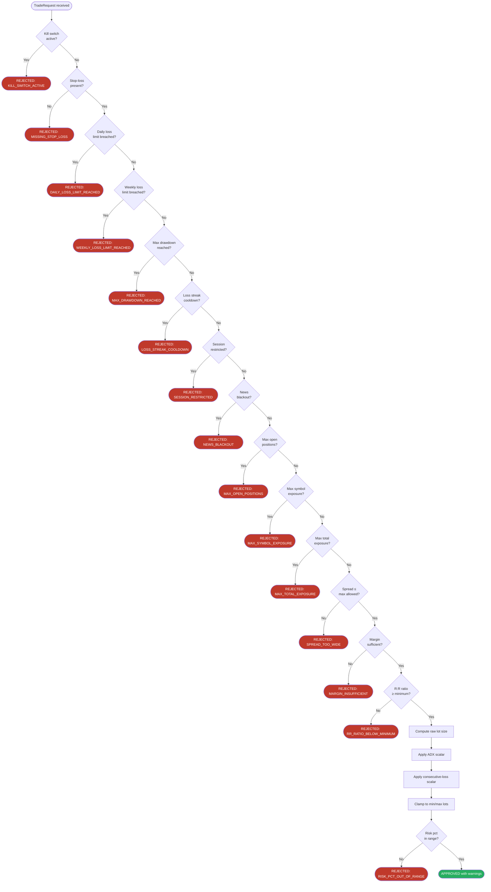

# Risk Engine Documentation

> **Module:** `risk_engine`  
> **Version:** 1.0.0  
> **Status:** Production  
> **Last Updated:** 2026-10-08

---

## Table of Contents

1. [Role and Philosophy](#1-role-and-philosophy)
2. [RiskDecision Schema](#2-riskdecision-schema)
3. [Risk Check Pipeline](#3-risk-check-pipeline)
4. [Configurable Parameters Reference](#4-configurable-parameters-reference)
5. [Risk Per Trade](#5-risk-per-trade)
6. [Position Sizing Formula](#6-position-sizing-formula)
7. [Daily Loss Limit](#7-daily-loss-limit)
8. [Weekly Loss Limit](#8-weekly-loss-limit)
9. [Maximum Drawdown Limit](#9-maximum-drawdown-limit)
10. [Maximum Simultaneous Open Positions](#10-maximum-simultaneous-open-positions)
11. [Maximum Exposure Per Symbol](#11-maximum-exposure-per-symbol)
12. [Maximum Total Exposure](#12-maximum-total-exposure)
13. [Maximum Spread Guard](#13-maximum-spread-guard)
14. [Maximum Slippage Tolerance](#14-maximum-slippage-tolerance)
15. [Minimum Risk:Reward Ratio](#15-minimum-riskreward-ratio)
16. [Stop-Loss Requirement](#16-stop-loss-requirement)
17. [Trading Session Restrictions](#17-trading-session-restrictions)
18. [News and Event Restrictions](#18-news-and-event-restrictions)
19. [Consecutive Loss Protection](#19-consecutive-loss-protection)
20. [Loss Streak Cooldown](#20-loss-streak-cooldown)
21. [Dynamic Risk Scaling by ADX](#21-dynamic-risk-scaling-by-adx)
22. [Margin Guard](#22-margin-guard)
23. [Emergency Kill Switch](#23-emergency-kill-switch)
24. [Risk Event Logging](#24-risk-event-logging)

---

## 1. Role and Philosophy

### 1.1 What the Risk Engine Is

The **Risk Engine** is a fully independent, stateless-evaluation module that sits between the AI signal generator and the broker execution layer. Every trade request — regardless of origin, confidence score, or AI model output — **must pass through the Risk Engine** before a single order is placed.

```
┌─────────────────┐     signal     ┌──────────────────┐    approved?    ┌────────────────┐
│  AI / Strategy  │ ─────────────► │   Risk Engine    │ ──────────────► │    Broker API  │
│    Module       │                │  (independent)   │                 │   (MT5 / REST) │
└─────────────────┘                └──────────────────┘                 └────────────────┘
                                          │
                                          │  rejected
                                          ▼
                                   ┌──────────────┐
                                   │  Risk Logger │
                                   └──────────────┘
```

### 1.2 Core Philosophy

| Principle | Description |
|-----------|-------------|
| **Independence** | The Risk Engine has no knowledge of, and cannot be influenced by, the AI's confidence scores or signal strength. It evaluates purely on objective risk metrics. |
| **Hard Limits** | Certain limits (e.g., daily loss limit, drawdown limit, kill switch) are **hard-coded guards** that the AI cannot bypass, override, or disable at runtime. They can only be changed via explicit configuration changes deployed by a human operator. |
| **Fail-Safe Default** | If the Risk Engine cannot evaluate a check (e.g., missing market data), it **rejects the trade** by default. Ambiguity always resolves to safety. |
| **Auditability** | Every decision — approved or rejected — is logged with a structured reason, timestamp, and full parameter snapshot. |
| **No Silent Modifications** | The Risk Engine either approves, rejects, or approves with warnings. It does **not** silently alter stop-losses, targets, or order types without explicit warning flags. |

### 1.3 Design Constraints

> [!IMPORTANT]
> The Risk Engine is designed to be **non-negotiable**. The AI strategy layer receives only a `RiskDecision` object. It may read the `recommended_size` and `warnings`, but it has **no mechanism** to force-approve a rejected decision. Any architecture change that allows the AI to bypass risk checks must go through a formal review and approval process.

- Written as a **pure Python module** with no external dependencies beyond `pydantic` and `logging`.
- All state (equity snapshots, daily P&L, loss streak counters) is loaded from a **thread-safe state store** at evaluation time.
- The Risk Engine is **re-entrant**: multiple strategies can call it concurrently; it uses immutable inputs for each evaluation.
- Unit tests must cover 100% of rejection paths.

---

## 2. RiskDecision Schema

Every call to the Risk Engine returns exactly one `RiskDecision` object. This is the canonical contract between the risk layer and the execution layer.

### 2.1 Pydantic Model

```python
from __future__ import annotations

from datetime import datetime
from enum import Enum
from typing import List, Optional

from pydantic import BaseModel, Field, validator


class RiskStatus(str, Enum):
    """Final verdict from the Risk Engine."""
    APPROVED  = "APPROVED"
    REJECTED  = "REJECTED"


class RejectionReason(str, Enum):
    """Enumerated rejection codes — always machine-readable."""
    DAILY_LOSS_LIMIT_REACHED      = "DAILY_LOSS_LIMIT_REACHED"
    WEEKLY_LOSS_LIMIT_REACHED     = "WEEKLY_LOSS_LIMIT_REACHED"
    MAX_DRAWDOWN_REACHED          = "MAX_DRAWDOWN_REACHED"
    MAX_OPEN_POSITIONS            = "MAX_OPEN_POSITIONS"
    MAX_SYMBOL_EXPOSURE           = "MAX_SYMBOL_EXPOSURE"
    MAX_TOTAL_EXPOSURE            = "MAX_TOTAL_EXPOSURE"
    SPREAD_TOO_WIDE               = "SPREAD_TOO_WIDE"
    SLIPPAGE_TOO_HIGH             = "SLIPPAGE_TOO_HIGH"
    RR_RATIO_BELOW_MINIMUM        = "RR_RATIO_BELOW_MINIMUM"
    MISSING_STOP_LOSS             = "MISSING_STOP_LOSS"
    SESSION_RESTRICTED            = "SESSION_RESTRICTED"
    NEWS_BLACKOUT                 = "NEWS_BLACKOUT"
    LOSS_STREAK_COOLDOWN          = "LOSS_STREAK_COOLDOWN"
    MARGIN_INSUFFICIENT           = "MARGIN_INSUFFICIENT"
    KILL_SWITCH_ACTIVE            = "KILL_SWITCH_ACTIVE"
    RISK_PCT_OUT_OF_RANGE         = "RISK_PCT_OUT_OF_RANGE"
    EVALUATION_ERROR              = "EVALUATION_ERROR"


class RiskWarning(str, Enum):
    """Non-blocking warnings attached to an APPROVED decision."""
    SIZE_REDUCED_LOW_ADX          = "SIZE_REDUCED_LOW_ADX"
    SIZE_REDUCED_CONSECUTIVE_LOSS = "SIZE_REDUCED_CONSECUTIVE_LOSS"
    SIZE_INCREASED_HIGH_ADX       = "SIZE_INCREASED_HIGH_ADX"
    SPREAD_ELEVATED               = "SPREAD_ELEVATED"
    NEAR_DAILY_LOSS_LIMIT         = "NEAR_DAILY_LOSS_LIMIT"
    NEAR_MAX_DRAWDOWN             = "NEAR_MAX_DRAWDOWN"
    LOW_FREE_MARGIN               = "LOW_FREE_MARGIN"


class TradeRequest(BaseModel):
    """Input submitted to the Risk Engine for evaluation."""
    symbol:          str              = Field(..., description="Trading symbol, e.g. 'XAUUSD'")
    direction:       str              = Field(..., pattern="^(BUY|SELL)$")
    entry_price:     float            = Field(..., gt=0)
    stop_loss:       Optional[float]  = Field(None, description="Must be provided; None triggers MISSING_STOP_LOSS rejection")
    take_profit:     Optional[float]  = Field(None)
    strategy_id:     str              = Field(..., description="Identifier of the originating strategy")
    requested_risk_pct: Optional[float] = Field(None, ge=0.0025, le=0.01,
                                                 description="Override risk %. Falls back to symbol default if None.")
    current_spread:  float            = Field(..., ge=0, description="Current spread in price units")
    current_adx:     Optional[float]  = Field(None, ge=0, le=100)
    timestamp:       datetime         = Field(default_factory=datetime.utcnow)

    @validator("stop_loss", always=True)
    def sl_must_be_logical(cls, sl, values):
        if sl is None:
            return sl
        entry = values.get("entry_price")
        direction = values.get("direction")
        if entry and direction:
            if direction == "BUY" and sl >= entry:
                raise ValueError("Stop-loss must be below entry for BUY orders.")
            if direction == "SELL" and sl <= entry:
                raise ValueError("Stop-loss must be above entry for SELL orders.")
        return sl


class RiskDecision(BaseModel):
    """Output of the Risk Engine — immutable after creation."""
    request:           TradeRequest
    status:            RiskStatus
    reason:            Optional[RejectionReason] = None
    reason_detail:     Optional[str]             = None
    recommended_size:  Optional[float]           = Field(None, description="Lot size in broker units, None if rejected")
    raw_size:          Optional[float]           = Field(None, description="Size before ADX/streak adjustments")
    size_scalar:       float                     = Field(1.0, description="Combined scaling factor applied to raw_size")
    warnings:          List[RiskWarning]         = Field(default_factory=list)
    evaluated_at:      datetime                  = Field(default_factory=datetime.utcnow)
    evaluation_ms:     int                       = Field(0, description="Evaluation latency in milliseconds")

    class Config:
        frozen = True   # RiskDecision is immutable once produced

    @property
    def is_approved(self) -> bool:
        return self.status == RiskStatus.APPROVED

    def summary(self) -> str:
        if self.is_approved:
            w = ", ".join(w.value for w in self.warnings) or "none"
            return (f"APPROVED | size={self.recommended_size:.4f} lots "
                    f"| scalar={self.size_scalar:.2f} | warnings=[{w}]")
        return f"REJECTED | reason={self.reason.value} | {self.reason_detail}"
```

### 2.2 Example Outputs

**Approved trade:**
```json
{
  "status": "APPROVED",
  "reason": null,
  "recommended_size": 0.08,
  "raw_size": 0.10,
  "size_scalar": 0.80,
  "warnings": ["SIZE_REDUCED_LOW_ADX", "NEAR_DAILY_LOSS_LIMIT"],
  "evaluation_ms": 3
}
```

**Rejected trade:**
```json
{
  "status": "REJECTED",
  "reason": "DAILY_LOSS_LIMIT_REACHED",
  "reason_detail": "Daily P&L -2.03% exceeds configured limit of -2.00%",
  "recommended_size": null,
  "raw_size": null,
  "size_scalar": 1.0,
  "warnings": [],
  "evaluation_ms": 1
}
```

---

## 3. Risk Check Pipeline

All checks are executed in strict priority order. The pipeline **short-circuits** on the first hard rejection — no further checks are run. Warnings accumulate across all non-blocking checks and are attached to the final `RiskDecision`.



> [!NOTE]
> The pipeline is intentionally ordered so that **catastrophic account-level checks** (kill switch, daily/weekly loss, drawdown) occur before symbol-level and order-level checks. This ensures that no computation is wasted evaluating spread or R:R when the account is already in a protected state.

---

## 4. Configurable Parameters Reference

All parameters are loaded from `config/risk_config.yaml` (or environment variable overrides prefixed with `RISK_`). Symbol-specific overrides take precedence over global defaults.

### 4.1 Global Parameters

| Parameter | Type | Default | Description |
|-----------|------|---------|-------------|
| `risk_pct_default` | float | `0.005` | Default risk per trade as fraction of equity (0.5%) |
| `risk_pct_min` | float | `0.0025` | Minimum allowed risk per trade (0.25%) |
| `risk_pct_max` | float | `0.01` | Maximum allowed risk per trade (1.0%) |
| `daily_loss_limit_pct` | float | `0.02` | Daily loss limit as fraction of start-of-day equity |
| `weekly_loss_limit_pct` | float | `0.05` | Weekly loss limit as fraction of start-of-week equity |
| `max_drawdown_pct` | float | `0.10` | Maximum peak-to-trough drawdown before halt |
| `max_open_positions` | int | `5` | Maximum number of simultaneously open positions |
| `max_total_exposure_lots` | float | `1.0` | Maximum total open lots across all symbols |
| `min_rr_ratio` | float | `1.5` | Minimum required Risk:Reward ratio |
| `max_slippage_pcts` | float | `0.0005` | Maximum tolerated slippage as fraction of entry price |
| `margin_buffer_pct` | float | `0.30` | Free margin must be ≥ 30% of required margin |
| `session_filter_enabled` | bool | `true` | Enable/disable session restriction checks |
| `news_filter_enabled` | bool | `true` | Enable/disable news blackout checks |
| `news_blackout_minutes_before` | int | `15` | Minutes before high-impact news to block trading |
| `news_blackout_minutes_after` | int | `30` | Minutes after high-impact news to block trading |
| `consecutive_loss_threshold` | int | `3` | Number of consecutive losses to trigger size reduction |
| `consecutive_loss_scalar` | float | `0.5` | Size multiplier after consecutive loss threshold |
| `loss_streak_halt_threshold` | int | `5` | Number of consecutive losses to trigger full cooldown |
| `loss_streak_cooldown_minutes` | int | `60` | Duration of cooldown after loss streak halt |
| `adx_low_threshold` | float | `20.0` | ADX below this → choppy market, reduce size |
| `adx_high_threshold` | float | `40.0` | ADX above this → strong trend, allow full/increased size |
| `adx_low_scalar` | float | `0.60` | Size multiplier when ADX < adx_low_threshold |
| `adx_high_scalar` | float | `1.20` | Size multiplier when ADX > adx_high_threshold |
| `kill_switch_active` | bool | `false` | Emergency halt flag |

### 4.2 Symbol-Specific Parameters

Defined under `symbols.<SYMBOL>` in `risk_config.yaml`:

| Parameter | Type | Default | Description |
|-----------|------|---------|-------------|
| `risk_pct` | float | *(global)* | Per-symbol risk override |
| `max_positions` | int | `3` | Maximum open positions on this symbol |
| `max_spread` | float | symbol-specific | Maximum spread in price units |
| `tick_size` | float | symbol-specific | Minimum price movement |
| `tick_value` | float | symbol-specific | Monetary value of one tick per lot |
| `lot_min` | float | `0.01` | Minimum lot size |
| `lot_max` | float | `10.0` | Maximum lot size |
| `lot_step` | float | `0.01` | Lot size increment |
| `session_blocks` | list | `[]` | UTC hour ranges to block (e.g. `[[22, 23], [0, 6]]`) |

### 4.3 Example `risk_config.yaml`

```yaml
# ── Global Risk Parameters ──────────────────────────────────────────────────
risk_pct_default: 0.005
risk_pct_min:     0.0025
risk_pct_max:     0.01

daily_loss_limit_pct:  0.02
weekly_loss_limit_pct: 0.05
max_drawdown_pct:      0.10

max_open_positions:     5
max_total_exposure_lots: 1.0
min_rr_ratio:          1.5
max_slippage_pct:      0.0005
margin_buffer_pct:     0.30

session_filter_enabled: true
news_filter_enabled:    true
news_blackout_minutes_before: 15
news_blackout_minutes_after:  30

consecutive_loss_threshold: 3
consecutive_loss_scalar:    0.50
loss_streak_halt_threshold: 5
loss_streak_cooldown_minutes: 60

adx_low_threshold:  20.0
adx_high_threshold: 40.0
adx_low_scalar:     0.60
adx_high_scalar:    1.20

kill_switch_active: false

# ── Symbol-Specific Overrides ────────────────────────────────────────────────
symbols:
  XAUUSD:
    risk_pct:       0.005
    max_positions:  3
    max_spread:     0.50       # USD per troy ounce
    tick_size:      0.01
    tick_value:     1.00       # $1 per 0.01 point per lot (standard lot = 100oz)
    lot_min:        0.01
    lot_max:        5.0
    lot_step:       0.01
    session_blocks:
      - [22, 23]               # Sunday open volatility
      - [0,  1]                # Asian session dead zone for gold
  EURUSD:
    risk_pct:       0.004
    max_positions:  2
    max_spread:     0.00020    # 2 pips
    tick_size:      0.00001
    tick_value:     1.00
    lot_min:        0.01
    lot_max:        10.0
    lot_step:       0.01
```

---

## 5. Risk Per Trade

### 5.1 Concept

The Risk Engine enforces that the **monetary loss at stop-loss** for any single trade must not exceed a configurable percentage of the **current account equity**. This is the foundational risk control — all position sizing derives from it.

| Risk Level | Percentage | Use Case |
|------------|-----------|----------|
| Conservative | 0.25% | High-uncertainty environments, news periods |
| Standard | 0.50% | Default for most strategies |
| Moderate | 0.75% | High-conviction setups, strong trends |
| Aggressive | 1.00% | Maximum allowed — requires explicit override |

> [!WARNING]
> The system **never** allows more than `risk_pct_max` (1.0%) per trade. Any `TradeRequest` specifying a `requested_risk_pct` above this cap is automatically rejected with `RISK_PCT_OUT_OF_RANGE`.

### 5.2 Per-Symbol Configuration

Different symbols can have different risk defaults. For example:

- **XAUUSD** (Gold): Default 0.5% — high volatility, wide SL needed
- **EURUSD**: Default 0.4% — tighter spreads, smaller SL typically
- **US30**: Default 0.35% — index volatility spikes

The strategy layer may **request** a specific risk percentage within bounds. The Risk Engine resolves the final percentage as:

```python
def resolve_risk_pct(request: TradeRequest, config: RiskConfig) -> float:
    symbol_cfg = config.symbols.get(request.symbol)
    if request.requested_risk_pct is not None:
        # Clamp to global min/max
        pct = max(config.risk_pct_min,
                  min(config.risk_pct_max, request.requested_risk_pct))
        return pct
    if symbol_cfg and symbol_cfg.risk_pct:
        return symbol_cfg.risk_pct
    return config.risk_pct_default
```

---

## 6. Position Sizing Formula

### 6.1 Formula

The canonical position sizing formula used by the Risk Engine:

```
lot_size = (equity × risk_pct) / (sl_distance / tick_size × tick_value)
```

Expanded:

```
monetary_risk  = equity × risk_pct
sl_in_ticks    = sl_distance / tick_size
value_per_lot  = sl_in_ticks × tick_value
lot_size       = monetary_risk / value_per_lot
```

Or equivalently:

```
lot_size = (equity × risk_pct × tick_size) / (sl_distance × tick_value)
```

### 6.2 Implementation

```python
def compute_lot_size(
    equity:       float,
    risk_pct:     float,
    entry_price:  float,
    stop_loss:    float,
    tick_size:    float,
    tick_value:   float,
    lot_min:      float,
    lot_max:      float,
    lot_step:     float,
) -> float:
    """
    Compute the raw lot size based on equity-at-risk and SL distance.

    Args:
        equity:      Current account equity in account currency.
        risk_pct:    Fraction of equity to risk (e.g. 0.005 for 0.5%).
        entry_price: Planned entry price.
        stop_loss:   Stop-loss price.
        tick_size:   Minimum price increment for the symbol.
        tick_value:  Monetary value of one tick per standard lot.
        lot_min:     Broker minimum lot size.
        lot_max:     Broker maximum lot size.
        lot_step:    Lot size granularity.

    Returns:
        Lot size rounded to lot_step, clamped to [lot_min, lot_max].

    Raises:
        ValueError: If sl_distance is zero or negative.
    """
    sl_distance = abs(entry_price - stop_loss)
    if sl_distance <= 0:
        raise ValueError(f"Invalid SL distance: {sl_distance}")

    monetary_risk  = equity * risk_pct
    sl_in_ticks    = sl_distance / tick_size
    value_per_lot  = sl_in_ticks * tick_value
    raw_lots       = monetary_risk / value_per_lot

    # Round down to nearest lot_step
    import math
    steps    = math.floor(raw_lots / lot_step)
    lot_size = steps * lot_step

    # Clamp to broker limits
    lot_size = max(lot_min, min(lot_max, lot_size))
    return round(lot_size, 2)
```

### 6.3 Worked Example — XAUUSD

**Scenario:**

| Parameter | Value |
|-----------|-------|
| Account equity | $10,000 |
| Risk per trade | 0.5% |
| Symbol | XAUUSD |
| Entry price | $2,350.00 |
| Stop-loss price | $2,338.00 |
| Tick size | $0.01 |
| Tick value | $1.00 per lot per tick |
| Lot min / max / step | 0.01 / 5.0 / 0.01 |

**Calculation:**

```
monetary_risk  = $10,000 × 0.005               = $50.00
sl_distance    = |2,350.00 − 2,338.00|         = $12.00
sl_in_ticks    = 12.00 / 0.01                  = 1,200 ticks
value_per_lot  = 1,200 × $1.00                 = $1,200 per lot
raw_lots       = $50.00 / $1,200               ≈ 0.0417 lots
rounded lots   = floor(0.0417 / 0.01) × 0.01  = 0.04 lots
```

**Result:** Order placed for **0.04 lots**. If the trade hits stop-loss, the maximum loss is exactly **$48.00** (0.04 × 1,200 ticks × $1.00 = $48), which is 0.48% of equity — safely within the 0.5% target.

> [!TIP]
> The slight under-sizing (0.04 vs 0.0417 lots) due to floor-rounding is intentional. The system always rounds **down**, never up, to ensure the monetary risk target is never exceeded even in the worst case.

### 6.4 Edge Cases

| Scenario | Handling |
|----------|----------|
| `sl_distance = 0` | Raises `ValueError`, trade rejected as `EVALUATION_ERROR` |
| Computed lots < `lot_min` | Clamped to `lot_min`; warning added if risk_pct would be breached |
| Computed lots > `lot_max` | Clamped to `lot_max`; risk_pct effectively reduced |
| Entry == stop_loss | Detected by validator; trade rejected as `MISSING_STOP_LOSS` |

---

## 7. Daily Loss Limit

### 7.1 Mechanism

The Risk Engine loads `start_of_day_equity` from the state store at each evaluation. The **daily P&L** is computed as:

```
daily_pnl_pct = (current_equity - start_of_day_equity) / start_of_day_equity
```

If `daily_pnl_pct ≤ -daily_loss_limit_pct`, the trade is rejected and **no new positions** may be opened for the remainder of the calendar day (UTC).

### 7.2 Reset Mechanics

- `start_of_day_equity` is snapshotted **at market open** (00:00 UTC) each day.
- The snapshot is taken from the **closed-trade equity** (floating P&L excluded) to prevent manipulation by holding loss-making positions overnight.
- The daily state resets automatically at the next 00:00 UTC snapshot.

### 7.3 Warning Threshold

When `daily_pnl_pct` reaches 80% of the daily limit, a `NEAR_DAILY_LOSS_LIMIT` warning is attached to approved trades. This allows operators to be alerted before the limit is hit.

```python
WARN_THRESHOLD = 0.80   # warn at 80% of daily limit

def check_daily_loss(state: RiskState, config: RiskConfig) -> CheckResult:
    pct = (state.current_equity - state.start_of_day_equity) / state.start_of_day_equity
    if pct <= -config.daily_loss_limit_pct:
        return CheckResult.reject(
            RejectionReason.DAILY_LOSS_LIMIT_REACHED,
            f"Daily P&L {pct:.2%} ≤ limit {-config.daily_loss_limit_pct:.2%}"
        )
    if pct <= -(config.daily_loss_limit_pct * WARN_THRESHOLD):
        return CheckResult.warn(RiskWarning.NEAR_DAILY_LOSS_LIMIT)
    return CheckResult.ok()
```

### 7.4 Configuration

| Parameter | Default | Description |
|-----------|---------|-------------|
| `daily_loss_limit_pct` | `0.02` | 2% of start-of-day equity |

---

## 8. Weekly Loss Limit

### 8.1 Mechanism

Mirrors the daily loss limit but operates over a rolling **Monday–Friday** trading week (UTC). `start_of_week_equity` is snapshotted at **00:00 UTC every Monday**.

```
weekly_pnl_pct = (current_equity - start_of_week_equity) / start_of_week_equity
```

If `weekly_pnl_pct ≤ -weekly_loss_limit_pct`, all new positions are blocked for the remainder of the week.

### 8.2 Reset Mechanics

| Event | Action |
|-------|--------|
| Monday 00:00 UTC | `start_of_week_equity` updated to current closed equity |
| Daily limit reset | Only resets `start_of_day_equity`; weekly accumulator is preserved |
| Manual override | Admin can reset weekly state via CLI: `risk-cli reset-weekly --confirm` |

> [!CAUTION]
> Manual weekly resets must be logged with an operator ID and reason. Unauthorized resets bypass a protective mechanism and expose the account to compounding weekly losses.

### 8.3 Interaction with Daily Limit

The daily limit and weekly limit are **independent checks** — both must pass. It is possible to:

- Have a good Monday and a bad Tuesday that doesn't breach the daily limit individually, but their cumulative effect breaches the weekly limit.
- Have a single catastrophic day that breaches both simultaneously.

The weekly check occurs **after** the daily check in the pipeline (see [Section 3](#3-risk-check-pipeline)).

### 8.4 Configuration

| Parameter | Default | Description |
|-----------|---------|-------------|
| `weekly_loss_limit_pct` | `0.05` | 5% of start-of-week equity |

---

## 9. Maximum Drawdown Limit

### 9.1 Concept

Maximum drawdown (MDD) measures the peak-to-trough decline from the **all-time equity high** recorded by the system. Unlike daily/weekly limits which reset, the drawdown limit is a **cumulative, non-resetting guard**.

```
drawdown_pct = (peak_equity - current_equity) / peak_equity
```

If `drawdown_pct ≥ max_drawdown_pct`, trading is halted until an operator explicitly resets the drawdown watermark.

### 9.2 Peak Equity Tracking

- `peak_equity` is updated **only upward**: whenever `current_equity > peak_equity`, the new peak is stored.
- Drawdown tracking uses **closed-trade equity** only. Open floating losses do not reset the peak.
- The initial `peak_equity` is set at system initialization from the broker's reported equity.

### 9.3 Implementation

```python
def check_max_drawdown(state: RiskState, config: RiskConfig) -> CheckResult:
    if state.peak_equity <= 0:
        return CheckResult.ok()   # No history yet
    drawdown = (state.peak_equity - state.current_equity) / state.peak_equity
    if drawdown >= config.max_drawdown_pct:
        return CheckResult.reject(
            RejectionReason.MAX_DRAWDOWN_REACHED,
            f"Drawdown {drawdown:.2%} ≥ limit {config.max_drawdown_pct:.2%}. "
            f"Peak equity: {state.peak_equity:.2f}, Current: {state.current_equity:.2f}. "
            "Manual operator reset required."
        )
    if drawdown >= config.max_drawdown_pct * 0.80:
        return CheckResult.warn(RiskWarning.NEAR_MAX_DRAWDOWN)
    return CheckResult.ok()
```

### 9.4 Recovery Protocol

When the drawdown limit is breached:

1. All **new orders** are blocked immediately.
2. **Existing positions** are NOT automatically closed (use the [Kill Switch](#23-emergency-kill-switch) for that).
3. An alert is sent via the notification system (Telegram / email).
4. An operator must review the situation and either:
   - Fix the underlying issue and run `risk-cli reset-drawdown --confirm --operator-id=<id>`
   - Reduce position sizes and restart with a reduced `max_drawdown_pct`

### 9.5 Configuration

| Parameter | Default | Description |
|-----------|---------|-------------|
| `max_drawdown_pct` | `0.10` | 10% peak-to-trough drawdown |

---

## 10. Maximum Simultaneous Open Positions

### 10.1 Rule

The Risk Engine queries the current open position count from the state store before approving any new trade. If `open_positions_count >= max_open_positions`, the trade is rejected.

```python
def check_max_open_positions(state: RiskState, config: RiskConfig) -> CheckResult:
    if state.open_positions_count >= config.max_open_positions:
        return CheckResult.reject(
            RejectionReason.MAX_OPEN_POSITIONS,
            f"Open positions ({state.open_positions_count}) >= limit ({config.max_open_positions})"
        )
    return CheckResult.ok()
```

### 10.2 Rationale

Limiting simultaneous positions:
- Reduces **correlation risk** — multiple positions in the same market direction amplify losses.
- Prevents **margin exhaustion** from rapid position accumulation.
- Keeps the system **manageable** — the AI cannot open 50 positions in a flash crash.

### 10.3 Configuration

| Parameter | Default | Range |
|-----------|---------|-------|
| `max_open_positions` | `5` | 1–50 |

---

## 11. Maximum Exposure Per Symbol

### 11.1 Rule

For any single symbol, the number of open positions is capped at `symbols.<SYMBOL>.max_positions`. This prevents the AI from stacking correlated bets on the same instrument.

**Example:** With `XAUUSD.max_positions = 3`, the system can hold at most 3 simultaneous XAUUSD positions (regardless of direction mix). A 4th XAUUSD signal is rejected with `MAX_SYMBOL_EXPOSURE`.

### 11.2 Directionality

The limit applies **regardless of direction**. A BUY and a SELL on the same symbol both count toward the symbol's exposure limit. This is intentional — even hedged positions consume margin and carry overnight risk.

### 11.3 Implementation

```python
def check_symbol_exposure(
    request: TradeRequest,
    state:   RiskState,
    config:  RiskConfig,
) -> CheckResult:
    symbol_cfg  = config.symbols.get(request.symbol)
    max_sym_pos = symbol_cfg.max_positions if symbol_cfg else 3  # global default
    current     = state.open_positions_by_symbol.get(request.symbol, 0)
    if current >= max_sym_pos:
        return CheckResult.reject(
            RejectionReason.MAX_SYMBOL_EXPOSURE,
            f"{request.symbol}: {current} open positions >= limit {max_sym_pos}"
        )
    return CheckResult.ok()
```

---

## 12. Maximum Total Exposure

### 12.1 Rule

Beyond per-symbol caps, the Risk Engine enforces a **total lot exposure** ceiling across all open positions combined. This protects against the scenario where many small positions on different symbols collectively create a dangerously large total position.

```
total_open_lots = sum(position.lots for position in state.open_positions)

if total_open_lots + requested_lots > max_total_exposure_lots → REJECT
```

### 12.2 Lot Normalization

Different symbols have different lot values. For exposure calculation, lots are compared in **raw broker lot units** (not monetary value). A future enhancement may normalize to USD notional value.

### 12.3 Configuration

| Parameter | Default | Description |
|-----------|---------|-------------|
| `max_total_exposure_lots` | `1.0` | Total lots across all open positions |

---

## 13. Maximum Spread Guard

### 13.1 Purpose

Wide spreads increase the **effective cost** of every trade. During news events, market opens, or low-liquidity periods, spreads can widen dramatically. The spread guard blocks order placement when the spread exceeds a symbol-specific threshold.

### 13.2 Mechanism

The `TradeRequest` must include the `current_spread` at the moment of signal generation. The Risk Engine compares it against the configured maximum:

```python
def check_spread(
    request:    TradeRequest,
    config:     RiskConfig,
) -> CheckResult:
    symbol_cfg = config.symbols.get(request.symbol)
    if symbol_cfg is None:
        return CheckResult.ok()   # No config, skip check
    max_spread = symbol_cfg.max_spread
    if request.current_spread > max_spread:
        return CheckResult.reject(
            RejectionReason.SPREAD_TOO_WIDE,
            f"Current spread {request.current_spread} > max {max_spread} for {request.symbol}"
        )
    # Warn if spread is elevated (>70% of max)
    if request.current_spread > max_spread * 0.70:
        return CheckResult.warn(RiskWarning.SPREAD_ELEVATED)
    return CheckResult.ok()
```

### 13.3 Typical Spread Limits by Symbol

| Symbol | Normal Spread | Max Allowed | Notes |
|--------|--------------|-------------|-------|
| XAUUSD | 0.20–0.35 | 0.50 | Widens significantly on FOMC |
| EURUSD | 0.00010 | 0.00020 | Very tight in London session |
| GBPUSD | 0.00015 | 0.00040 | Widens on BOE events |
| US30 | 1.0–2.0 pts | 5.0 pts | Index gap risk on open |

---

## 14. Maximum Slippage Tolerance

### 14.1 Concept

Slippage occurs when the **actual fill price** differs from the requested entry price. The Risk Engine defines a maximum tolerated slippage as a fraction of the entry price. If the executed fill would result in slippage beyond this threshold, the position should be closed immediately (post-fill enforcement).

> [!NOTE]
> The pre-trade check validates that **expected** slippage (based on current market conditions, e.g., order book depth if available) does not exceed the limit. Post-fill enforcement is handled by the execution monitor, not the Risk Engine itself.

### 14.2 Configuration

| Parameter | Default | Description |
|-----------|---------|-------------|
| `max_slippage_pct` | `0.0005` | 0.05% of entry price |

**Example:** Entry price $2,350 → maximum tolerated slippage = $2,350 × 0.0005 = **$1.175**. A fill worse than $2,351.175 (for BUY) triggers a post-fill exit.

---

## 15. Minimum Risk:Reward Ratio

### 15.1 Rule

Every trade must offer a minimum expected reward relative to its risk. The R:R ratio is calculated from entry, stop-loss, and take-profit prices:

```
rr_ratio = |entry - take_profit| / |entry - stop_loss|
```

If `rr_ratio < min_rr_ratio`, the trade is rejected.

### 15.2 Implementation

```python
def check_rr_ratio(request: TradeRequest, config: RiskConfig) -> CheckResult:
    if request.take_profit is None:
        # No TP defined — RR check skipped (system allows open-ended trades
        # only if explicitly configured; default is to require TP)
        if config.require_take_profit:
            return CheckResult.reject(
                RejectionReason.RR_RATIO_BELOW_MINIMUM,
                "No take-profit provided and require_take_profit=true"
            )
        return CheckResult.ok()

    sl_distance = abs(request.entry_price - request.stop_loss)
    tp_distance = abs(request.entry_price - request.take_profit)

    if sl_distance == 0:
        return CheckResult.reject(
            RejectionReason.MISSING_STOP_LOSS,
            "SL distance is zero — cannot compute R:R ratio"
        )

    rr = tp_distance / sl_distance
    if rr < config.min_rr_ratio:
        return CheckResult.reject(
            RejectionReason.RR_RATIO_BELOW_MINIMUM,
            f"R:R ratio {rr:.2f} < minimum {config.min_rr_ratio:.2f}. "
            f"SL: {sl_distance:.5f}, TP: {tp_distance:.5f}"
        )
    return CheckResult.ok()
```

### 15.3 Configuration

| Parameter | Default | Notes |
|-----------|---------|-------|
| `min_rr_ratio` | `1.5` | 1.5:1 minimum (risk $1 to make $1.50) |
| `require_take_profit` | `true` | Reject trades with no TP defined |

---

## 16. Stop-Loss Requirement

### 16.1 Absolute Rule

> [!IMPORTANT]
> **Every trade must have a stop-loss. No exceptions. This is a non-negotiable hard rule.**

A `TradeRequest` with `stop_loss = None` is **immediately rejected** at the first check in the pipeline, before any other evaluation occurs. The AI strategy layer must always provide a stop-loss before submitting to the Risk Engine.

### 16.2 Rationale

- Without a stop-loss, a single losing position can theoretically consume the entire account.
- Automated systems cannot rely on manual monitoring to exit bad trades.
- Stop-loss ensures the position sizing formula has a meaningful SL distance to compute from.

### 16.3 Validity Checks

Beyond presence, the stop-loss is validated for logical correctness:

| Check | BUY | SELL |
|-------|-----|------|
| SL below entry | ✅ Required | ❌ Invalid |
| SL above entry | ❌ Invalid | ✅ Required |
| SL equals entry | ❌ Invalid | ❌ Invalid |
| SL beyond TP | ❌ Invalid | ❌ Invalid |

---

## 17. Trading Session Restrictions

### 17.1 Purpose

Different symbols exhibit dramatically different behavior across trading sessions. Trading during low-liquidity periods (e.g., late Sunday open, Asian session for gold) increases spread costs and slippage risk. The session filter optionally blocks trading during defined UTC hour ranges.

### 17.2 Configuration

Session blocks are defined per symbol as UTC hour ranges `[start_hour, end_hour)`:

```yaml
symbols:
  XAUUSD:
    session_blocks:
      - [22, 23]    # Sunday market open — thin liquidity
      - [0, 2]      # Late Asian — low gold volume
```

### 17.3 Implementation

```python
from datetime import datetime, timezone

def check_session(
    request:  TradeRequest,
    config:   RiskConfig,
) -> CheckResult:
    if not config.session_filter_enabled:
        return CheckResult.ok()

    symbol_cfg = config.symbols.get(request.symbol)
    if symbol_cfg is None or not symbol_cfg.session_blocks:
        return CheckResult.ok()

    utc_hour = request.timestamp.astimezone(timezone.utc).hour
    for (start, end) in symbol_cfg.session_blocks:
        if start <= utc_hour < end:
            return CheckResult.reject(
                RejectionReason.SESSION_RESTRICTED,
                f"Trading blocked during UTC hours {start}–{end} for {request.symbol}. "
                f"Current UTC hour: {utc_hour}"
            )
    return CheckResult.ok()
```

### 17.4 Global Session Switch

The `session_filter_enabled` global flag allows operators to **disable all session filtering** with a single configuration change — useful during testing or when strategies are intentionally designed for off-hours trading.

---

## 18. News and Event Restrictions

### 18.1 Purpose

High-impact economic events (FOMC, NFP, CPI, central bank decisions) cause sudden, violent price moves with extreme spreads and slippage. The news filter blocks new position entries during a configurable window around these events.

### 18.2 News Calendar Integration

The Risk Engine consumes a **news event feed** (e.g., from ForexFactory API or an internal calendar service) loaded at startup and refreshed every 30 minutes. Events are filtered to `HIGH` impact level only.

```python
from dataclasses import dataclass
from datetime import datetime

@dataclass(frozen=True)
class NewsEvent:
    event_id:   str
    title:      str
    currency:   str        # e.g., "USD", "EUR"
    impact:     str        # "HIGH", "MEDIUM", "LOW"
    scheduled:  datetime   # UTC
```

### 18.3 Blackout Window

For each high-impact event affecting a symbol's currency:

```
blackout_start = event.scheduled - timedelta(minutes=news_blackout_minutes_before)
blackout_end   = event.scheduled + timedelta(minutes=news_blackout_minutes_after)

if blackout_start <= now <= blackout_end → REJECT (NEWS_BLACKOUT)
```

### 18.4 Symbol-Currency Mapping

| Symbol | Affected Currencies |
|--------|-------------------|
| XAUUSD | USD (primary), global risk events |
| EURUSD | EUR, USD |
| GBPUSD | GBP, USD |
| USDJPY | USD, JPY |

### 18.5 Configuration

| Parameter | Default | Description |
|-----------|---------|-------------|
| `news_filter_enabled` | `true` | Enable/disable news blackout |
| `news_blackout_minutes_before` | `15` | Minutes before event to block |
| `news_blackout_minutes_after` | `30` | Minutes after event to block |

---

## 19. Consecutive Loss Protection

### 19.1 Mechanism

After a configurable number of consecutive losing trades, the Risk Engine automatically **reduces position size** by applying a scalar. This prevents the system from continuing to trade at full size during a losing streak, which could rapidly compound drawdown.

### 19.2 State Tracking

The state store tracks `consecutive_losses: int` — incremented on each losing trade close, reset to 0 on any winning trade.

```python
def compute_consecutive_loss_scalar(
    consecutive_losses: int,
    config:             RiskConfig,
) -> tuple[float, list[RiskWarning]]:
    """
    Returns (scalar, warnings).
    """
    if consecutive_losses >= config.consecutive_loss_threshold:
        return (config.consecutive_loss_scalar, [RiskWarning.SIZE_REDUCED_CONSECUTIVE_LOSS])
    return (1.0, [])
```

### 19.3 Scaling Behavior

| Consecutive Losses | Scalar | Effect on Lot Size |
|-------------------|--------|-------------------|
| 0–2 | 1.00 | Full size (default threshold = 3) |
| ≥ 3 | 0.50 | Half size |
| ≥ 5 | Full cooldown | See [Section 20](#20-loss-streak-cooldown) |

### 19.4 Configuration

| Parameter | Default | Description |
|-----------|---------|-------------|
| `consecutive_loss_threshold` | `3` | Losses before size reduction |
| `consecutive_loss_scalar` | `0.50` | Multiplier applied to lot size |

---

## 20. Loss Streak Cooldown

### 20.1 Mechanism

If `consecutive_losses >= loss_streak_halt_threshold`, the Risk Engine enters a **full trading halt** (cooldown mode). No new positions are opened until the cooldown period expires.

This is a harder response than the size reduction in [Section 19](#19-consecutive-loss-protection) — it is a **complete pause** to allow the system (and operator) to review what is happening.

### 20.2 Cooldown State

```python
@dataclass
class CooldownState:
    active:          bool
    halt_triggered:  Optional[datetime]   # When the cooldown started
    expires_at:      Optional[datetime]   # When trading can resume

def check_loss_streak_cooldown(state: RiskState, config: RiskConfig) -> CheckResult:
    cd = state.cooldown
    if not cd.active:
        return CheckResult.ok()
    now = datetime.utcnow().replace(tzinfo=timezone.utc)
    if now < cd.expires_at:
        remaining = int((cd.expires_at - now).total_seconds() / 60)
        return CheckResult.reject(
            RejectionReason.LOSS_STREAK_COOLDOWN,
            f"Loss streak cooldown active. Resumes in {remaining} minutes "
            f"(at {cd.expires_at.isoformat()} UTC). "
            f"Triggered after {config.loss_streak_halt_threshold} consecutive losses."
        )
    # Cooldown expired — auto-resume with reduced size
    state.cooldown = CooldownState(active=False, halt_triggered=None, expires_at=None)
    state.consecutive_losses = 0  # Reset streak after cooldown
    return CheckResult.ok()
```

### 20.3 Notification

On cooldown activation:
- ⚠️ Telegram alert sent to configured operator channels.
- Log entry written with full trade history leading to the halt.
- `cooldown_active` flag set in shared state — all strategy threads observe it immediately.

### 20.4 Configuration

| Parameter | Default | Description |
|-----------|---------|-------------|
| `loss_streak_halt_threshold` | `5` | Consecutive losses to trigger halt |
| `loss_streak_cooldown_minutes` | `60` | Minutes trading is paused |

---

## 21. Dynamic Risk Scaling by ADX

### 21.1 Concept

The Average Directional Index (ADX) measures **trend strength**, not direction. Low ADX indicates a choppy, sideways market where trend-following strategies are less effective and losses are more likely. High ADX indicates a strong trend where momentum strategies perform better.

The Risk Engine uses ADX to **dynamically scale position size** without changing the risk percentage — effectively trading smaller in uncertain conditions and allowing slightly larger trades in confirmed trends.

### 21.2 Scaling Logic

```python
def compute_adx_scalar(
    adx:    Optional[float],
    config: RiskConfig,
) -> tuple[float, list[RiskWarning]]:
    """
    Returns (scalar, warnings) based on current ADX value.
    """
    if adx is None:
        return (1.0, [])   # No ADX data — no scaling applied

    if adx < config.adx_low_threshold:
        return (config.adx_low_scalar, [RiskWarning.SIZE_REDUCED_LOW_ADX])

    if adx > config.adx_high_threshold:
        return (config.adx_high_scalar, [RiskWarning.SIZE_INCREASED_HIGH_ADX])

    # Linear interpolation in the neutral zone [adx_low, adx_high]
    neutral_range = config.adx_high_threshold - config.adx_low_threshold
    position_in_range = (adx - config.adx_low_threshold) / neutral_range
    scalar_range  = config.adx_high_scalar - config.adx_low_scalar
    scalar = config.adx_low_scalar + position_in_range * scalar_range
    return (round(scalar, 3), [])
```

### 21.3 ADX Scaling Table

| ADX Value | Market Condition | Scalar | Effect on 0.04 lot trade |
|-----------|-----------------|--------|--------------------------|
| < 20 | Choppy / Sideways | 0.60 | → 0.02 lots |
| 20–25 | Weak trend | 0.60–0.75 | → 0.02–0.03 lots |
| 25–30 | Developing trend | 0.75–0.90 | → 0.03 lots |
| 30–40 | Moderate trend | 0.90–1.20 | → 0.04 lots |
| > 40 | Strong trend | 1.20 | → 0.05 lots (capped at lot_max) |

### 21.4 Combined Scaling

When both ADX scaling and consecutive-loss scaling apply, they are **multiplied**:

```python
final_scalar = adx_scalar * consecutive_loss_scalar
final_lots   = raw_lots * final_scalar

# Example: ADX=15 (scalar=0.60) + 3 consecutive losses (scalar=0.50)
# final_scalar = 0.60 × 0.50 = 0.30
# 0.04 lots × 0.30 = 0.012 → rounds down to 0.01 lots (minimum)
```

### 21.5 Configuration

| Parameter | Default | Description |
|-----------|---------|-------------|
| `adx_low_threshold` | `20.0` | ADX below this → choppy |
| `adx_high_threshold` | `40.0` | ADX above this → strong trend |
| `adx_low_scalar` | `0.60` | Size multiplier for choppy market |
| `adx_high_scalar` | `1.20` | Size multiplier for trending market |

> [!TIP]
> ADX scaling can be disabled by setting `adx_low_scalar = adx_high_scalar = 1.0`. This makes the system trade constant size regardless of trend strength, which is appropriate for mean-reversion strategies that *prefer* choppy conditions.

---

## 22. Margin Guard

### 22.1 Purpose

Even if the lot size is within all other limits, the margin guard ensures that the account has **sufficient free margin** before placing the order. This prevents margin calls caused by a rapid sequence of positions consuming available margin.

### 22.2 Free Margin Check

```python
def check_margin(
    state:         RiskState,
    config:        RiskConfig,
    required_margin: float,  # Margin required by broker for this specific trade
) -> CheckResult:
    """
    Requires: free_margin >= required_margin * (1 + margin_buffer_pct)
    The buffer_pct ensures a safety cushion beyond the bare minimum.
    """
    threshold = required_margin * (1.0 + config.margin_buffer_pct)
    if state.free_margin < threshold:
        return CheckResult.reject(
            RejectionReason.MARGIN_INSUFFICIENT,
            f"Free margin {state.free_margin:.2f} < required {threshold:.2f} "
            f"(trade needs {required_margin:.2f} + {config.margin_buffer_pct:.0%} buffer)"
        )
    if state.free_margin < threshold * 1.5:
        return CheckResult.warn(RiskWarning.LOW_FREE_MARGIN)
    return CheckResult.ok()
```

### 22.3 Margin Calculation

The required margin is typically supplied by the broker API (`mt5.order_calc_margin()`). If unavailable, it can be approximated:

```python
def estimate_required_margin(
    lots:       float,
    price:      float,
    leverage:   int,
    contract_size: float = 100.0,   # Standard lot = 100 oz for gold
) -> float:
    """Approximate margin requirement in account currency."""
    notional = lots * contract_size * price
    return notional / leverage
```

### 22.4 Configuration

| Parameter | Default | Description |
|-----------|---------|-------------|
| `margin_buffer_pct` | `0.30` | Free margin must exceed required margin by this additional 30% |

---

## 23. Emergency Kill Switch

### 23.1 Overview

The kill switch is the **last-resort emergency stop**. When activated, it:

1. Immediately **blocks all new orders** (Risk Engine rejects every `TradeRequest` with `KILL_SWITCH_ACTIVE`).
2. Optionally (configurable) **closes all open positions** at market price.
3. Sends an **emergency alert** to all configured notification channels.
4. Writes a kill switch event to the audit log with timestamp and activating identity.

### 23.2 Activation Methods

| Method | Description |
|--------|-------------|
| **CLI** | `risk-cli kill-switch --enable --reason="FOMC panic" --operator-id=<id>` |
| **API** | `POST /risk/kill-switch {"enable": true, "reason": "...", "operator_id": "..."}` |
| **Config file** | Set `kill_switch_active: true` in `risk_config.yaml` and hot-reload |
| **Auto-trigger** | Configured to fire automatically at `max_drawdown_pct` if `auto_kill_on_drawdown: true` |

### 23.3 Deactivation

The kill switch **cannot be deactivated by the AI**. It can only be disabled by a human operator:

```bash
# Deactivate kill switch
risk-cli kill-switch --disable --reason="Market stabilized" --operator-id=op_001
```

On deactivation:
- Kill switch flag cleared in state store.
- `start_of_day_equity` refreshed to current equity (to avoid immediate daily limit trigger).
- Audit log entry created.

### 23.4 Kill Switch State

```python
@dataclass(frozen=True)
class KillSwitchState:
    active:         bool
    reason:         Optional[str]
    activated_at:   Optional[datetime]
    activated_by:   Optional[str]
    auto_triggered: bool = False
```

### 23.5 Automatic Trigger

If `auto_kill_on_drawdown: true` is set, the Risk Engine will activate the kill switch **and** schedule closure of all open positions when `max_drawdown_pct` is breached:

```python
if auto_kill and drawdown >= config.max_drawdown_pct:
    state.kill_switch = KillSwitchState(
        active=True,
        reason=f"Auto-triggered: drawdown {drawdown:.2%} >= {config.max_drawdown_pct:.2%}",
        activated_at=datetime.utcnow(),
        activated_by="SYSTEM",
        auto_triggered=True,
    )
    schedule_close_all_positions(reason="KILL_SWITCH_AUTO_DRAWDOWN")
```

---

## 24. Risk Event Logging

### 24.1 Philosophy

Every decision made by the Risk Engine — approved or rejected — is logged to a **structured, append-only audit log**. This log is the primary source of truth for:

- Post-hoc analysis of why trades were or were not taken.
- Regulatory compliance documentation.
- Strategy performance attribution.
- Risk parameter calibration.

### 24.2 Log Schema

```python
from dataclasses import dataclass, field
from datetime import datetime
from typing import Any, Dict, List, Optional


@dataclass
class RiskEventLog:
    """Structured audit record for every Risk Engine evaluation."""

    # Identification
    event_id:       str       # UUID4
    timestamp:      datetime  # UTC
    strategy_id:    str
    symbol:         str

    # Decision
    status:         str       # "APPROVED" | "REJECTED"
    reason:         Optional[str]         = None
    reason_detail:  Optional[str]         = None
    warnings:       List[str]             = field(default_factory=list)

    # Trade Parameters
    direction:      Optional[str]         = None
    entry_price:    Optional[float]       = None
    stop_loss:      Optional[float]       = None
    take_profit:    Optional[float]       = None
    spread:         Optional[float]       = None
    adx:            Optional[float]       = None

    # Sizing
    raw_size:       Optional[float]       = None
    recommended_size: Optional[float]     = None
    size_scalar:    float                 = 1.0

    # Account State at Evaluation
    equity:         Optional[float]       = None
    peak_equity:    Optional[float]       = None
    free_margin:    Optional[float]       = None
    daily_pnl_pct:  Optional[float]       = None
    weekly_pnl_pct: Optional[float]       = None
    drawdown_pct:   Optional[float]       = None
    open_positions: Optional[int]         = None
    consecutive_losses: Optional[int]     = None

    # Performance
    evaluation_ms:  int                   = 0

    # Full parameter snapshot (for reproducibility)
    config_snapshot: Dict[str, Any]       = field(default_factory=dict)
```

### 24.3 Log Destinations

| Destination | Format | Use Case |
|-------------|--------|----------|
| Local file (`risk_events.jsonl`) | JSONL | Fast append, local debugging |
| Database (`risk_events` table) | SQL rows | Querying, reporting |
| Monitoring system (Prometheus) | Metrics | Real-time dashboards |
| Notification channel (Telegram) | Text summary | Operator alerts on rejections |

### 24.4 Example Log Entry (JSONL)

```json
{
  "event_id": "a3f2c1d0-4b5e-4f89-91cc-123456789abc",
  "timestamp": "2026-10-08T09:35:12.441Z",
  "strategy_id": "gold_trend_v3",
  "symbol": "XAUUSD",
  "status": "APPROVED",
  "reason": null,
  "reason_detail": null,
  "warnings": ["SIZE_REDUCED_LOW_ADX"],
  "direction": "BUY",
  "entry_price": 2350.00,
  "stop_loss": 2338.00,
  "take_profit": 2380.00,
  "spread": 0.28,
  "adx": 17.4,
  "raw_size": 0.04,
  "recommended_size": 0.02,
  "size_scalar": 0.60,
  "equity": 10000.00,
  "peak_equity": 10250.00,
  "free_margin": 8800.00,
  "daily_pnl_pct": -0.0081,
  "weekly_pnl_pct": -0.0123,
  "drawdown_pct": 0.0244,
  "open_positions": 1,
  "consecutive_losses": 1,
  "evaluation_ms": 4,
  "config_snapshot": {
    "risk_pct": 0.005,
    "daily_loss_limit_pct": 0.02,
    "max_drawdown_pct": 0.10,
    "min_rr_ratio": 1.5,
    "adx_low_threshold": 20.0,
    "adx_low_scalar": 0.60
  }
}
```

### 24.5 Alerting on Rejections

All `REJECTED` decisions trigger an immediate alert to configured Telegram channels. The alert includes:

- Symbol, direction, strategy ID
- Rejection reason and detail
- Current account state (equity, drawdown, daily P&L)
- Timestamp

```
🚫 RISK REJECTION [2026-10-08 09:35:12 UTC]
Symbol:    XAUUSD | Direction: BUY | Strategy: gold_trend_v3
Reason:    DAILY_LOSS_LIMIT_REACHED
Detail:    Daily P&L -2.03% ≤ limit -2.00%
Equity:    $9,797 | Drawdown: 4.4% | Open: 0 positions
```

---

## Appendix A: CheckResult Helper

```python
from dataclasses import dataclass, field
from typing import List, Optional


@dataclass
class CheckResult:
    """Internal result type returned by each individual risk check."""
    passed:   bool
    rejection: Optional[RejectionReason] = None
    detail:   Optional[str]             = None
    warnings: List[RiskWarning]         = field(default_factory=list)

    @classmethod
    def ok(cls) -> "CheckResult":
        return cls(passed=True)

    @classmethod
    def warn(cls, *warnings: RiskWarning) -> "CheckResult":
        return cls(passed=True, warnings=list(warnings))

    @classmethod
    def reject(cls, reason: RejectionReason, detail: str = "") -> "CheckResult":
        return cls(passed=False, rejection=reason, detail=detail)
```

---

## Appendix B: Full Pipeline Pseudocode

```python
import time
import uuid
from datetime import datetime, timezone

def evaluate(request: TradeRequest, state: RiskState, config: RiskConfig) -> RiskDecision:
    t0       = time.monotonic()
    warnings = []

    # ── Hard Rejections (Priority Order) ───────────────────────────────────
    checks = [
        lambda: check_kill_switch(state, config),
        lambda: check_stop_loss_present(request),
        lambda: check_daily_loss(state, config),
        lambda: check_weekly_loss(state, config),
        lambda: check_max_drawdown(state, config),
        lambda: check_loss_streak_cooldown(state, config),
        lambda: check_session(request, config),
        lambda: check_news_blackout(request, state, config),
        lambda: check_max_open_positions(state, config),
        lambda: check_symbol_exposure(request, state, config),
        lambda: check_total_exposure(state, config),
        lambda: check_spread(request, config),
    ]

    for check_fn in checks:
        result = check_fn()
        if not result.passed:
            return _build_rejection(request, result, t0)
        warnings.extend(result.warnings)

    # ── Margin Check (needs lot estimate first) ─────────────────────────────
    risk_pct    = resolve_risk_pct(request, config)
    symbol_cfg  = config.symbols[request.symbol]
    raw_lots    = compute_lot_size(
        equity      = state.current_equity,
        risk_pct    = risk_pct,
        entry_price = request.entry_price,
        stop_loss   = request.stop_loss,
        tick_size   = symbol_cfg.tick_size,
        tick_value  = symbol_cfg.tick_value,
        lot_min     = symbol_cfg.lot_min,
        lot_max     = symbol_cfg.lot_max,
        lot_step    = symbol_cfg.lot_step,
    )
    est_margin  = estimate_required_margin(raw_lots, request.entry_price, state.leverage)
    margin_res  = check_margin(state, config, est_margin)
    if not margin_res.passed:
        return _build_rejection(request, margin_res, t0)
    warnings.extend(margin_res.warnings)

    # ── R:R Ratio ───────────────────────────────────────────────────────────
    rr_res = check_rr_ratio(request, config)
    if not rr_res.passed:
        return _build_rejection(request, rr_res, t0)

    # ── Dynamic Scaling ─────────────────────────────────────────────────────
    adx_scalar, adx_warns   = compute_adx_scalar(request.current_adx, config)
    cl_scalar,  cl_warns    = compute_consecutive_loss_scalar(state.consecutive_losses, config)
    final_scalar = adx_scalar * cl_scalar
    warnings.extend(adx_warns + cl_warns)

    final_lots = clamp_lots(raw_lots * final_scalar, symbol_cfg)

    elapsed_ms = int((time.monotonic() - t0) * 1000)
    log_risk_event(request, state, config, "APPROVED", raw_lots, final_lots, final_scalar, warnings, elapsed_ms)

    return RiskDecision(
        request          = request,
        status           = RiskStatus.APPROVED,
        recommended_size = final_lots,
        raw_size         = raw_lots,
        size_scalar      = final_scalar,
        warnings         = warnings,
        evaluated_at     = datetime.now(timezone.utc),
        evaluation_ms    = elapsed_ms,
    )
```

---

## Appendix C: Glossary

| Term | Definition |
|------|-----------|
| **Equity** | Account balance including floating P&L of open positions |
| **Balance** | Account balance from closed trades only (no floating P&L) |
| **Drawdown** | Peak-to-trough decline in equity from the historical high |
| **ADX** | Average Directional Index — measures trend strength (0–100) |
| **Lot** | Standard unit of position size; 1 standard lot XAUUSD = 100 troy ounces |
| **Tick size** | Minimum price movement for a symbol |
| **Tick value** | Monetary value of one tick movement per one standard lot |
| **Free margin** | Margin available to open new positions = Equity − Used Margin |
| **Spread** | Difference between Ask and Bid prices |
| **Slippage** | Difference between requested fill price and actual fill price |
| **R:R Ratio** | Risk-to-Reward ratio = TP distance / SL distance |
| **Kill switch** | Emergency halt that blocks all new orders |
| **Cooldown** | Temporary trading pause after a loss streak |
| **Scalar** | Multiplier applied to raw lot size (0.0–2.0 range) |

---

*Documentation maintained by the Trading-gold project team. For questions or corrections, open an issue in the project repository.*
