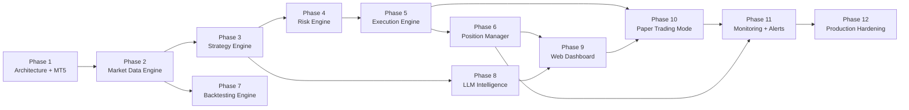
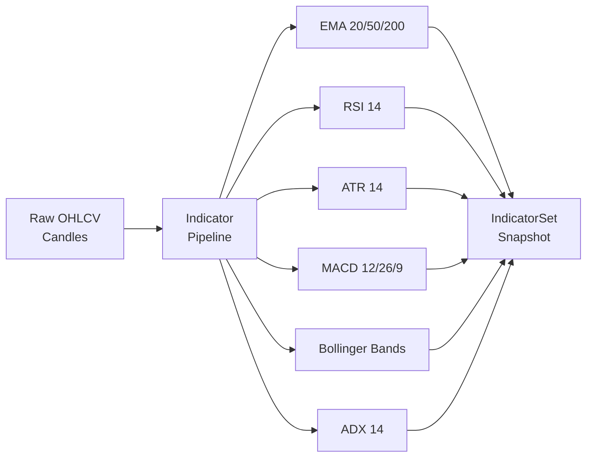
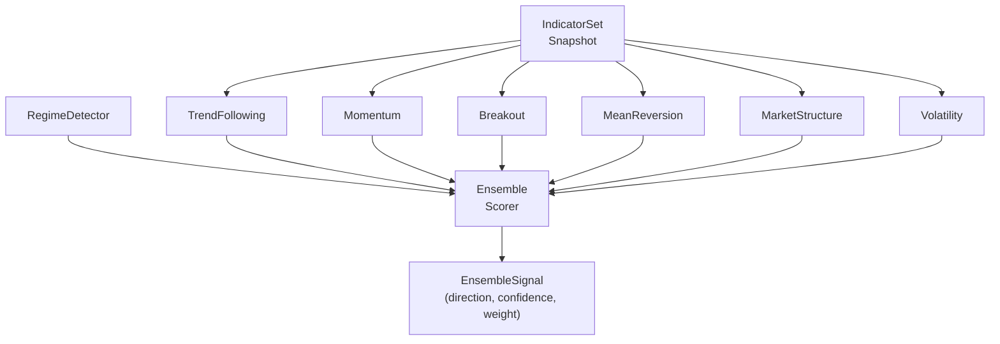
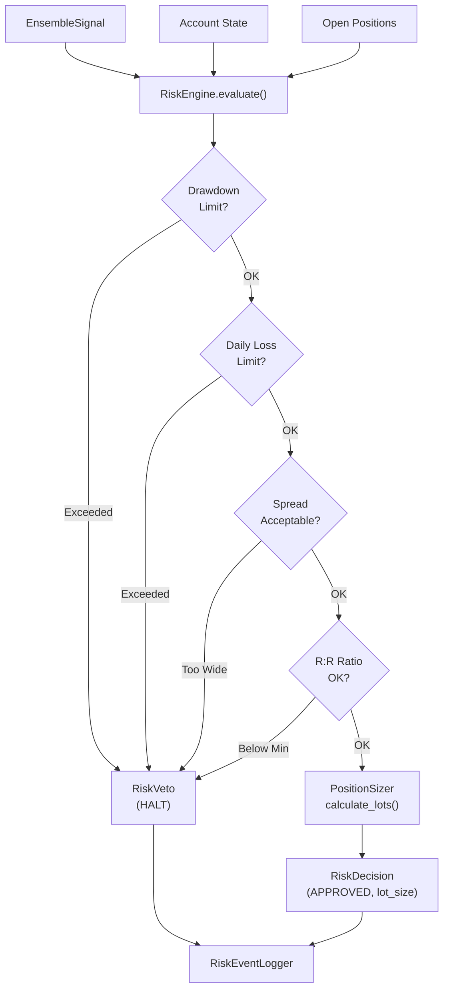
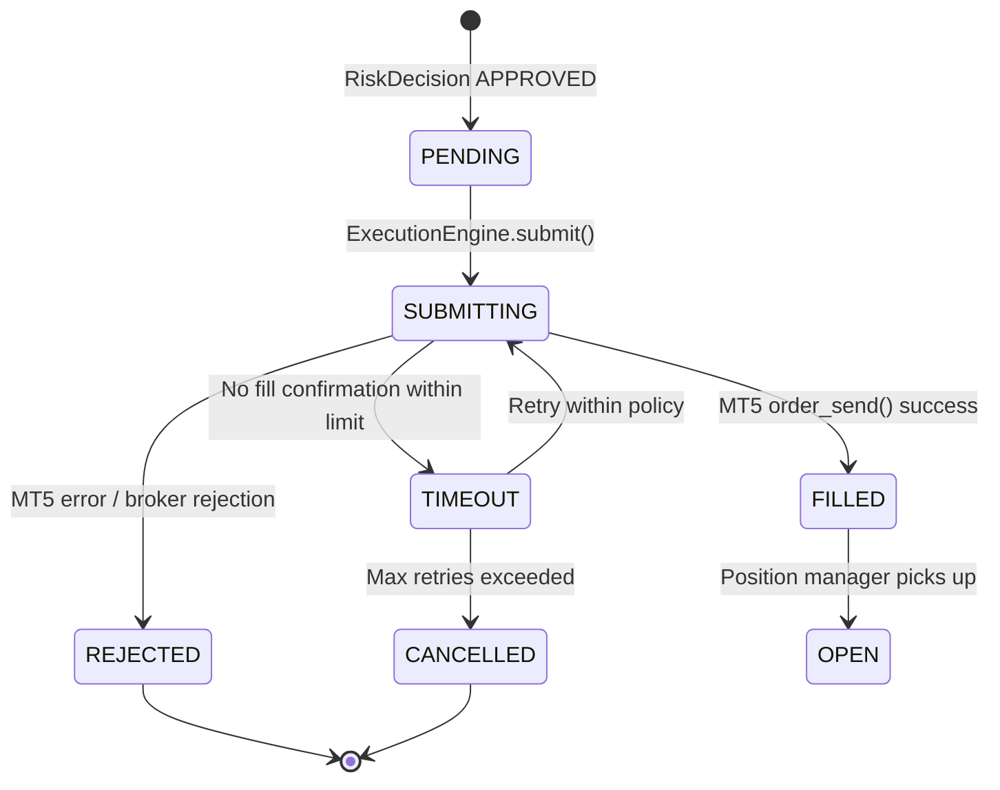
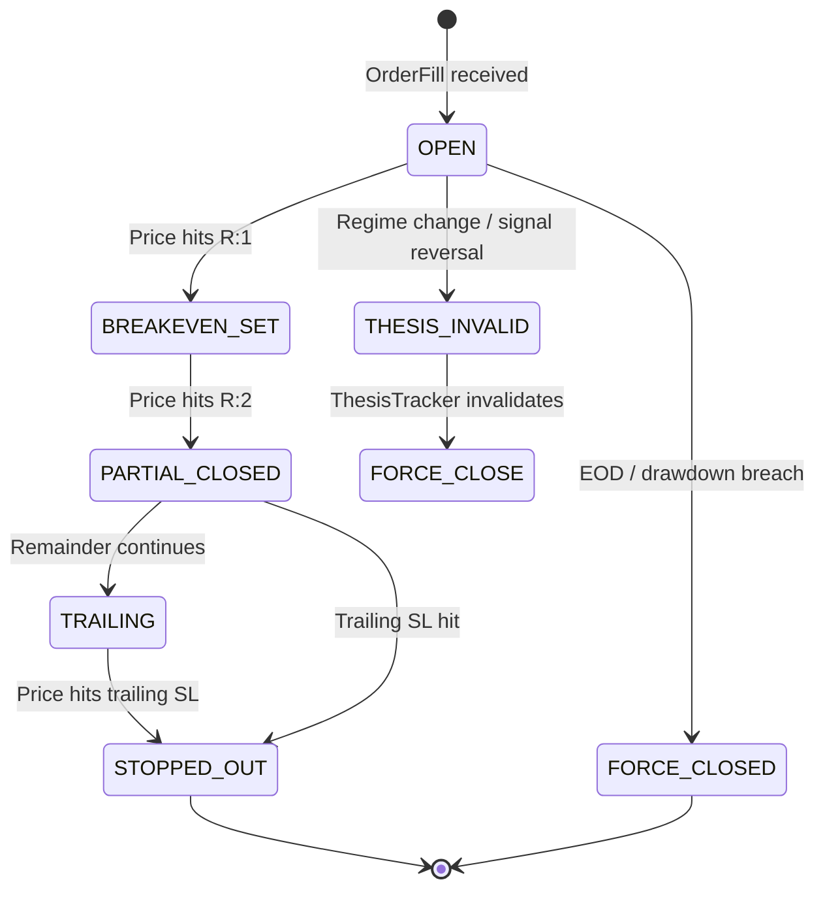
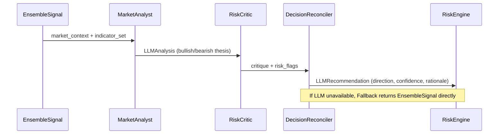

# 🏆 Trading-Gold System — Project Roadmap

> **Version:** 1.0.0  
> **Last Updated:** 2026-10-08  
> **Status:** Active Development  
> **Project:** Automated Gold (XAUUSD) Trading System with LLM Intelligence

---

## Executive Summary

The Trading-Gold system is a production-grade, fully automated algorithmic trading platform targeting the XAUUSD (Gold/USD) market. It combines a multi-strategy ensemble engine with LLM-powered market analysis, a robust risk management layer, a live web dashboard, paper trading mode, and enterprise-level monitoring and alerting.

The system is decomposed into **12 sequential phases**, each building on the previous, progressing from foundational infrastructure to production hardening. The architecture follows a modular, service-oriented design backed by a clean Python codebase, MetaTrader 5 (MT5) integration, and FastAPI-based tooling.

### Key Design Principles

| Principle | Description |
|-----------|-------------|
| **Safety First** | Hard risk limits enforced at every layer; no bypassing allowed |
| **Modularity** | Each subsystem (data, strategy, risk, execution) is independently testable |
| **Observability** | Structured logging, health checks, and dashboards throughout |
| **Resilience** | Reconnect logic, fallback modes, and watchdog processes at every critical path |
| **LLM-Augmented** | AI-assisted market analysis with deterministic fallback when unavailable |
| **Paper → Live** | Safe transition path: develop in paper mode, promote to live with approval |

---

## Phase Dependency Flowchart



---

## Phase Summary Table

| # | Phase | Complexity | Key Deliverables | Depends On |
|---|-------|-----------|------------------|------------|
| 1 | Architecture + MT5 Connection Layer | 🟡 Medium | Module skeleton, MT5 adapter, DB schema, health endpoints | — |
| 2 | Market Data Engine | 🟡 Medium | Candle fetcher, indicator pipeline, bar cache, tick stream | 1 |
| 3 | Strategy Engine | 🔴 High | 6 strategies, ensemble scorer, regime detector | 2 |
| 4 | Risk Engine | 🔴 High | Hard limits, position sizer, risk events, audit log | 3 |
| 5 | Execution Engine | 🟡 Medium | Order lifecycle, MT5 send, paper simulator, retries | 4 |
| 6 | Position Manager | 🔴 High | Monitor loop, trailing stop, breakeven, partial close | 5 |
| 7 | Backtesting Engine | 🔴 High | Historical downloader, simulation, walk-forward, reports | 2 |
| 8 | LLM Intelligence | 🔴 High | Multi-agent LLM layer, schema validation, fallback | 3 |
| 9 | Web Dashboard | 🟡 Medium | FastAPI app, JWT, routers, WebSocket, emergency controls | 6, 8 |
| 10 | Paper Trading Mode | 🟢 Low | Integration test, paper/live switching, dashboard display | 5, 9 |
| 11 | Monitoring + Alerts | 🟡 Medium | Structured logs, Telegram/email/webhook, watchdog | 10, 6 |
| 12 | Production Hardening | 🔴 High | Security review, load test, failover, final checklist | 11 |

---

## Phase 1: Architecture + MT5 Connection Layer

### Goals

Establish the foundational codebase structure, configuration system, database schema, and a reliable connection layer to MetaTrader 5. This phase produces the skeleton on which all subsequent phases depend. Every later module will import from the interfaces and utilities created here.

### Deliverables

| Deliverable | Path | Description |
|-------------|------|-------------|
| Module structure | `src/` | Top-level package layout with `__init__.py` files |
| Settings module | `src/config/settings.py` | Pydantic `BaseSettings` class loading from `.env` |
| Environment template | `.env.example` | All configurable keys with documentation |
| MT5 adapter (real) | `src/adapters/mt5_adapter.py` | Live MT5 connection wrapper with typed methods |
| MT5 adapter (mock) | `src/adapters/mt5_mock.py` | Deterministic mock for testing without MT5 installed |
| MT5 adapter interface | `src/adapters/base_adapter.py` | Abstract base class / protocol for adapters |
| Database schema | `src/db/schema.sql` | Complete DDL for all tables |
| Alembic migrations | `alembic/` | Migration history, `env.py`, `alembic.ini` |
| Connection manager | `src/core/connection_manager.py` | Singleton with reconnect loop and backoff |
| Health endpoints | `src/api/health.py` | `/health`, `/health/mt5`, `/health/db` routes |
| Basic tests | `tests/unit/test_connection.py` | Connection lifecycle tests |

#### Module Structure

```
Trading-gold/
├── src/
│   ├── adapters/          # MT5 real/mock adapters
│   ├── api/               # FastAPI routers
│   ├── config/            # Settings and constants
│   ├── core/              # Shared core utilities
│   ├── db/                # Database models and migrations
│   ├── strategies/        # Strategy implementations
│   ├── risk/              # Risk engine
│   ├── execution/         # Order management
│   ├── position/          # Position monitor
│   ├── backtesting/       # Backtesting engine
│   ├── llm/               # LLM intelligence layer
│   ├── monitoring/        # Logging and alerts
│   └── dashboard/         # Web dashboard
├── tests/
│   ├── unit/
│   ├── integration/
│   └── fixtures/
├── alembic/
├── docs/
├── scripts/
└── docker/
```

### Success Criteria

- [ ] `src/` package imports cleanly with no circular dependencies
- [ ] `Settings` loads all required env vars and raises `ValidationError` on missing keys
- [ ] MT5 real adapter connects and returns account info when MT5 terminal is running
- [ ] MT5 mock adapter returns pre-seeded deterministic data
- [ ] All database tables created via `alembic upgrade head`
- [ ] Connection manager performs automatic reconnect within 30 seconds of drop
- [ ] `/health` returns `200 OK` with `{"status": "healthy"}` JSON

### Test Requirements

```
tests/unit/test_settings.py           — settings validation, env override
tests/unit/test_mt5_mock.py           — mock adapter contract compliance
tests/unit/test_connection_manager.py — reconnect backoff logic
tests/integration/test_health_api.py  — all health endpoints return correct codes
```

**Minimum coverage target:** 80% for all Phase 1 modules.

### Estimated Complexity: 🟡 Medium

Setting up Pydantic settings and Alembic migrations is straightforward. The complexity comes from designing a clean adapter abstraction that allows seamless swapping between real MT5 and mock, and implementing reliable reconnect logic with exponential backoff. Platform dependency (MT5 is Windows-only) requires the mock to be comprehensive enough to support full CI/CD on Linux/macOS.

---

## Phase 2: Market Data Engine

### Goals

Build the data backbone of the trading system. This includes multi-timeframe OHLCV candle fetching, a composable technical indicator pipeline, an in-memory/disk bar cache, persistence of market data, and real-time tick streaming from MT5.

### Deliverables

| Deliverable | Path | Description |
|-------------|------|-------------|
| Candle fetcher | `src/data/candle_fetcher.py` | Fetches OHLCV bars for any symbol/timeframe |
| Multi-timeframe manager | `src/data/mtf_manager.py` | Coordinates M1, M5, M15, H1, H4, D1 data |
| Indicator pipeline | `src/data/indicators.py` | EMA, RSI, ATR, MACD, BB, Stochastic, ADX |
| Bar cache | `src/data/bar_cache.py` | LRU cache with TTL and warm-up logic |
| Market data persistence | `src/db/market_data_repo.py` | Upsert candles to DB; query historical windows |
| Tick streamer | `src/data/tick_streamer.py` | Async tick subscription and broadcast |
| Data schemas | `src/data/schemas.py` | Pydantic models: `Candle`, `Tick`, `IndicatorSet` |
| Tests | `tests/unit/test_indicators.py` | Indicator value correctness against known datasets |

#### Indicator Pipeline Architecture



### Success Criteria

- [ ] `CandleFetcher` retrieves correct bar counts for all supported timeframes
- [ ] Indicator values match TA-Lib reference values within 0.01% tolerance
- [ ] Bar cache returns stale data on MT5 timeout without crashing
- [ ] Ticks stream at ≥ 1 tick/second during live market hours
- [ ] Market data persisted and queryable within 100ms of candle close

### Test Requirements

```
tests/unit/test_candle_fetcher.py       — fetches, validates, handles gaps
tests/unit/test_indicators.py           — known-good reference comparisons
tests/unit/test_bar_cache.py            — TTL expiry, LRU eviction, warm-up
tests/integration/test_tick_streamer.py — mock MT5 tick injection, subscriber fanout
```

**Minimum coverage target:** 85% for all Phase 2 modules.

### Estimated Complexity: 🟡 Medium

Multi-timeframe alignment (ensuring M1 candles are consistent with H1 bars) and handling missing bars / weekend gaps adds complexity. The indicator pipeline must be computationally efficient since it runs on every bar close across multiple timeframes. Tick streaming requires careful async design to avoid blocking the main event loop.

---

## Phase 3: Strategy Engine

### Goals

Implement the core signal-generation layer. Six independent strategies produce scored signals; an ensemble aggregator combines them using a weighted-voting approach; a regime detector dynamically adjusts strategy weights based on market conditions.

### Deliverables

| Deliverable | Path | Description |
|-------------|------|-------------|
| Base interface | `src/strategies/base_strategy.py` | `BaseStrategy` ABC with `generate_signal()` contract |
| Trend Following | `src/strategies/trend_following.py` | EMA crossover + ADX filter |
| Momentum | `src/strategies/momentum.py` | RSI divergence + MACD confirmation |
| Breakout | `src/strategies/breakout.py` | ATR-based range breakout detection |
| Mean Reversion | `src/strategies/mean_reversion.py` | Bollinger Band extremes + RSI reversal |
| Market Structure | `src/strategies/market_structure.py` | S/R levels, CHoCH, BOS detection |
| Volatility | `src/strategies/volatility.py` | ATR volatility regime filter |
| Ensemble scorer | `src/strategies/ensemble.py` | Weighted signal aggregation and confidence scoring |
| Regime detector | `src/strategies/regime_detector.py` | Trend / ranging / volatile regime classification |
| Signal schemas | `src/strategies/schemas.py` | `Signal`, `EnsembleSignal`, `RegimeState` |
| Unit tests | `tests/unit/strategies/` | Per-strategy unit tests |

#### Signal Flow



#### Signal Schema

```python
class Signal(BaseModel):
    strategy_name: str
    direction: Literal["BUY", "SELL", "NEUTRAL"]
    confidence: float          # 0.0 – 1.0
    timeframe: str
    reasoning: str
    timestamp: datetime

class EnsembleSignal(BaseModel):
    direction: Literal["BUY", "SELL", "NEUTRAL"]
    composite_score: float     # –1.0 (strong sell) to +1.0 (strong buy)
    confidence: float
    contributing_strategies: list[str]
    regime: str
    timestamp: datetime
```

### Success Criteria

- [ ] Each strategy produces a valid `Signal` for any `IndicatorSet` input (no exceptions)
- [ ] Ensemble correctly weights strategies based on active regime
- [ ] Regime detector classifies trending/ranging/volatile markets correctly on backtested data
- [ ] Strategy signals are stateless (same input always produces same output)
- [ ] No strategy depends on another strategy's output (independent signals)

### Test Requirements

```
tests/unit/strategies/test_trend_following.py   — entry conditions, filter logic
tests/unit/strategies/test_momentum.py          — RSI/MACD signal combinations
tests/unit/strategies/test_breakout.py          — range detection, breakout confirmation
tests/unit/strategies/test_mean_reversion.py    — BB extremes, RSI reversal
tests/unit/strategies/test_market_structure.py  — CHoCH / BOS detection
tests/unit/strategies/test_volatility.py        — ATR regime classification
tests/unit/strategies/test_ensemble.py          — weighting math, regime-to-weight mapping
tests/unit/strategies/test_regime_detector.py   — regime classification on fixture data
```

**Minimum coverage target:** 90% for all Phase 3 modules.

### Estimated Complexity: 🔴 High

Market structure detection (Change of Character, Break of Structure) is non-trivial and requires multi-bar pattern recognition. Regime detection requires careful calibration to avoid over-switching. The ensemble scoring must be numerically stable and well-documented so it can be tuned during backtesting. Each strategy requires dedicated historical validation to confirm edge.

---

## Phase 4: Risk Engine

### Goals

Enforce all trading risk limits at a hard, policy-enforced level that cannot be bypassed by any other module. The risk engine is the final gatekeeper before any order is sent to the execution layer. It manages position sizing, drawdown tracking, exposure limits, and produces a rich audit trail.

### Deliverables

| Deliverable | Path | Description |
|-------------|------|-------------|
| Risk engine core | `src/risk/risk_engine.py` | Main `RiskEngine` class with `evaluate()` method |
| Hard limits config | `src/risk/limits.py` | All risk constants: max lot, max drawdown, max daily loss, etc. |
| Position sizer | `src/risk/position_sizer.py` | ATR-based and fixed-percent lot size calculators |
| Risk decision schema | `src/risk/schemas.py` | `RiskDecision`, `RiskVeto`, `RiskEvent` models |
| Risk event logger | `src/risk/event_logger.py` | Appends every decision to the audit log table |
| Daily tracker | `src/risk/daily_tracker.py` | Tracks intra-day P&L, consecutive losses, exposure |
| Unit tests | `tests/unit/risk/` | All hard limits tested at boundaries |

#### Hard Limits Catalogue

| Limit | Default Value | Description |
|-------|--------------|-------------|
| `MAX_LOT_SIZE` | 0.50 | Maximum single trade lot size |
| `MAX_OPEN_POSITIONS` | 3 | No more than N concurrent positions |
| `MAX_DAILY_LOSS_PCT` | 3.0% | Kill switch triggers if daily loss exceeds this |
| `MAX_DRAWDOWN_PCT` | 8.0% | System halt if equity drawdown exceeds this |
| `MIN_RISK_REWARD` | 1.5 | Reject orders with R:R below this ratio |
| `MAX_SPREAD_PIPS` | 5.0 | Reject orders when spread is too wide |
| `MAX_CONSECUTIVE_LOSSES` | 5 | Pause trading after N losses in a row |
| `POSITION_SIZE_PCT` | 1.0% | Default risk-per-trade as % of account equity |

#### Risk Evaluation Flow



### Success Criteria

- [ ] Every hard limit correctly vetoes a non-compliant order
- [ ] `evaluate()` is synchronous and completes in < 5ms
- [ ] `RiskDecision` is immutable once created
- [ ] Every decision (approved or vetoed) is written to the audit log
- [ ] Position sizer produces lot sizes that never exceed broker's maximum
- [ ] Kill switch triggers and halts all trading when daily loss limit is breached

### Test Requirements

```
tests/unit/risk/test_hard_limits.py      — each limit at boundary: pass, fail, edge
tests/unit/risk/test_position_sizer.py   — ATR-based and fixed % sizing
tests/unit/risk/test_daily_tracker.py    — loss accumulation, reset at midnight
tests/unit/risk/test_risk_engine.py      — full evaluate() workflow
tests/unit/risk/test_event_logger.py     — DB write, retrieval, schema validation
```

**Minimum coverage target:** 95% for all Phase 4 modules. Risk logic must be near-fully covered.

### Estimated Complexity: 🔴 High

The risk engine must be bulletproof. Edge cases abound: what happens when the MT5 connection drops mid-evaluation? What if account equity data is stale? What happens on rollover when daily P&L resets? Each scenario must be explicitly handled and tested. The position sizer must account for different broker contract sizes, leverage, and currency pairs.

---

## Phase 5: Execution Engine

### Goals

Implement the full order lifecycle from signal to fill confirmation. Includes MT5 order placement with error handling and retry logic, a paper trading simulator for safe development, and full persistence of all order events.

### Deliverables

| Deliverable | Path | Description |
|-------------|------|-------------|
| Execution engine | `src/execution/execution_engine.py` | Orchestrates order creation, submission, and tracking |
| MT5 order sender | `src/execution/mt5_order_sender.py` | Wraps MT5 `order_send()` with retry and error handling |
| Paper simulator | `src/execution/paper_simulator.py` | Simulates fills using live bid/ask prices |
| Order lifecycle FSM | `src/execution/order_fsm.py` | State machine: PENDING → SUBMITTED → FILLED / REJECTED |
| Order models | `src/execution/schemas.py` | `Order`, `OrderFill`, `OrderEvent` Pydantic models |
| Order repository | `src/db/order_repo.py` | CRUD for orders and events in DB |
| Retry policy | `src/execution/retry_policy.py` | Configurable backoff and max-attempt policy |
| Tests | `tests/unit/execution/` | Order lifecycle, retry scenarios |

#### Order Lifecycle State Machine



### Success Criteria

- [ ] Orders submitted via real adapter are reflected in MT5 terminal within 3 seconds
- [ ] Paper simulator fills orders using current bid/ask within 1 tick
- [ ] Rejected orders are never retried beyond `MAX_RETRIES`
- [ ] Every order state transition is persisted to the database
- [ ] Execution engine is decoupled from risk engine (receives only `RiskDecision`)

### Test Requirements

```
tests/unit/execution/test_order_fsm.py          — all state transitions
tests/unit/execution/test_mt5_order_sender.py   — success, rejection, timeout, retry
tests/unit/execution/test_paper_simulator.py    — fill accuracy, partial fill
tests/integration/execution/test_order_repo.py  — DB persistence roundtrip
```

**Minimum coverage target:** 85% for all Phase 5 modules.

### Estimated Complexity: 🟡 Medium

MT5 `order_send()` is synchronous and blocking; wrapping it safely without deadlocking the async event loop requires careful thread-pool management. Retry logic must distinguish between transient errors (retry) and permanent rejections (do not retry). The paper simulator must realistically model slippage and spread.

---

## Phase 6: Position Manager

### Goals

After a trade is filled, the position manager takes over to actively monitor and manage it throughout its lifetime. This includes real-time P&L tracking, trailing stop adjustments, breakeven moves, partial profit-taking, force-close rules, and thesis invalidation detection.

### Deliverables

| Deliverable | Path | Description |
|-------------|------|-------------|
| Position monitor | `src/position/position_monitor.py` | Async loop polling open positions every tick |
| Trade thesis tracker | `src/position/thesis_tracker.py` | Records entry rationale and monitors for invalidation |
| Trailing stop manager | `src/position/trailing_stop.py` | ATR-based trailing stop adjustment logic |
| Breakeven manager | `src/position/breakeven.py` | Moves SL to entry when position hits R:1 |
| Partial close manager | `src/position/partial_close.py` | Closes 50% at R:1, lets remainder run |
| Force close rules | `src/position/force_close.py` | EOD close, drawdown breach, session close |
| Position schemas | `src/position/schemas.py` | `Position`, `ThesisState`, `PositionEvent` |
| Tests | `tests/unit/position/` | Each management rule individually |

#### Position Lifecycle



### Success Criteria

- [ ] Trailing stop adjusts on every new bar close for active positions
- [ ] Breakeven trigger fires correctly when position reaches R:1 profit
- [ ] Partial close executes within 2 seconds of reaching R:2
- [ ] Thesis invalidation correctly triggers force close within one bar
- [ ] Force close rules execute during market hours even when primary signal is lost
- [ ] All position events written to DB with timestamps

### Test Requirements

```
tests/unit/position/test_trailing_stop.py     — ATR calculation, adjustment conditions
tests/unit/position/test_breakeven.py         — trigger price, SL modification
tests/unit/position/test_partial_close.py     — lot reduction, remainder tracking
tests/unit/position/test_force_close.py       — EOD, drawdown, session rules
tests/unit/position/test_thesis_tracker.py    — invalidation conditions
```

**Minimum coverage target:** 90% for all Phase 6 modules.

### Estimated Complexity: 🔴 High

Managing multiple concurrent positions with independent timers and state machines while reacting to live tick data is the most complex async programming challenge in the system. Race conditions between position updates and order submissions must be carefully avoided using proper locking. Thesis invalidation requires cross-referencing live strategy signals against historical entry rationale.

---

## Phase 7: Backtesting Engine

### Goals

Build a self-contained backtesting framework that enables strategy validation against historical data. Includes historical data download from MT5, a simulation engine that replays market data, performance metrics calculation, walk-forward testing, and structured HTML/PDF reports.

### Deliverables

| Deliverable | Path | Description |
|-------------|------|-------------|
| Historical downloader | `src/backtesting/downloader.py` | Downloads and stores multi-year OHLCV data |
| Simulation engine | `src/backtesting/simulator.py` | Replays bars through strategy + risk + execution stack |
| Performance metrics | `src/backtesting/metrics.py` | Sharpe, Sortino, Calmar, max drawdown, win rate, etc. |
| Walk-forward tester | `src/backtesting/walk_forward.py` | Rolling in-sample / out-of-sample windows |
| Report generator | `src/backtesting/reports.py` | HTML/JSON report with equity curve, trade log |
| Backtest schemas | `src/backtesting/schemas.py` | `BacktestConfig`, `BacktestResult`, `TradeRecord` |
| CLI runner | `scripts/run_backtest.py` | Command-line backtest launcher |

#### Performance Metrics Catalogue

| Metric | Description |
|--------|-------------|
| Total Return % | Net P&L as percentage of starting capital |
| Sharpe Ratio | Risk-adjusted return (annualized) |
| Sortino Ratio | Downside-adjusted return |
| Calmar Ratio | Return / Max Drawdown |
| Max Drawdown % | Largest peak-to-trough equity decline |
| Win Rate % | Percentage of profitable trades |
| Profit Factor | Gross profit / Gross loss |
| Average R:R | Mean realized risk-reward ratio |
| Expectancy | Average expected profit per trade |
| Total Trades | Number of completed trades in period |

### Success Criteria

- [ ] Backtester replays 1 year of H1 data in < 60 seconds
- [ ] Results are deterministic (same config always produces same results)
- [ ] Walk-forward test produces non-overlapping in/out-of-sample windows
- [ ] Reports include equity curve, monthly returns table, and trade list
- [ ] Metrics match verified reference calculations within 0.001 tolerance

### Test Requirements

```
tests/unit/backtesting/test_simulator.py      — determinism, bar replay order
tests/unit/backtesting/test_metrics.py        — metric calculations vs. reference
tests/unit/backtesting/test_walk_forward.py   — window generation, no overlap
tests/integration/backtesting/test_e2e.py     — full backtest run on fixture data
```

**Minimum coverage target:** 85% for all Phase 7 modules.

### Estimated Complexity: 🔴 High

Correctly simulating realistic trade execution in a backtest (accounting for spread, slippage, and overnight fees) without introducing look-ahead bias is the primary challenge. Walk-forward testing requires careful window management to avoid data leakage. Report generation with rich visualizations requires integration with plotting libraries.

---

## Phase 8: LLM Intelligence

### Goals

Augment the strategy ensemble with LLM-powered reasoning. Three specialized agents (Market Analyst, Risk Critic, Decision Reconciler) collaborate to produce a high-level trading recommendation with structured, schema-validated output. The system gracefully degrades to deterministic fallback when LLMs are unavailable.

### Deliverables

| Deliverable | Path | Description |
|-------------|------|-------------|
| LLM provider abstraction | `src/llm/providers/base_provider.py` | `LLMProvider` protocol supporting OpenAI, Anthropic, local |
| OpenAI provider | `src/llm/providers/openai_provider.py` | GPT-4o integration with retry and token management |
| Anthropic provider | `src/llm/providers/anthropic_provider.py` | Claude integration |
| Market Analyst agent | `src/llm/agents/market_analyst.py` | Analyzes IndicatorSet + price action context |
| Risk Critic agent | `src/llm/agents/risk_critic.py` | Challenges proposed trades, identifies red flags |
| Decision Reconciler | `src/llm/agents/decision_reconciler.py` | Combines analyst and critic into final recommendation |
| Schema validator | `src/llm/schema_validator.py` | Validates LLM JSON output against Pydantic models |
| Fallback handler | `src/llm/fallback.py` | Returns ensemble-only decision when LLM unavailable |
| LLM schemas | `src/llm/schemas.py` | `LLMAnalysis`, `LLMRecommendation`, `LLMFallback` |

#### Multi-Agent Architecture



#### LLM Recommendation Schema

```python
class LLMRecommendation(BaseModel):
    direction: Literal["BUY", "SELL", "NEUTRAL", "ABSTAIN"]
    confidence: float          # 0.0 – 1.0
    rationale: str             # Human-readable explanation
    key_risks: list[str]       # Top 3 risks identified by critic
    overrides_ensemble: bool   # True if LLM disagrees with ensemble
    fallback_used: bool        # True if LLM was unavailable
    model_used: str | None     # e.g. "gpt-4o", "claude-3-5-sonnet"
    latency_ms: float
```

### Success Criteria

- [ ] All three agents produce valid `LLMRecommendation` objects
- [ ] Schema validation rejects malformed LLM outputs (retries up to 3 times)
- [ ] Fallback activates within 500ms when LLM endpoint is unreachable
- [ ] LLM latency does not block trade execution (async with timeout)
- [ ] Provider can be switched via config without code changes

### Test Requirements

```
tests/unit/llm/test_schema_validator.py     — valid/invalid LLM JSON cases
tests/unit/llm/test_fallback.py             — fallback triggers and output
tests/unit/llm/test_market_analyst.py       — prompt construction, output parsing
tests/unit/llm/test_risk_critic.py          — critique generation
tests/unit/llm/test_decision_reconciler.py  — consensus logic
tests/integration/llm/test_provider.py      — mock HTTP responses, retry behavior
```

**Minimum coverage target:** 85% for all Phase 8 modules.

### Estimated Complexity: 🔴 High

LLM output is non-deterministic. Robust schema validation, retry on malformed responses, and fallback paths are essential. Prompt engineering for financial analysis requires domain expertise and iterative testing. Token costs and latency must be monitored and bounded. Multi-provider support requires clean abstraction.

---

## Phase 9: Web Dashboard

### Goals

Build a production-quality web dashboard for real-time monitoring, trade management, and system control. Backed by FastAPI with JWT authentication, WebSocket live updates, and a complete set of API endpoints covering every system subsystem.

### Deliverables

| Deliverable | Path | Description |
|-------------|------|-------------|
| FastAPI app | `src/api/app.py` | Main application with middleware and router registration |
| JWT auth | `src/api/auth.py` | Login, token issue, refresh, protected route dependency |
| Account router | `src/api/routers/account.py` | Account info, equity, margin |
| Positions router | `src/api/routers/positions.py` | Open positions, P&L, history |
| Orders router | `src/api/routers/orders.py` | Order history, manual order placement |
| Risk router | `src/api/routers/risk.py` | Risk limits status, daily loss tracker |
| Signals router | `src/api/routers/signals.py` | Live ensemble signal, LLM recommendation |
| Backtest router | `src/api/routers/backtest.py` | Launch backtest, fetch results |
| WebSocket handler | `src/api/websocket.py` | Live tick, signal, and P&L broadcast |
| Dashboard pages | `src/dashboard/` | HTML/JS pages: overview, positions, signals, risk, settings |
| Emergency controls | `src/api/routers/emergency.py` | Kill switch, close all, pause/resume |

#### API Route Map

| Method | Endpoint | Description |
|--------|----------|-------------|
| POST | `/auth/login` | Obtain JWT token |
| POST | `/auth/refresh` | Refresh JWT token |
| GET | `/account/info` | Account balance, equity, margin |
| GET | `/positions/open` | All open positions with live P&L |
| DELETE | `/positions/{id}` | Manually close a position |
| GET | `/risk/status` | Current risk limits and utilization |
| GET | `/signals/latest` | Latest ensemble + LLM signal |
| POST | `/backtest/run` | Start a backtest job |
| GET | `/backtest/{id}` | Fetch backtest results |
| WS | `/ws/live` | WebSocket: ticks, signals, P&L |
| POST | `/emergency/kill-switch` | Halt all trading immediately |
| POST | `/emergency/close-all` | Close all open positions |

### Success Criteria

- [ ] All API endpoints return correct HTTP status codes and response schemas
- [ ] JWT tokens expire after configured TTL and refresh works correctly
- [ ] WebSocket broadcasts live data within 500ms of source event
- [ ] Emergency kill-switch halts trading within 2 seconds
- [ ] Dashboard loads in < 3 seconds on standard connection
- [ ] All routes are protected except `/auth/login` and `/health`

### Test Requirements

```
tests/unit/api/test_auth.py              — login, token validation, expiry
tests/unit/api/test_positions_router.py  — CRUD, schema validation
tests/unit/api/test_emergency.py         — kill switch, close-all behavior
tests/integration/api/test_websocket.py  — WebSocket message delivery, reconnect
tests/integration/api/test_e2e_api.py    — full API flow with test client
```

**Minimum coverage target:** 80% for all Phase 9 modules.

### Estimated Complexity: 🟡 Medium

FastAPI reduces boilerplate significantly. The main complexity lies in WebSocket connection management (fan-out to multiple clients, reconnect handling) and ensuring the emergency controls are race-condition-free when issued concurrently with live trading signals.

---

## Phase 10: Paper Trading Mode

### Goals

Integrate all subsystems into a paper trading mode that exercises the full stack without real capital at risk. Enables side-by-side operation (paper vs. live) and ensures a safe, verified path to production deployment.

### Deliverables

| Deliverable | Path | Description |
|-------------|------|-------------|
| Paper mode config | `src/config/trading_mode.py` | `TradingMode` enum: `PAPER`, `LIVE` |
| Mode switcher | `src/core/mode_manager.py` | Runtime mode switching with audit log |
| Paper account | `src/execution/paper_account.py` | Virtual account: balance, positions, history |
| Integration test suite | `tests/integration/test_paper_trading.py` | Full signal-to-fill paper trade cycle |
| Mode display | `src/api/routers/mode.py` | API + dashboard display of current mode |
| Mode guard | `src/execution/mode_guard.py` | Prevents live orders when in paper mode |

### Success Criteria

- [ ] Full trade cycle (signal → risk → execute → position → close) runs in paper mode
- [ ] Paper mode never sends orders to real MT5 terminal
- [ ] Switching from paper to live requires explicit confirmation (two-step)
- [ ] Dashboard prominently displays current mode with color coding
- [ ] Paper P&L tracked accurately and displayed in real-time

### Test Requirements

```
tests/integration/test_paper_trading.py    — end-to-end paper trade cycle
tests/unit/test_mode_guard.py              — paper mode blocks live order sends
tests/unit/test_mode_manager.py            — mode switching, audit logging
```

**Minimum coverage target:** 85% for all Phase 10 modules.

### Estimated Complexity: 🟢 Low

By Phase 10, all components exist. The primary task is wiring them together and ensuring the paper simulator intercepts correctly. The mode guard is a simple but critical safety check. Most complexity comes from integration test setup, not new logic.

---

## Phase 11: Monitoring + Alerts

### Goals

Implement comprehensive observability for the production system: structured logging with correlation IDs, enhanced health endpoints with deep checks, multi-channel alert delivery (Telegram, email, webhook), automated performance reports, and a watchdog process that restarts crashed components.

### Deliverables

| Deliverable | Path | Description |
|-------------|------|-------------|
| Structured logger | `src/monitoring/logger.py` | JSON-formatted logs with correlation IDs |
| Log middleware | `src/api/middleware/logging.py` | Request/response logging for all API calls |
| Health check suite | `src/api/health.py` | Extended deep health checks (MT5, DB, LLM, disk) |
| Telegram alerter | `src/monitoring/alerts/telegram.py` | Bot-based alert delivery |
| Email alerter | `src/monitoring/alerts/email.py` | SMTP-based alert with HTML template |
| Webhook alerter | `src/monitoring/alerts/webhook.py` | Generic HTTP webhook (Slack, Discord, etc.) |
| Alert manager | `src/monitoring/alert_manager.py` | Routes events to configured alert channels |
| Alert events | `src/monitoring/alert_events.py` | Typed alert definitions: trade, risk, error, daily |
| Performance reporter | `src/monitoring/performance_reporter.py` | Daily P&L, weekly, monthly reports |
| Watchdog | `src/monitoring/watchdog.py` | Process monitor with restart and circuit-breaker |

#### Alert Event Types

| Event | Severity | Channels |
|-------|----------|----------|
| `TRADE_OPENED` | INFO | Telegram |
| `TRADE_CLOSED` | INFO | Telegram |
| `KILL_SWITCH_TRIGGERED` | CRITICAL | Telegram + Email |
| `DAILY_LOSS_LIMIT_HIT` | HIGH | Telegram + Email |
| `MAX_DRAWDOWN_HIT` | CRITICAL | All channels |
| `MT5_CONNECTION_LOST` | HIGH | Telegram |
| `LLM_UNAVAILABLE` | MEDIUM | Telegram |
| `COMPONENT_RESTARTED` | HIGH | Telegram + Email |
| `DAILY_REPORT` | INFO | Email |

### Success Criteria

- [ ] All log output is valid JSON with required fields (timestamp, level, correlation_id, module)
- [ ] Telegram alert delivered within 5 seconds of triggering event
- [ ] Watchdog detects crashed component within 30 seconds and attempts restart
- [ ] Health endpoint reports `degraded` (not `healthy`) when MT5 disconnects
- [ ] Daily performance report delivered at configured time each day
- [ ] Alert deduplication prevents duplicate notifications within 60-second window

### Test Requirements

```
tests/unit/monitoring/test_alert_manager.py   — routing, deduplication, channel fallback
tests/unit/monitoring/test_watchdog.py        — crash detection, restart, circuit breaker
tests/unit/monitoring/test_logger.py          — JSON format, correlation ID propagation
tests/integration/monitoring/test_alerts.py   — mock HTTP endpoints for Telegram/webhook
```

**Minimum coverage target:** 80% for all Phase 11 modules.

### Estimated Complexity: 🟡 Medium

Structured logging and alert delivery are well-understood patterns. The watchdog requires careful implementation to avoid restart loops (circuit breaker pattern). Alert deduplication requires a small in-memory or Redis-backed store. Performance reporting requires aggregating trade data across time windows.

---

## Phase 12: Production Hardening

### Goals

Prepare the system for live production deployment. This phase covers security review, load testing, failover and recovery testing, final documentation review, and a signed-off deployment checklist. No new features are added; this phase validates and fortifies what exists.

### Deliverables

| Deliverable | Path | Description |
|-------------|------|-------------|
| Security review report | `docs/security_review.md` | Findings and remediations for all security concerns |
| Load test suite | `tests/load/` | Locust or k6 load tests for API endpoints |
| Failover test playbook | `docs/failover_playbook.md` | Manual and automated failover test procedures |
| Secrets audit | `scripts/audit_secrets.sh` | Checks for hardcoded credentials in codebase |
| Rate limiting | `src/api/middleware/rate_limit.py` | Per-IP and per-user rate limiting on all API routes |
| Input sanitization | `src/api/middleware/sanitizer.py` | Validates and sanitizes all user inputs |
| API key rotation | `docs/api_key_rotation.md` | Procedure for rotating all external API keys |
| Documentation review | `docs/` | Final review of all docs for accuracy and completeness |
| Deployment checklist | `docs/DEPLOYMENT.md` | Step-by-step production deployment guide |
| Final sign-off | `docs/RELEASE_SIGN_OFF.md` | Stakeholder approval record |

#### Security Review Checklist

| Area | Check | Status |
|------|-------|--------|
| Authentication | JWT secret is ≥ 256-bit, not hardcoded | ☐ |
| Authorization | All routes require auth except `/health`, `/auth/login` | ☐ |
| Secrets management | All secrets in env vars / vault, not in code | ☐ |
| SQL injection | All DB queries use parameterized statements | ☐ |
| Input validation | Pydantic validates all external inputs | ☐ |
| Rate limiting | API endpoints rate-limited per-user and per-IP | ☐ |
| HTTPS | TLS enforced for all external communication | ☐ |
| Dependencies | `pip audit` shows no critical CVEs | ☐ |
| Logging | No sensitive data (passwords, keys) in logs | ☐ |
| Emergency kill | Kill switch accessible even under high load | ☐ |

#### Load Test Targets

| Endpoint | Concurrent Users | Target P95 Latency |
|----------|-----------------|-------------------|
| `GET /positions/open` | 50 | < 200ms |
| `GET /signals/latest` | 50 | < 300ms |
| `WS /ws/live` | 100 | < 100ms per message |
| `POST /emergency/kill-switch` | 10 | < 500ms |

#### Deployment Checklist

```
Pre-Deployment:
  [ ] All tests pass: pytest --tb=short -q (exit code 0)
  [ ] Coverage ≥ 85% across all modules
  [ ] No critical security findings open
  [ ] Load tests pass at target thresholds
  [ ] Paper trading mode validated for ≥ 5 trading days

Deployment:
  [ ] Secrets rotated and loaded into production vault
  [ ] Alembic migrations applied to production DB
  [ ] MT5 terminal running and connected
  [ ] Health endpoint returns 200 on all components
  [ ] Telegram alerts firing correctly

Post-Deployment:
  [ ] Monitor for 24 hours in paper mode on production infrastructure
  [ ] Confirm all alert channels working
  [ ] Confirm watchdog restarting test process correctly
  [ ] Sign-off from lead developer and risk officer
  [ ] Switch to LIVE mode only after full sign-off
```

### Success Criteria

- [ ] Zero open critical or high security findings
- [ ] All load test targets met under specified concurrent users
- [ ] Failover test: system recovers from MT5 drop within 30 seconds
- [ ] Failover test: system recovers from DB drop within 60 seconds
- [ ] Full test suite passes with ≥ 85% overall coverage
- [ ] All documentation reviewed and marked accurate
- [ ] Deployment checklist signed off by at least two reviewers

### Test Requirements

```
tests/load/locustfile.py               — API load simulation
tests/security/test_auth_bypass.py     — auth bypass attempts
tests/security/test_injection.py       — SQL and command injection attempts
tests/integration/test_failover.py     — MT5 drop, DB drop, LLM drop recovery
```

**Minimum coverage target:** 85% overall; 95% for risk and execution modules.

### Estimated Complexity: 🔴 High

Production hardening is deceptively difficult. Security vulnerabilities often emerge only under adversarial conditions that normal development doesn't exercise. Load testing under realistic concurrency frequently reveals race conditions and resource leaks that unit tests miss. Failover testing requires carefully scripted infrastructure disruption that is hard to reproduce deterministically.

---

## Appendix A: Technology Stack

| Layer | Technology | Version |
|-------|-----------|---------|
| Language | Python | ≥ 3.11 |
| MT5 Integration | MetaTrader5 (Python binding) | Latest |
| Data Validation | Pydantic v2 | ≥ 2.0 |
| Web Framework | FastAPI | ≥ 0.110 |
| Database | SQLite (dev) / PostgreSQL (prod) | PostgreSQL ≥ 15 |
| ORM / Migrations | SQLAlchemy + Alembic | ≥ 2.0 |
| Task Queuing | asyncio + background tasks | stdlib |
| LLM - OpenAI | openai | ≥ 1.0 |
| LLM - Anthropic | anthropic | ≥ 0.25 |
| Testing | pytest + pytest-asyncio | ≥ 7.0 |
| Load Testing | Locust | ≥ 2.0 |
| Alerts | python-telegram-bot, smtplib | Latest |
| Config | python-dotenv + Pydantic Settings | ≥ 1.0 |

---

## Appendix B: Risk Limits Quick Reference

> [!CAUTION]
> These limits are **hard-coded defaults**. Changing them in production requires risk officer approval and dual sign-off.

| Parameter | Default | Override Via |
|-----------|---------|-------------|
| `MAX_LOT_SIZE` | 0.50 | `.env` |
| `MAX_OPEN_POSITIONS` | 3 | `.env` |
| `MAX_DAILY_LOSS_PCT` | 3.0% | `.env` |
| `MAX_DRAWDOWN_PCT` | 8.0% | `.env` |
| `MIN_RISK_REWARD` | 1.5 | `.env` |
| `MAX_SPREAD_PIPS` | 5.0 | `.env` |
| `MAX_CONSECUTIVE_LOSSES` | 5 | `.env` |
| `POSITION_SIZE_PCT` | 1.0% | `.env` |

---

## Appendix C: Test Coverage Targets by Phase

| Phase | Module(s) | Target Coverage |
|-------|-----------|----------------|
| 1 | Connection, Settings, Adapters | 80% |
| 2 | Data, Indicators, Cache | 85% |
| 3 | Strategies, Ensemble, Regime | 90% |
| 4 | Risk Engine, Position Sizer | 95% |
| 5 | Execution, Order FSM | 85% |
| 6 | Position Manager | 90% |
| 7 | Backtesting | 85% |
| 8 | LLM Layer | 85% |
| 9 | API, Dashboard | 80% |
| 10 | Paper Trading | 85% |
| 11 | Monitoring, Alerts | 80% |
| 12 | Security, Load Tests | 85% overall |

> [!IMPORTANT]
> The **Risk Engine (Phase 4)** and **Execution Engine (Phase 5)** carry the highest financial risk. Their coverage targets (95% and 85% respectively) are non-negotiable minimums for production sign-off.

---

## Appendix D: Definition of Done

A phase is considered **Done** when all of the following are true:

1. ✅ All deliverables listed in the phase are implemented and code-reviewed
2. ✅ All success criteria are verifiably met (automated or documented manual check)
3. ✅ All required tests exist and pass in CI
4. ✅ Coverage target for the phase is met or exceeded
5. ✅ No open `FIXME` or `TODO` comments in phase-related files
6. ✅ Phase-specific documentation is written and accurate
7. ✅ PR merged to `main` branch with at least one reviewer approval

---

*This roadmap is a living document. It should be updated after each phase retrospective to reflect actual deliverables, revised estimates, and lessons learned.*
