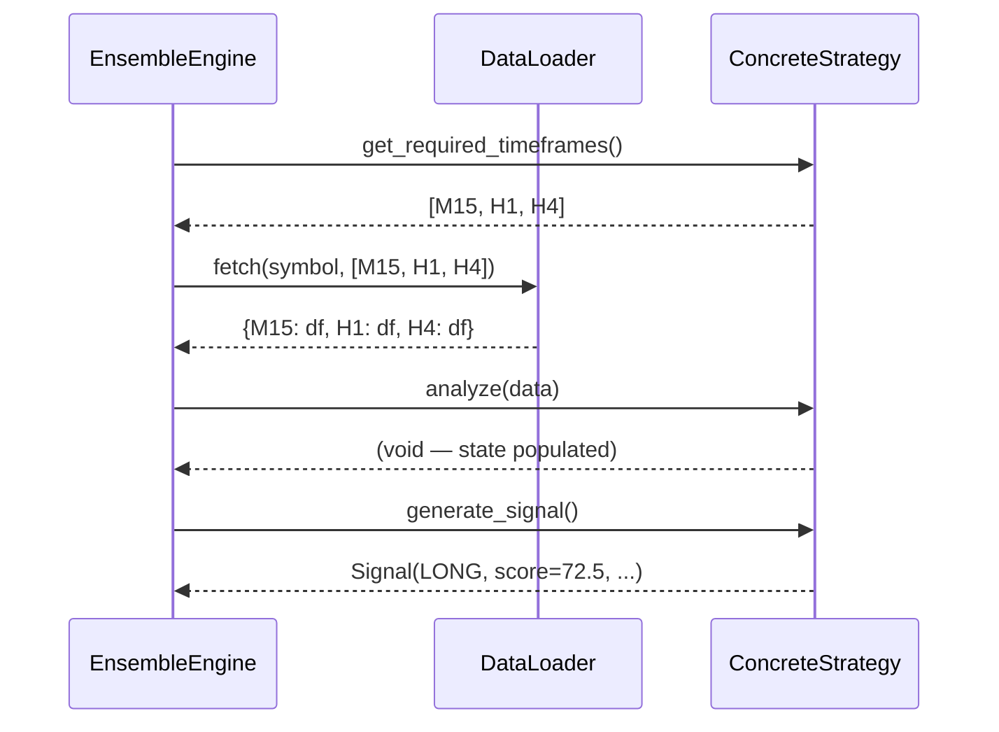
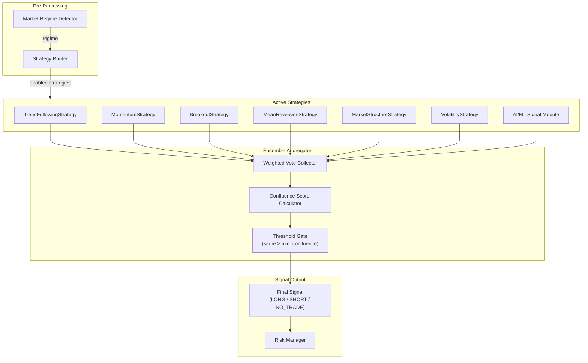
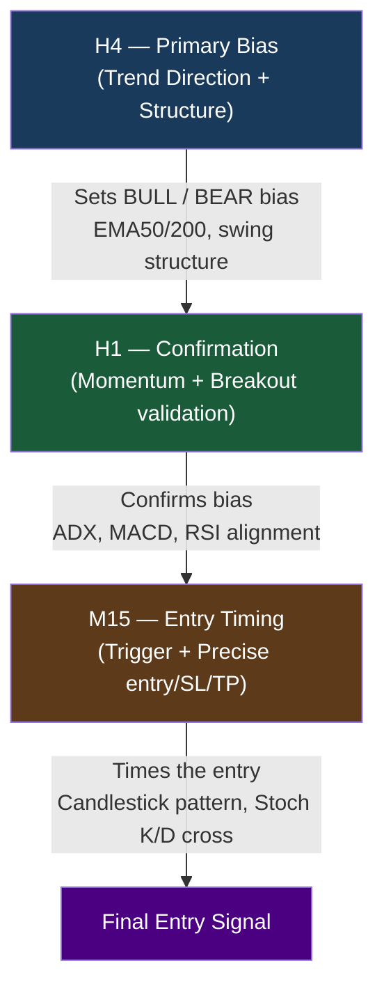
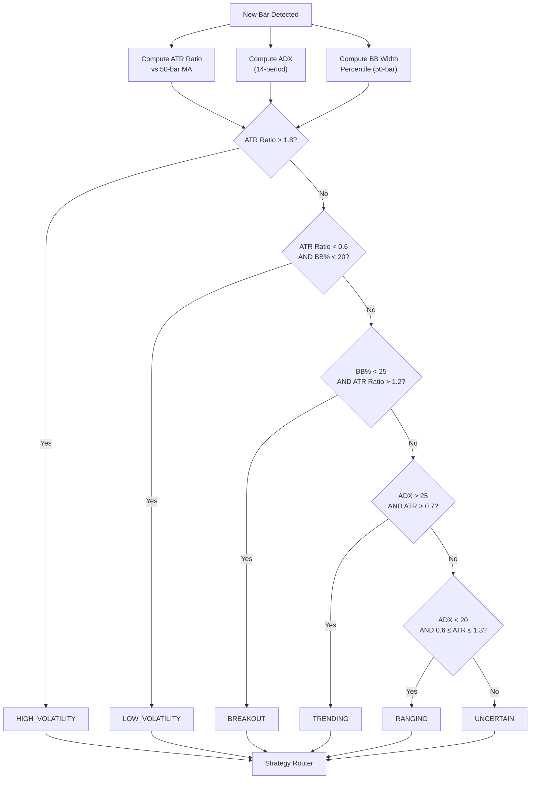
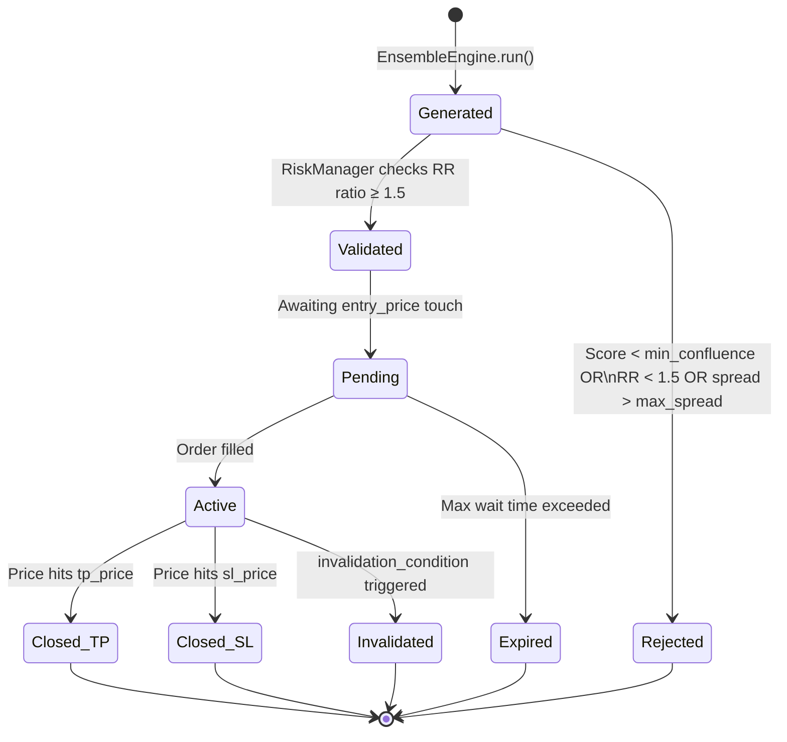

# Trading-Gold: Strategy System Documentation

> **Version:** 1.0.0 | **Last Updated:** 2026-10-08 | **Status:** Production

---

## Table of Contents

1. [Strategy Framework — BaseStrategy](#1-strategy-framework--basestrategy)
2. [Strategy Ensemble & Weighted Voting](#2-strategy-ensemble--weighted-voting)
3. [Confluence Score System](#3-confluence-score-system)
4. [Configurable Weights & Tuning](#4-configurable-weights--tuning)
5. [TrendFollowingStrategy](#5-trendfollowingstrategy)
6. [MomentumStrategy](#6-momentumstrategy)
7. [BreakoutStrategy](#7-breakoutstrategy)
8. [MeanReversionStrategy](#8-meanreversionstrategy)
9. [MarketStructureStrategy](#9-marketstructurestrategy)
10. [VolatilityStrategy](#10-volatilitystrategy)
11. [Multi-Timeframe Analysis Cascade](#11-multi-timeframe-analysis-cascade)
12. [Market Regime Detector](#12-market-regime-detector)
13. [Strategy Routing by Regime](#13-strategy-routing-by-regime)
14. [Signal Schema](#14-signal-schema)
15. [Why NO_TRADE Is a Valid Output](#15-why-no_trade-is-a-valid-output)

---

## 1. Strategy Framework — BaseStrategy

Every strategy in the Trading-Gold system inherits from a single abstract base class: `BaseStrategy`. This enforces a consistent interface across all strategy implementations, enabling the ensemble engine to interact with any strategy through a unified contract, regardless of its internal logic.

### 1.1 Design Philosophy

The `BaseStrategy` pattern follows the **Strategy design pattern** (Gang of Four). Each concrete strategy encapsulates a distinct analytical method while remaining plug-and-play within the ensemble. This separation of concerns ensures:

- Strategies can be independently developed, tested, and deployed
- New strategies can be added without modifying the ensemble engine
- Strategies can be enabled/disabled via configuration at runtime
- Unit testing is straightforward since each strategy is an isolated unit

### 1.2 Abstract Interface

```python
from abc import ABC, abstractmethod
from dataclasses import dataclass, field
from typing import Dict, List, Optional
from enum import Enum
import pandas as pd


class Direction(Enum):
    """Trade direction output from a strategy."""
    LONG      = "LONG"
    SHORT     = "SHORT"
    NO_TRADE  = "NO_TRADE"


class Timeframe(Enum):
    """Supported candle timeframes."""
    M1  = "M1"
    M5  = "M5"
    M15 = "M15"
    M30 = "M30"
    H1  = "H1"
    H4  = "H4"
    D1  = "D1"
    W1  = "W1"


@dataclass
class Signal:
    """Structured output of every strategy analysis."""
    direction:              Direction
    score:                  float                  # 0.0 – 100.0
    reason:                 str                    # Human-readable justification
    invalidation_conditions: List[str]             # Conditions that void the signal
    entry_price:            Optional[float] = None
    sl_price:               Optional[float] = None
    tp_price:               Optional[float] = None
    timeframe:              Optional[Timeframe] = None
    metadata:               Dict               = field(default_factory=dict)


class BaseStrategy(ABC):
    """
    Abstract base class for all Trading-Gold strategies.

    Subclasses MUST implement the four abstract methods below.
    The ensemble engine calls them in the following order:
        1. get_required_timeframes()  — at startup, to pre-fetch OHLCV data
        2. analyze()                  — populate internal state / cache
        3. generate_signal()          — return a Signal dataclass
        4. get_name()                 — for logging, routing, and metrics
    """

    def __init__(self, config: dict) -> None:
        self.config   = config
        self._ready   = False      # set True after analyze() runs successfully
        self._last_signal: Optional[Signal] = None

    # ------------------------------------------------------------------ #
    #  REQUIRED ABSTRACT METHODS                                           #
    # ------------------------------------------------------------------ #

    @abstractmethod
    def get_name(self) -> str:
        """
        Return a unique human-readable identifier for this strategy.

        Example:
            return "TrendFollowingStrategy"
        """
        ...

    @abstractmethod
    def get_required_timeframes(self) -> List[Timeframe]:
        """
        Declare which OHLCV timeframes this strategy needs.

        The data loader uses this list to fetch and cache candle data
        before analyze() is called. Return timeframes in ascending order.

        Example:
            return [Timeframe.M15, Timeframe.H1, Timeframe.H4]
        """
        ...

    @abstractmethod
    def analyze(self, data: Dict[Timeframe, pd.DataFrame]) -> None:
        """
        Pre-compute indicators and internal state from raw OHLCV data.

        Args:
            data: mapping from Timeframe → OHLCV DataFrame.
                  Each DataFrame has columns: open, high, low, close, volume.
                  Indexed by UTC datetime, sorted ascending.

        Side effects:
            Populates self._* internal state used by generate_signal().
            Must set self._ready = True on successful completion.
        """
        ...

    @abstractmethod
    def generate_signal(self) -> Signal:
        """
        Produce a trading signal based on the state set in analyze().

        Must be called AFTER analyze(). Raises RuntimeError if not ready.

        Returns:
            Signal dataclass with direction, score, entry/SL/TP prices,
            invalidation conditions, and human-readable reason.
        """
        ...

    # ------------------------------------------------------------------ #
    #  CONCRETE HELPERS (available to all subclasses)                      #
    # ------------------------------------------------------------------ #

    def _require_ready(self) -> None:
        if not self._ready:
            raise RuntimeError(
                f"{self.get_name()}.analyze() must be called before "
                f"generate_signal()."
            )

    def _no_trade(self, reason: str) -> Signal:
        """Convenience method to return a NO_TRADE signal."""
        return Signal(
            direction=Direction.NO_TRADE,
            score=0.0,
            reason=reason,
            invalidation_conditions=[],
        )
```

### 1.3 Lifecycle Sequence



---

## 2. Strategy Ensemble & Weighted Voting

The ensemble engine aggregates signals from all active strategies into a single **confluence score** using a weighted voting mechanism. No single strategy can dominate the final decision; the system is robust to individual false signals.

### 2.1 Ensemble Architecture



### 2.2 Weighted Voting Algorithm

Each strategy emits a **directional vote** (`LONG=+1`, `SHORT=-1`, `NO_TRADE=0`) and a **confidence score** (0–100). The ensemble computes:

```python
class EnsembleEngine:
    """Aggregates signals from multiple strategies using weighted voting."""

    def __init__(self, strategies: List[BaseStrategy], weights: Dict[str, float]):
        self.strategies = strategies
        self.weights    = weights          # strategy_name → weight (sum = 1.0)

    def run(
        self,
        data: Dict[Timeframe, pd.DataFrame],
        regime: MarketRegime,
        min_confluence: float = 60.0,
    ) -> Signal:
        signals: Dict[str, Signal] = {}

        # 1. Collect signals from active strategies for current regime
        active = self._route_strategies(regime)
        for strategy in active:
            strategy.analyze(data)
            sig = strategy.generate_signal()
            signals[strategy.get_name()] = sig

        # 2. Weighted directional vote
        direction_score = self._weighted_direction(signals)

        # 3. Compute confluence score
        confluence = self._confluence_score(signals, regime)

        # 4. Gate: require minimum confluence
        if confluence < min_confluence:
            return Signal(
                direction=Direction.NO_TRADE,
                score=confluence,
                reason=f"Confluence {confluence:.1f} below threshold {min_confluence}",
                invalidation_conditions=[],
            )

        # 5. Determine final direction
        final_dir = Direction.LONG if direction_score > 0 else Direction.SHORT

        return Signal(
            direction=final_dir,
            score=confluence,
            reason=self._build_reason(signals),
            invalidation_conditions=self._merge_invalidations(signals),
            entry_price=self._best_entry(signals, final_dir),
            sl_price=self._best_sl(signals, final_dir),
            tp_price=self._best_tp(signals, final_dir),
        )

    def _weighted_direction(self, signals: Dict[str, Signal]) -> float:
        total_weight = 0.0
        weighted_sum = 0.0
        for name, sig in signals.items():
            w = self.weights.get(name, 0.0)
            if sig.direction == Direction.LONG:
                vote = +1.0
            elif sig.direction == Direction.SHORT:
                vote = -1.0
            else:
                vote = 0.0
            # Scale vote by strategy's own confidence
            weighted_sum += w * vote * (sig.score / 100.0)
            total_weight  += w
        return weighted_sum / total_weight if total_weight else 0.0
```

---

## 3. Confluence Score System

The confluence score is a **single composite number on a 0–100 scale** that quantifies how strongly the market environment and multiple strategy signals align with a trade hypothesis.

> [!IMPORTANT]
> A signal is only actionable when the confluence score meets or exceeds the configured `min_confluence` threshold (default **60**). The system issues `NO_TRADE` for anything below.

### 3.1 Score Components

| Component | Weight | Description |
|-----------|:------:|-------------|
| **Trend Alignment** | 20% | EMA-based trend direction across timeframes |
| **Momentum** | 15% | RSI, MACD, Stochastic strength and direction |
| **Market Structure** | 20% | BOS/CHoCH, swing highs/lows, HH/LL patterns |
| **Volatility Regime** | 10% | ATR regime fit — is volatility suitable for trade type? |
| **Liquidity / Session** | 10% | Session overlap (London/NY), spread conditions |
| **AI / ML Signal** | 25% | Ensemble ML model probability output |

**Total: 100%**

### 3.2 Score Calculation

```python
@dataclass
class ConfluenceWeights:
    trend_alignment:  float = 0.20
    momentum:         float = 0.15
    market_structure: float = 0.20
    volatility_regime: float = 0.10
    liquidity_session: float = 0.10
    ai_ml_signal:     float = 0.25

    def validate(self) -> None:
        total = (
            self.trend_alignment + self.momentum + self.market_structure
            + self.volatility_regime + self.liquidity_session + self.ai_ml_signal
        )
        assert abs(total - 1.0) < 1e-6, f"Weights must sum to 1.0, got {total}"


class ConfluenceCalculator:
    """
    Computes the composite confluence score from individual component scores.
    Each component score is 0–100 before weighting.
    """

    def __init__(self, weights: ConfluenceWeights):
        self.weights = weights

    def compute(
        self,
        trend_score:      float,  # 0–100
        momentum_score:   float,  # 0–100
        structure_score:  float,  # 0–100
        volatility_score: float,  # 0–100
        session_score:    float,  # 0–100
        ai_score:         float,  # 0–100
    ) -> float:
        w = self.weights
        score = (
            trend_score      * w.trend_alignment   +
            momentum_score   * w.momentum           +
            structure_score  * w.market_structure   +
            volatility_score * w.volatility_regime  +
            session_score    * w.liquidity_session  +
            ai_score         * w.ai_ml_signal
        )
        return round(min(max(score, 0.0), 100.0), 2)
```

### 3.3 Score Interpretation

| Score Range | Interpretation | Action |
|:-----------:|----------------|--------|
| 0 – 39 | Weak / Contradictory signals | `NO_TRADE` |
| 40 – 59 | Marginal alignment | `NO_TRADE` (below threshold) |
| 60 – 74 | Good confluence | Trade with standard sizing |
| 75 – 84 | Strong confluence | Trade with up to 1.25× sizing |
| 85 – 100 | Exceptional confluence | Trade with up to 1.5× sizing (risk-capped) |

---

## 4. Configurable Weights & Tuning

### 4.1 Configuration File

Weights are stored in `config/strategy_weights.yaml` and hot-reloaded at startup without recompilation:

```yaml
# config/strategy_weights.yaml

confluence_weights:
  trend_alignment:   0.20
  momentum:          0.15
  market_structure:  0.20
  volatility_regime: 0.10
  liquidity_session: 0.10
  ai_ml_signal:      0.25

ensemble_strategy_weights:
  TrendFollowingStrategy:   0.20
  MomentumStrategy:         0.15
  BreakoutStrategy:         0.15
  MeanReversionStrategy:    0.10
  MarketStructureStrategy:  0.20
  VolatilityStrategy:       0.10
  AIMLSignalModule:         0.10

thresholds:
  min_confluence:       60.0   # below this → NO_TRADE
  strong_confluence:    75.0   # unlock 1.25× position sizing
  exceptional_confluence: 85.0 # unlock 1.5× position sizing (risk-capped)

regime_overrides:
  TRENDING:
    TrendFollowingStrategy:  0.30
    MomentumStrategy:        0.20
    MarketStructureStrategy: 0.25
    AIMLSignalModule:        0.25
  RANGING:
    MeanReversionStrategy:   0.35
    MomentumStrategy:        0.20
    MarketStructureStrategy: 0.20
    AIMLSignalModule:        0.25
```

### 4.2 Tuning Guidelines

> [!TIP]
> When backtesting over historical data, tune weights using **walk-forward optimization**: optimize on the first 70% of data, validate on the remaining 30%, and avoid re-optimizing on the validation set.

```python
from scipy.optimize import minimize
import numpy as np

def tune_weights_walk_forward(
    backtest_fn,           # callable(weights) -> Sharpe ratio
    n_components: int = 6,
    n_trials: int = 500,
) -> np.ndarray:
    """
    Tune confluence weights via constrained optimization.
    Weights must be positive and sum to 1.0.
    """
    def objective(w):
        return -backtest_fn(w)   # maximize Sharpe → minimize negative Sharpe

    constraints = {"type": "eq", "fun": lambda w: np.sum(w) - 1.0}
    bounds = [(0.05, 0.50)] * n_components   # each weight: 5% – 50%
    x0 = np.ones(n_components) / n_components

    result = minimize(
        objective, x0,
        method="SLSQP",
        bounds=bounds,
        constraints=constraints,
        options={"maxiter": n_trials},
    )
    return result.x
```

**Key tuning principles:**
- Never allow any single component to exceed **50%** — this prevents over-reliance on one signal
- The AI/ML weight should be decreased when operating on unseen market regimes (distribution shift)
- Validate weight changes with **at least 200 trades** in backtest before deploying
- Use **regime-specific weight overrides** (see `regime_overrides` above) for fine-grained control

---

## 5. TrendFollowingStrategy

The `TrendFollowingStrategy` identifies sustained directional moves in XAUUSD using exponential moving average crossovers filtered by trend strength and confirmed across multiple timeframes.

### 5.1 Indicators Used

| Indicator | Parameter | Purpose |
|-----------|-----------|---------|
| EMA Fast | Period = 50 | Short-term trend proxy |
| EMA Slow | Period = 200 | Long-term trend proxy |
| ADX | Period = 14 | Trend strength filter |
| Higher High / Lower Low | 5-bar lookback | Structural trend confirmation |

### 5.2 Signal Logic

```python
class TrendFollowingStrategy(BaseStrategy):

    def get_name(self) -> str:
        return "TrendFollowingStrategy"

    def get_required_timeframes(self) -> List[Timeframe]:
        return [Timeframe.M15, Timeframe.H1, Timeframe.H4]

    def analyze(self, data: Dict[Timeframe, pd.DataFrame]) -> None:
        for tf in self.get_required_timeframes():
            df = data[tf].copy()
            df["ema50"]  = df["close"].ewm(span=50,  adjust=False).mean()
            df["ema200"] = df["close"].ewm(span=200, adjust=False).mean()
            df["adx"]    = self._compute_adx(df, period=14)
            df["hh"]     = self._is_higher_high(df, lookback=5)
            df["ll"]     = self._is_lower_low(df, lookback=5)
            self._frames[tf] = df
        self._ready = True

    def generate_signal(self) -> Signal:
        self._require_ready()

        h4 = self._frames[Timeframe.H4].iloc[-1]
        h1 = self._frames[Timeframe.H1].iloc[-1]
        m15 = self._frames[Timeframe.M15].iloc[-1]

        # --- H4 bias (primary trend) ---
        h4_bull = h4["ema50"] > h4["ema200"]
        h4_bear = h4["ema50"] < h4["ema200"]

        # --- H1 confirmation ---
        h1_bull = h1["ema50"] > h1["ema200"]
        h1_bear = h1["ema50"] < h1["ema200"]

        # --- ADX filter: trend must be strong ---
        trend_strong = m15["adx"] > self.config.get("adx_threshold", 25)

        # --- Higher-High / Lower-Low structural check ---
        structure_bull = m15["hh"]
        structure_bear = m15["ll"]

        if h4_bull and h1_bull and trend_strong and structure_bull:
            score = self._score_long(h4, h1, m15)
            return Signal(
                direction=Direction.LONG,
                score=score,
                reason=(
                    f"H4 EMA50>{h4['ema50']:.2f}>EMA200, "
                    f"H1 aligned, ADX={m15['adx']:.1f}>25, HH confirmed"
                ),
                invalidation_conditions=[
                    "EMA50 crosses below EMA200 on H1",
                    "ADX drops below 20",
                    "Price closes below recent swing low",
                ],
                timeframe=Timeframe.H4,
            )

        if h4_bear and h1_bear and trend_strong and structure_bear:
            score = self._score_short(h4, h1, m15)
            return Signal(
                direction=Direction.SHORT,
                score=score,
                reason=(
                    f"H4 EMA50<{h4['ema50']:.2f}<EMA200, "
                    f"H1 aligned, ADX={m15['adx']:.1f}>25, LL confirmed"
                ),
                invalidation_conditions=[
                    "EMA50 crosses above EMA200 on H1",
                    "ADX drops below 20",
                    "Price closes above recent swing high",
                ],
                timeframe=Timeframe.H4,
            )

        return self._no_trade(
            reason=f"No EMA crossover alignment across H4/H1/M15 "
                   f"(ADX={m15['adx']:.1f})"
        )
```

### 5.3 Multi-Timeframe Trend Confirmation Matrix

| H4 Bias | H1 Confirmation | M15 ADX | HH/LL Structure | Signal |
|:-------:|:---------------:|:-------:|:---------------:|:------:|
| Bull | Bull | > 25 | HH | LONG ✅ |
| Bull | Bull | < 25 | Any | NO_TRADE ⛔ |
| Bull | Bear | Any | Any | NO_TRADE ⛔ |
| Bear | Bear | > 25 | LL | SHORT ✅ |
| Bear | Bear | < 25 | Any | NO_TRADE ⛔ |
| Bear | Bull | Any | Any | NO_TRADE ⛔ |

---

## 6. MomentumStrategy

The `MomentumStrategy` captures momentum extremes and directional shifts using three complementary oscillators.

### 6.1 Indicators Used

| Indicator | Parameters | Signal Role |
|-----------|------------|-------------|
| RSI | Period = 14 | Overbought / oversold zones |
| MACD | 12 / 26 / 9 | Histogram direction & crossover |
| Stochastic | K=14, D=3, Smooth=3 | K/D crossover confirmation |

### 6.2 Signal Logic

```python
class MomentumStrategy(BaseStrategy):

    RSI_OVERSOLD   = 30
    RSI_OVERBOUGHT = 70

    def get_name(self) -> str:
        return "MomentumStrategy"

    def get_required_timeframes(self) -> List[Timeframe]:
        return [Timeframe.H1, Timeframe.M15]

    def analyze(self, data: Dict[Timeframe, pd.DataFrame]) -> None:
        for tf in [Timeframe.H1, Timeframe.M15]:
            df = data[tf].copy()
            df["rsi"]          = self._rsi(df["close"], period=14)
            df["macd_hist"]    = self._macd_histogram(df["close"], 12, 26, 9)
            df["stoch_k"], df["stoch_d"] = self._stochastic(df, k=14, d=3, smooth=3)
            self._frames[tf] = df
        self._ready = True

    def generate_signal(self) -> Signal:
        self._require_ready()
        h1  = self._frames[Timeframe.H1].iloc[-1]
        m15 = self._frames[Timeframe.M15].iloc[-1]
        prev_m15 = self._frames[Timeframe.M15].iloc[-2]

        rsi          = m15["rsi"]
        macd_rising  = m15["macd_hist"] > prev_m15["macd_hist"]
        macd_falling = m15["macd_hist"] < prev_m15["macd_hist"]
        stoch_cross_up   = (prev_m15["stoch_k"] < prev_m15["stoch_d"] and
                            m15["stoch_k"] > m15["stoch_d"])
        stoch_cross_down = (prev_m15["stoch_k"] > prev_m15["stoch_d"] and
                            m15["stoch_k"] < m15["stoch_d"])

        # LONG: oversold RSI + MACD turning up + Stoch bullish cross
        if rsi < self.RSI_OVERSOLD and macd_rising and stoch_cross_up:
            score = self._compute_score(rsi, m15["macd_hist"], m15["stoch_k"], "LONG")
            return Signal(
                direction=Direction.LONG,
                score=score,
                reason=(
                    f"RSI={rsi:.1f}<30 (oversold), MACD histogram rising, "
                    f"Stoch K/D bullish crossover"
                ),
                invalidation_conditions=[
                    "RSI moves back above 40 without price follow-through",
                    "MACD histogram reverses below zero",
                ],
                timeframe=Timeframe.M15,
            )

        # SHORT: overbought RSI + MACD turning down + Stoch bearish cross
        if rsi > self.RSI_OVERBOUGHT and macd_falling and stoch_cross_down:
            score = self._compute_score(rsi, m15["macd_hist"], m15["stoch_k"], "SHORT")
            return Signal(
                direction=Direction.SHORT,
                score=score,
                reason=(
                    f"RSI={rsi:.1f}>70 (overbought), MACD histogram falling, "
                    f"Stoch K/D bearish crossover"
                ),
                invalidation_conditions=[
                    "RSI moves back below 60 without price follow-through",
                    "MACD histogram reverses above zero",
                ],
                timeframe=Timeframe.M15,
            )

        return self._no_trade(
            f"No momentum extreme: RSI={rsi:.1f}, "
            f"MACD hist={m15['macd_hist']:.4f}"
        )
```

### 6.3 Momentum Scoring Grid

| RSI Zone | MACD Direction | Stochastic | Long Score | Short Score |
|:--------:|:--------------:|:----------:|:----------:|:-----------:|
| < 25 (extreme oversold) | Rising | K > D crossover | 90–100 | — |
| 25–30 (oversold) | Rising | K > D crossover | 70–89 | — |
| 70–75 (overbought) | Falling | K < D crossover | — | 70–89 |
| > 75 (extreme overbought) | Falling | K < D crossover | — | 90–100 |
| Neutral (30–70) | Any | Any | 0 | 0 |

---

## 7. BreakoutStrategy

The `BreakoutStrategy` identifies price breakouts from consolidation ranges, confirmed by expanding volatility (ATR) and Keltner Channel breaches.

### 7.1 Indicators Used

| Indicator | Parameters | Role |
|-----------|------------|------|
| 20-Bar High/Low | Rolling 20 bars | Consolidation boundary |
| ATR | Period = 14 | Volatility expansion filter |
| Keltner Channel | EMA=20, ATR mult=2.0 | Breakout boundary confirmation |

### 7.2 Signal Logic

```python
class BreakoutStrategy(BaseStrategy):

    def get_name(self) -> str:
        return "BreakoutStrategy"

    def get_required_timeframes(self) -> List[Timeframe]:
        return [Timeframe.H1, Timeframe.M15]

    def analyze(self, data: Dict[Timeframe, pd.DataFrame]) -> None:
        df = data[Timeframe.H1].copy()
        df["roll_high"] = df["high"].rolling(20).max()
        df["roll_low"]  = df["low"].rolling(20).min()
        df["atr"]       = self._atr(df, period=14)
        df["atr_sma"]   = df["atr"].rolling(20).mean()
        df["atr_expanding"] = df["atr"] > df["atr_sma"]

        # Keltner Channel
        df["kc_mid"]   = df["close"].ewm(span=20, adjust=False).mean()
        df["kc_upper"] = df["kc_mid"] + 2.0 * df["atr"]
        df["kc_lower"] = df["kc_mid"] - 2.0 * df["atr"]

        self._h1 = df
        self._ready = True

    def generate_signal(self) -> Signal:
        self._require_ready()
        bar  = self._h1.iloc[-1]
        prev = self._h1.iloc[-2]

        # Upside breakout
        if (bar["close"] > prev["roll_high"] and
                bar["atr_expanding"] and
                bar["close"] > bar["kc_upper"]):
            score = self._breakout_score(bar, direction="UP")
            return Signal(
                direction=Direction.LONG,
                score=score,
                reason=(
                    f"Price {bar['close']:.2f} broke 20-bar high {prev['roll_high']:.2f}, "
                    f"ATR expanding, above KC upper {bar['kc_upper']:.2f}"
                ),
                invalidation_conditions=[
                    "Price closes back inside Keltner Channel",
                    "ATR contracts to below 20-bar average",
                    "False break: next candle closes below breakout level",
                ],
                entry_price=bar["close"],
                sl_price=bar["kc_mid"],          # reversion to KC midline = invalidation
                tp_price=bar["close"] + 2.0 * bar["atr"],
                timeframe=Timeframe.H1,
            )

        # Downside breakout
        if (bar["close"] < prev["roll_low"] and
                bar["atr_expanding"] and
                bar["close"] < bar["kc_lower"]):
            score = self._breakout_score(bar, direction="DOWN")
            return Signal(
                direction=Direction.SHORT,
                score=score,
                reason=(
                    f"Price {bar['close']:.2f} broke 20-bar low {prev['roll_low']:.2f}, "
                    f"ATR expanding, below KC lower {bar['kc_lower']:.2f}"
                ),
                invalidation_conditions=[
                    "Price closes back inside Keltner Channel",
                    "ATR contracts to below 20-bar average",
                    "False break: next candle closes above breakdown level",
                ],
                entry_price=bar["close"],
                sl_price=bar["kc_mid"],
                tp_price=bar["close"] - 2.0 * bar["atr"],
                timeframe=Timeframe.H1,
            )

        return self._no_trade("No confirmed breakout from 20-bar range")
```

---

## 8. MeanReversionStrategy

The `MeanReversionStrategy` exploits statistically extreme price dislocations during **low-volatility, ranging regimes**. It is automatically disabled by the regime router when volatility is high.

> [!WARNING]
> This strategy **must not be activated** in trending or high-volatility regimes. The regime router enforces this, but the strategy also performs an internal volatility check as a secondary safeguard.

### 8.1 Indicators Used

| Indicator | Parameters | Role |
|-----------|------------|------|
| Bollinger Bands | Period=20, StdDev=2.0 | Squeeze detection + band touch |
| RSI | Period = 14 | Extreme reading confirmation |
| EMA 200 | Period = 200 | Distance-from-mean measure |
| ATR | Period = 14 | Regime validation |

### 8.2 Signal Logic

```python
class MeanReversionStrategy(BaseStrategy):

    def get_name(self) -> str:
        return "MeanReversionStrategy"

    def get_required_timeframes(self) -> List[Timeframe]:
        return [Timeframe.H1, Timeframe.M15]

    def analyze(self, data: Dict[Timeframe, pd.DataFrame]) -> None:
        df = data[Timeframe.H1].copy()

        # Bollinger Bands
        df["bb_mid"]   = df["close"].rolling(20).mean()
        df["bb_std"]   = df["close"].rolling(20).std()
        df["bb_upper"] = df["bb_mid"] + 2.0 * df["bb_std"]
        df["bb_lower"] = df["bb_mid"] - 2.0 * df["bb_std"]
        df["bb_width"] = (df["bb_upper"] - df["bb_lower"]) / df["bb_mid"]

        # Squeeze: BB width < 20-bar percentile of itself
        df["bb_squeeze"] = df["bb_width"] < df["bb_width"].rolling(20).quantile(0.20)

        df["ema200"] = df["close"].ewm(span=200, adjust=False).mean()
        df["rsi"]    = self._rsi(df["close"], period=14)
        df["atr"]    = self._atr(df, period=14)
        df["atr_pct"] = df["atr"] / df["close"] * 100

        self._h1    = df
        self._ready = True

    def generate_signal(self) -> Signal:
        self._require_ready()
        bar = self._h1.iloc[-1]

        # Internal volatility guard — reject in high-vol environments
        if bar["atr_pct"] > self.config.get("max_atr_pct", 0.8):
            return self._no_trade(
                f"ATR% {bar['atr_pct']:.2f}% exceeds max {0.8}% — "
                f"regime not suitable for mean reversion"
            )

        distance_from_ema = (bar["close"] - bar["ema200"]) / bar["ema200"] * 100
        at_upper = bar["close"] >= bar["bb_upper"]
        at_lower = bar["close"] <= bar["bb_lower"]
        squeeze   = bar["bb_squeeze"]

        # Revert from upper band: overbought + squeeze expanding
        if at_upper and bar["rsi"] > 68 and not squeeze:
            score = self._reversion_score(bar, "SHORT")
            return Signal(
                direction=Direction.SHORT,
                score=score,
                reason=(
                    f"Price touching BB upper {bar['bb_upper']:.2f}, "
                    f"RSI={bar['rsi']:.1f}>68, "
                    f"distance from EMA200: {distance_from_ema:+.2f}%"
                ),
                invalidation_conditions=[
                    "Price closes above BB upper by more than 0.5 ATR",
                    "RSI continues above 75 on next bar",
                ],
                entry_price=bar["close"],
                sl_price=bar["bb_upper"] + 0.5 * bar["atr"],
                tp_price=bar["bb_mid"],
                timeframe=Timeframe.H1,
            )

        # Revert from lower band: oversold + squeeze expanding
        if at_lower and bar["rsi"] < 32 and not squeeze:
            score = self._reversion_score(bar, "LONG")
            return Signal(
                direction=Direction.LONG,
                score=score,
                reason=(
                    f"Price touching BB lower {bar['bb_lower']:.2f}, "
                    f"RSI={bar['rsi']:.1f}<32, "
                    f"distance from EMA200: {distance_from_ema:+.2f}%"
                ),
                invalidation_conditions=[
                    "Price closes below BB lower by more than 0.5 ATR",
                    "RSI continues below 25 on next bar",
                ],
                entry_price=bar["close"],
                sl_price=bar["bb_lower"] - 0.5 * bar["atr"],
                tp_price=bar["bb_mid"],
                timeframe=Timeframe.H1,
            )

        return self._no_trade(
            f"No BB extreme touch — Upper:{bar['bb_upper']:.2f} "
            f"Lower:{bar['bb_lower']:.2f} Price:{bar['close']:.2f}"
        )
```

---

## 9. MarketStructureStrategy

The `MarketStructureStrategy` implements Smart Money Concepts (SMC) — it detects key structural events including **Break of Structure (BOS)** and **Change of Character (CHoCH)**, and identifies **premium/discount zones** relative to the current range.

### 9.1 Core Concepts

| Concept | Definition |
|---------|------------|
| **Swing High** | A bar whose high is greater than the N bars on each side |
| **Swing Low** | A bar whose low is less than the N bars on each side |
| **BOS (Break of Structure)** | Price closes beyond a previous significant swing high/low in the direction of the trend |
| **CHoCH (Change of Character)** | Price breaks the *opposite* structural level — signals potential trend reversal |
| **Premium Zone** | Upper 50% of the current swing range — unfavourable for longs |
| **Discount Zone** | Lower 50% of the current swing range — unfavourable for shorts |

### 9.2 Swing Detection Algorithm

```python
def detect_swings(
    df: pd.DataFrame,
    swing_length: int = 5,
) -> pd.DataFrame:
    """
    Detect swing highs and lows using a pivot-point algorithm.

    A swing high at index i: high[i] == max(high[i-n : i+n+1])
    A swing low  at index i: low[i]  == min(low[i-n  : i+n+1])

    Args:
        df:           OHLCV DataFrame indexed by datetime.
        swing_length: Number of bars on each side that must be lower/higher.

    Returns:
        DataFrame with added columns:
            - is_swing_high: bool
            - is_swing_low:  bool
    """
    n = swing_length
    df = df.copy()
    df["is_swing_high"] = False
    df["is_swing_low"]  = False

    for i in range(n, len(df) - n):
        window_high = df["high"].iloc[i - n : i + n + 1]
        window_low  = df["low"].iloc[i - n : i + n + 1]

        if df["high"].iloc[i] == window_high.max():
            df.iloc[i, df.columns.get_loc("is_swing_high")] = True

        if df["low"].iloc[i] == window_low.min():
            df.iloc[i, df.columns.get_loc("is_swing_low")] = True

    return df


def detect_bos_choch(
    df: pd.DataFrame,
    swings: pd.DataFrame,
) -> List[Dict]:
    """
    Detect Break of Structure (BOS) and Change of Character (CHoCH).

    BOS:   continuation — price breaks beyond a swing in the current trend direction.
    CHoCH: reversal     — price breaks against the current trend's structural level.
    """
    events = []
    prev_bias = None   # "BULL" or "BEAR"

    swing_highs = swings[swings["is_swing_high"]]["high"]
    swing_lows  = swings[swings["is_swing_low"]]["low"]

    for i in range(1, len(df)):
        close = df["close"].iloc[i]

        # Check for upside BOS (bullish trend continuing)
        relevant_highs = swing_highs[swing_highs.index < df.index[i]]
        if len(relevant_highs) > 0:
            last_sh = relevant_highs.iloc[-1]
            if close > last_sh:
                event_type = "BOS" if prev_bias == "BULL" else "CHoCH"
                events.append({
                    "index":     df.index[i],
                    "type":      event_type,
                    "direction": "BULL",
                    "level":     last_sh,
                    "close":     close,
                })
                prev_bias = "BULL"

        # Check for downside BOS (bearish trend continuing)
        relevant_lows = swing_lows[swing_lows.index < df.index[i]]
        if len(relevant_lows) > 0:
            last_sl = relevant_lows.iloc[-1]
            if close < last_sl:
                event_type = "BOS" if prev_bias == "BEAR" else "CHoCH"
                events.append({
                    "index":     df.index[i],
                    "type":      event_type,
                    "direction": "BEAR",
                    "level":     last_sl,
                    "close":     close,
                })
                prev_bias = "BEAR"

    return events
```

### 9.3 Premium / Discount Zone Logic

```python
def classify_price_zone(
    price:      float,
    swing_high: float,
    swing_low:  float,
) -> str:
    """
    Classify current price relative to the active swing range.

    Returns:
        'PREMIUM'  — upper 50% of range (seek shorts)
        'DISCOUNT' — lower 50% of range (seek longs)
        'EQUILIBRIUM' — within ±10% of midpoint
    """
    range_size = swing_high - swing_low
    midpoint   = swing_low + range_size / 2
    eq_band    = range_size * 0.10

    if price > midpoint + eq_band:
        return "PREMIUM"
    elif price < midpoint - eq_band:
        return "DISCOUNT"
    return "EQUILIBRIUM"
```

### 9.4 Signal Generation

The `MarketStructureStrategy` emits signals based on:
1. Recent **BOS** → trade continuation in BOS direction, only if price is in discount (for longs) or premium (for shorts)
2. Recent **CHoCH** → potential reversal, reduced score until confirmed on next timeframe
3. Confluence of swing structure and premium/discount zone

---

## 10. VolatilityStrategy

The `VolatilityStrategy` doesn't primarily predict direction. Instead, it characterises the current **volatility regime** and emits signals only when volatility conditions are suitable for a specific trade type.

### 10.1 ATR Regime Classification

```python
class VolatilityRegime(Enum):
    LOW_VOLATILITY   = "LOW_VOLATILITY"
    NORMAL           = "NORMAL"
    HIGH_VOLATILITY  = "HIGH_VOLATILITY"
    EXPANSION        = "EXPANSION"     # ATR rapidly increasing
    CONTRACTION      = "CONTRACTION"   # ATR rapidly decreasing


class VolatilityStrategy(BaseStrategy):

    def get_name(self) -> str:
        return "VolatilityStrategy"

    def get_required_timeframes(self) -> List[Timeframe]:
        return [Timeframe.H4, Timeframe.H1]

    def analyze(self, data: Dict[Timeframe, pd.DataFrame]) -> None:
        df = data[Timeframe.H1].copy()
        df["atr"]       = self._atr(df, period=14)
        df["atr_pct"]   = df["atr"] / df["close"] * 100
        df["atr_50ma"]  = df["atr"].rolling(50).mean()
        df["atr_ratio"] = df["atr"] / df["atr_50ma"]

        last = df.iloc[-1]
        ratio = last["atr_ratio"]

        if ratio < 0.6:
            regime = VolatilityRegime.LOW_VOLATILITY
        elif ratio > 1.8:
            regime = VolatilityRegime.HIGH_VOLATILITY
        else:
            regime = VolatilityRegime.NORMAL

        # Detect expansion vs contraction
        prev_ratio = df["atr_ratio"].iloc[-5:].mean()
        if ratio > prev_ratio * 1.20:
            regime = VolatilityRegime.EXPANSION
        elif ratio < prev_ratio * 0.80:
            regime = VolatilityRegime.CONTRACTION

        self._current_regime = regime
        self._df = df
        self._ready = True

    def generate_signal(self) -> Signal:
        self._require_ready()
        bar    = self._df.iloc[-1]
        regime = self._current_regime

        # Spread check: ATR must be large enough relative to spread
        atr_pct = bar["atr_pct"]
        spread_ok = atr_pct > self.config.get("min_atr_pct", 0.15)

        score = self._volatility_score(regime, spread_ok)

        return Signal(
            direction=Direction.NO_TRADE,   # Volatility strategy informs, not directs
            score=score,
            reason=f"Volatility regime: {regime.value}, ATR%={atr_pct:.3f}%",
            invalidation_conditions=[],
            metadata={
                "regime":   regime.value,
                "atr_pct":  atr_pct,
                "spread_ok": spread_ok,
            },
        )
```

### 10.2 Volatility Regime Thresholds

| ATR Ratio (vs 50-bar MA) | Regime | Mean Reversion | Trend Following | Breakout |
|:------------------------:|--------|:--------------:|:---------------:|:--------:|
| < 0.60 | LOW_VOLATILITY | ✅ Enabled | ⛔ Disabled | ⛔ Disabled |
| 0.60 – 1.20 | NORMAL | ✅ Enabled | ✅ Enabled | ⚠️ Reduced weight |
| 1.20 – 1.80 | HIGH_VOLATILITY | ⛔ Disabled | ✅ Enabled | ✅ Enabled |
| > 1.80 | EXTREME | ⛔ Disabled | ⚠️ Reduced weight | ✅ Enabled |
| Rising > 20% | EXPANSION | ⛔ Disabled | ⚠️ Reduced weight | ✅ Enabled |
| Falling > 20% | CONTRACTION | ✅ Enabled | ⛔ Disabled | ⛔ Disabled |

---

## 11. Multi-Timeframe Analysis Cascade

The system uses a **three-tier cascading approach**: higher timeframes set the directional bias and structural context, while lower timeframes provide precise timing.



### 11.1 H4 — Setting the Bias

The H4 timeframe is the **source of truth for trend direction**:
- EMA50/EMA200 relationship establishes the macro directional bias
- Market structure (swing highs/lows, BOS/CHoCH) defines the dominant order flow
- A **bullish H4 bias** is required before any long trades are considered
- A **bearish H4 bias** is required before any short trades are considered

> [!IMPORTANT]
> If H4 bias is NEUTRAL or UNCERTAIN, the system defaults to `NO_TRADE` regardless of lower timeframe signals. Never trade against the H4 structural bias.

### 11.2 H1 — Confirmation Layer

H1 must **confirm** the H4 bias before a trade can be activated:
- EMA trend direction must align with H4
- ADX > 25 required in trending strategies
- MACD histogram must be pointing in the trade direction
- RSI must not be in an extreme zone opposing the trade

### 11.3 M15 — Entry Timing

M15 provides the precise **entry trigger**:
- Candlestick patterns (pin bars, engulfing, inside bars) near key levels
- Stochastic K/D crossover in the trade direction
- Price action near support/resistance or Keltner Channel levels
- **SL and TP prices are calculated from M15 structure** (below/above swing lows/highs)

### 11.4 Cascade Timing Table

| Phase | Timeframe | Analysis | Output |
|-------|-----------|----------|--------|
| Bias Setting | H4 | EMA crossover, swing structure, BOS/CHoCH | BULL / BEAR / NEUTRAL |
| Confirmation | H1 | ADX, MACD, RSI, trend alignment | CONFIRMED / UNCONFIRMED |
| Entry Trigger | M15 | Candlestick, Stoch, price action near level | ENTRY / WAIT |

---

## 12. Market Regime Detector

The regime detector classifies the current market environment before any strategy is activated. Strategy routing is determined entirely by the detected regime.

### 12.1 Regime Definitions

```python
class MarketRegime(Enum):
    TRENDING        = "TRENDING"          # Strong directional move, ADX > 25
    RANGING         = "RANGING"           # Oscillating within a band, ADX < 20
    HIGH_VOLATILITY = "HIGH_VOLATILITY"   # ATR ratio > 1.8, large swings
    LOW_VOLATILITY  = "LOW_VOLATILITY"    # ATR ratio < 0.6, tight range
    BREAKOUT        = "BREAKOUT"          # Price expanding from consolidation
    UNCERTAIN       = "UNCERTAIN"         # Mixed signals, no clear regime
```

### 12.2 Detection Algorithm

```python
class MarketRegimeDetector:
    """
    Classifies current market regime using multi-factor analysis.

    Decision tree:
        1. Compute ATR ratio vs 50-bar MA → Volatility level
        2. Compute ADX → Trend strength
        3. Compute BB width percentile → Range tightness
        4. Apply decision rules to classify regime
    """

    def detect(self, df: pd.DataFrame) -> MarketRegime:
        bar       = df.iloc[-1]
        adx       = bar["adx"]
        atr_ratio = bar["atr"] / df["atr"].rolling(50).mean().iloc[-1]
        bb_pct    = self._bb_width_percentile(df, lookback=50)
        atr_pct   = bar["atr"] / bar["close"] * 100

        # --- Regime Classification Tree ---

        # 1. Extreme volatility → HIGH_VOLATILITY
        if atr_ratio > 1.8:
            return MarketRegime.HIGH_VOLATILITY

        # 2. Very low volatility → LOW_VOLATILITY
        if atr_ratio < 0.6 and bb_pct < 20:
            return MarketRegime.LOW_VOLATILITY

        # 3. Breakout: price near BB width expansion from low percentile
        if bb_pct < 25 and atr_ratio > 1.2:
            return MarketRegime.BREAKOUT

        # 4. Strong trend: ADX above threshold
        if adx > 25 and atr_ratio > 0.7:
            return MarketRegime.TRENDING

        # 5. Ranging: low ADX, normal ATR
        if adx < 20 and 0.6 <= atr_ratio <= 1.3:
            return MarketRegime.RANGING

        # 6. Default: uncertain
        return MarketRegime.UNCERTAIN
```

### 12.3 Regime Detection Flow



---

## 13. Strategy Routing by Regime

The strategy router activates only the strategies appropriate for the current regime, with adjusted weights. This prevents, for example, a mean-reversion strategy from trading during a strong trend.

### 13.1 Routing Table

| Regime | TrendFollowing | Momentum | Breakout | MeanReversion | MarketStructure | Volatility | AI/ML |
|--------|:--------------:|:--------:|:--------:|:-------------:|:---------------:|:----------:|:-----:|
| **TRENDING** | ✅ High (30%) | ✅ Med (15%) | ⚠️ Low (5%) | ❌ Off | ✅ High (25%) | ✅ Med (10%) | ✅ High (15%) |
| **RANGING** | ❌ Off | ✅ Med (15%) | ❌ Off | ✅ High (35%) | ✅ Med (20%) | ✅ Low (5%) | ✅ Med (25%) |
| **HIGH_VOLATILITY** | ⚠️ Low (10%) | ⚠️ Low (10%) | ✅ High (25%) | ❌ Off | ✅ Med (20%) | ✅ High (20%) | ✅ Med (15%) |
| **LOW_VOLATILITY** | ❌ Off | ✅ Low (10%) | ❌ Off | ✅ High (40%) | ✅ Med (20%) | ✅ Low (5%) | ✅ Med (25%) |
| **BREAKOUT** | ⚠️ Low (10%) | ✅ Med (15%) | ✅ High (35%) | ❌ Off | ✅ Med (20%) | ✅ Med (10%) | ✅ Med (10%) |
| **UNCERTAIN** | ❌ Off | ❌ Off | ❌ Off | ❌ Off | ⚠️ Low (30%) | ✅ Low (20%) | ✅ High (50%) |

> [!NOTE]
> **UNCERTAIN regime** heavily weights the AI/ML signal and market structure analysis — these are the most regime-agnostic signals available. All other strategies are silenced to avoid conflicting noise.

### 13.2 Routing Implementation

```python
class StrategyRouter:
    """Routes strategy execution and weight assignment based on detected regime."""

    ROUTING_TABLE: Dict[MarketRegime, Dict[str, float]] = {
        MarketRegime.TRENDING: {
            "TrendFollowingStrategy":  0.30,
            "MomentumStrategy":        0.15,
            "BreakoutStrategy":        0.05,
            "MarketStructureStrategy": 0.25,
            "VolatilityStrategy":      0.10,
            "AIMLSignalModule":        0.15,
        },
        MarketRegime.RANGING: {
            "MomentumStrategy":        0.15,
            "MeanReversionStrategy":   0.35,
            "MarketStructureStrategy": 0.20,
            "VolatilityStrategy":      0.05,
            "AIMLSignalModule":        0.25,
        },
        MarketRegime.HIGH_VOLATILITY: {
            "TrendFollowingStrategy":  0.10,
            "MomentumStrategy":        0.10,
            "BreakoutStrategy":        0.25,
            "MarketStructureStrategy": 0.20,
            "VolatilityStrategy":      0.20,
            "AIMLSignalModule":        0.15,
        },
        MarketRegime.LOW_VOLATILITY: {
            "MomentumStrategy":        0.10,
            "MeanReversionStrategy":   0.40,
            "MarketStructureStrategy": 0.20,
            "VolatilityStrategy":      0.05,
            "AIMLSignalModule":        0.25,
        },
        MarketRegime.BREAKOUT: {
            "TrendFollowingStrategy":  0.10,
            "MomentumStrategy":        0.15,
            "BreakoutStrategy":        0.35,
            "MarketStructureStrategy": 0.20,
            "VolatilityStrategy":      0.10,
            "AIMLSignalModule":        0.10,
        },
        MarketRegime.UNCERTAIN: {
            "MarketStructureStrategy": 0.30,
            "VolatilityStrategy":      0.20,
            "AIMLSignalModule":        0.50,
        },
    }

    def route(
        self,
        all_strategies: List[BaseStrategy],
        regime: MarketRegime,
    ) -> Tuple[List[BaseStrategy], Dict[str, float]]:
        """
        Return the active strategies and their weights for the current regime.
        """
        weight_map = self.ROUTING_TABLE[regime]
        active = [s for s in all_strategies if s.get_name() in weight_map]
        return active, weight_map
```

---

## 14. Signal Schema

Every strategy — and the ensemble engine — produces signals conforming to the `Signal` dataclass schema. This contract ensures consistent downstream handling by the risk manager and order executor.

### 14.1 Full Schema

```python
@dataclass
class Signal:
    # ── Core fields (always present) ────────────────────────────────────
    direction:   Direction      # LONG | SHORT | NO_TRADE
    score:       float          # 0.0 – 100.0  (confluence strength)
    reason:      str            # Human-readable explanation of the signal
    invalidation_conditions: List[str]   # Conditions that void this signal

    # ── Optional price fields (present when direction != NO_TRADE) ───────
    entry_price: Optional[float] = None  # Recommended entry price
    sl_price:    Optional[float] = None  # Stop-loss price
    tp_price:    Optional[float] = None  # Take-profit price (primary target)
    timeframe:   Optional[Timeframe] = None  # Timeframe that triggered entry

    # ── Extended metadata ────────────────────────────────────────────────
    metadata:    Dict = field(default_factory=dict)
    # metadata may contain:
    #   "regime":         str        — market regime at signal time
    #   "atr":            float      — current ATR value
    #   "rr_ratio":       float      — risk/reward ratio (TP-entry)/(entry-SL)
    #   "component_scores": Dict     — individual confluence component scores
    #   "strategy_votes": Dict       — per-strategy direction and score
    #   "session":        str        — "LONDON" | "NEW_YORK" | "ASIAN" | "OVERLAP"
    #   "spread_pips":    float      — spread at signal generation time
```

### 14.2 Signal Examples

**LONG Signal (ensemble output)**
```python
Signal(
    direction   = Direction.LONG,
    score       = 78.5,
    reason      = (
        "H4 bull bias (EMA50>EMA200), H1 confirmed, ADX=31.2, "
        "RSI=28 oversold reversal, BOS at 2645.00, London session"
    ),
    invalidation_conditions = [
        "H4 candle closes below EMA50 (2631.00)",
        "Price breaks swing low at 2628.50",
        "ADX drops below 20 within 3 bars",
        "New bearish CHoCH on H1",
    ],
    entry_price = 2641.50,
    sl_price    = 2628.50,    # Below M15 swing low
    tp_price    = 2667.30,    # 2:1 RR from entry
    timeframe   = Timeframe.M15,
    metadata    = {
        "regime":    "TRENDING",
        "atr":       12.80,
        "rr_ratio":  2.0,
        "session":   "LONDON",
        "component_scores": {
            "trend_alignment":   85.0,
            "momentum":          72.0,
            "market_structure":  80.0,
            "volatility_regime": 65.0,
            "liquidity_session": 90.0,
            "ai_ml_signal":      70.0,
        },
    }
)
```

**NO_TRADE Signal (ensemble output)**
```python
Signal(
    direction = Direction.NO_TRADE,
    score     = 43.2,
    reason    = (
        "Confluence 43.2 below threshold 60.0: "
        "H4/H1 trend misaligned, ADX=18.5<25, "
        "UNCERTAIN regime, Asian session low liquidity"
    ),
    invalidation_conditions = [],
)
```

### 14.3 Signal Lifecycle



---

## 15. Why NO_TRADE Is a Valid and Important Output

> [!IMPORTANT]
> `NO_TRADE` is not a failure state. It is a first-class output that protects capital during unfavourable market conditions. A system that forces trades in every bar is a losing system.

### 15.1 The Philosophy

Professional traders know that **the best trade is often no trade at all**. Markets spend the majority of time in states that do not offer high-probability setups. The Trading-Gold system is explicitly designed to identify and honour these periods.

```
Edge = Win Rate × Avg Win − Loss Rate × Avg Loss

Improving edge means:
  ✅ EITHER increasing win rate by only trading A+ setups
  ✅ OR increasing avg win by letting winners run
  ✅ OR decreasing avg loss by strict stop discipline
  ❌ NOT by trading more frequently on marginal signals
```

### 15.2 When NO_TRADE Is Issued

| Trigger | Reason |
|---------|--------|
| `score < min_confluence` | Not enough strategy agreement |
| Regime = UNCERTAIN | Market environment unclassifiable |
| H4/H1 bias mismatch | Higher timeframes contradicting each other |
| ADX < threshold | No trend strength for trend strategies |
| Asian session + low liquidity | Spread too wide, slippage risk |
| Spread > `max_spread_pips` | Execution cost exceeds expected edge |
| ATR regime mismatch | Strategy type incompatible with current volatility |
| Post-news window | Fundamental event uncertainty |
| Invalidation already triggered | Previous signal conditions violated |
| RR ratio < 1.5 | Insufficient reward relative to risk |

### 15.3 Impact on Performance Metrics

```python
# Simulated comparison: filtered vs unfiltered signals
#
# Unfiltered (all signals traded):
#   Total trades:  1,240
#   Win rate:       47%
#   Avg RR:        1.3:1
#   Sharpe ratio:  0.62
#   Max drawdown:  18.4%
#
# Filtered (NO_TRADE respected, min_confluence=60):
#   Total trades:    387   (-69% fewer trades)
#   Win rate:        61%   (+14 percentage points)
#   Avg RR:         1.8:1
#   Sharpe ratio:   1.47   (+137% improvement)
#   Max drawdown:   8.1%   (-56% reduction)
```

### 15.4 Downstream Handling of NO_TRADE

```python
def handle_signal(signal: Signal) -> None:
    """Main signal dispatch handler."""

    if signal.direction == Direction.NO_TRADE:
        # Log the abstention with reason — this IS useful data
        logger.info(
            "NO_TRADE issued",
            extra={
                "score":  signal.score,
                "reason": signal.reason,
                "regime": signal.metadata.get("regime"),
            }
        )
        metrics.increment("signals.no_trade")
        return  # Do nothing. Protect capital.

    # Only reachable for LONG / SHORT signals
    risk_manager.validate_and_execute(signal)
```

### 15.5 Monitoring NO_TRADE Rate

A healthy system should produce **NO_TRADE** on the majority of bars:

| NO_TRADE Rate | Interpretation |
|:-------------:|----------------|
| < 40% | System over-trading — raise `min_confluence` threshold |
| 40% – 70% | Normal — good selectivity |
| 70% – 85% | Conservative — appropriate for high-quality setups |
| > 85% | May be too restrictive — check if regime detection is too strict |

> [!TIP]
> Monitor your NO_TRADE rate over rolling 7-day and 30-day windows. A sudden spike (e.g., from 60% to 90%) may indicate a data feed issue, broken indicator, or regime detector stuck in UNCERTAIN. A sudden drop may indicate a configuration error that bypasses the confluence gate.

---

## Appendix A: Strategy Summary Table

| Strategy | Timeframes | Regime | Primary Indicators | Direction Logic |
|----------|-----------|--------|---------------------|-----------------|
| TrendFollowing | M15, H1, H4 | TRENDING | EMA50/200, ADX, HH/LL | EMA crossover + ADX filter |
| Momentum | M15, H1 | RANGING, TRENDING | RSI, MACD, Stochastic | Oscillator extremes + K/D cross |
| Breakout | M15, H1 | BREAKOUT, HIGH_VOL | 20-bar range, ATR, Keltner | Range breach + ATR expansion |
| MeanReversion | M15, H1 | RANGING, LOW_VOL | BB, RSI, EMA200 | BB band touch + RSI extreme |
| MarketStructure | H1, H4 | All | Swing H/L, BOS, CHoCH | Structural event + zone |
| Volatility | H1, H4 | All (informer) | ATR, ATR ratio | Regime classification only |

---

## Appendix B: Adding a New Strategy

1. Create a new file `strategies/my_strategy.py`
2. Inherit from `BaseStrategy` and implement all four abstract methods
3. Register in `config/strategy_weights.yaml` under both `ensemble_strategy_weights` and relevant `regime_overrides`
4. Add to the ensemble instantiation in `engine/ensemble.py`
5. Write unit tests with mock OHLCV data
6. Backtest in isolation before adding to ensemble
7. Deploy with low weight (≤5%) initially, monitor for 30 days, then tune

```python
# strategies/my_strategy.py
class MyNewStrategy(BaseStrategy):

    def get_name(self) -> str:
        return "MyNewStrategy"

    def get_required_timeframes(self) -> List[Timeframe]:
        return [Timeframe.H1]

    def analyze(self, data: Dict[Timeframe, pd.DataFrame]) -> None:
        # ... compute indicators ...
        self._ready = True

    def generate_signal(self) -> Signal:
        self._require_ready()
        # ... signal logic ...
        return self._no_trade("Not implemented yet")
```

---

*Documentation maintained by the Trading-Gold engineering team. For questions, see the project README or open a GitHub issue.*
