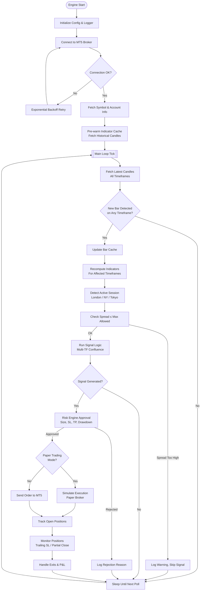
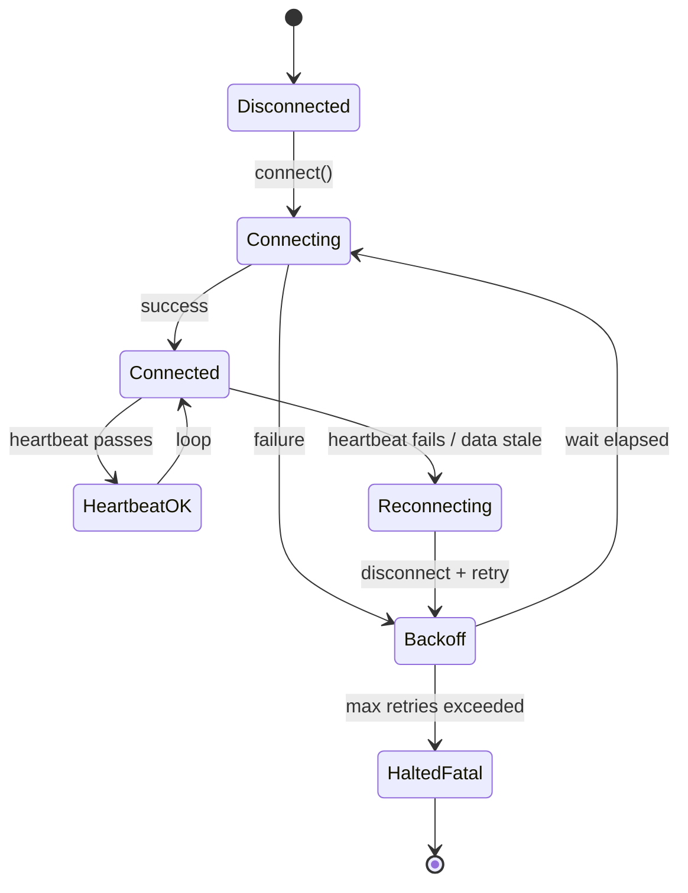
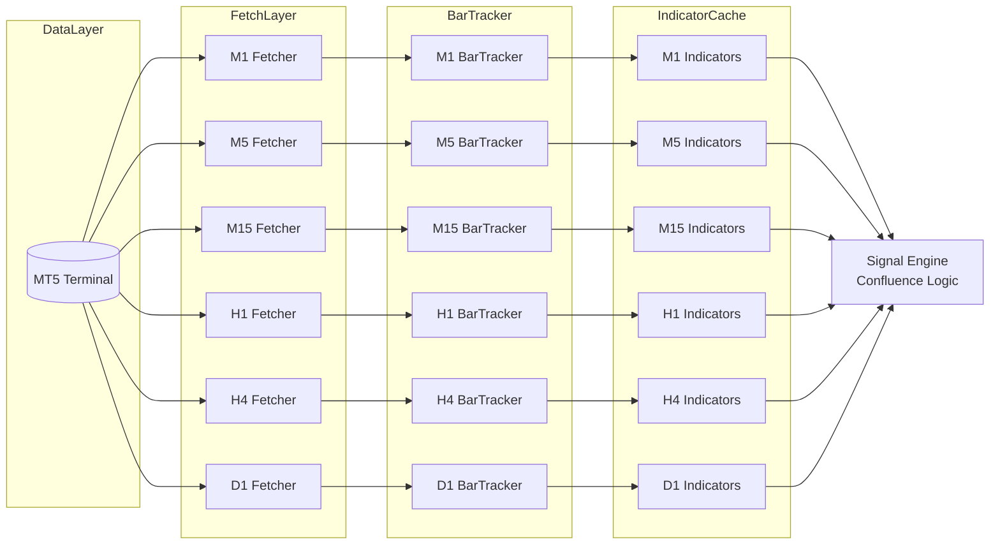
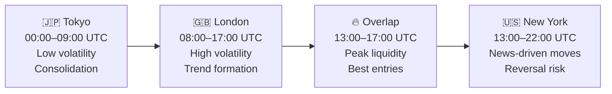
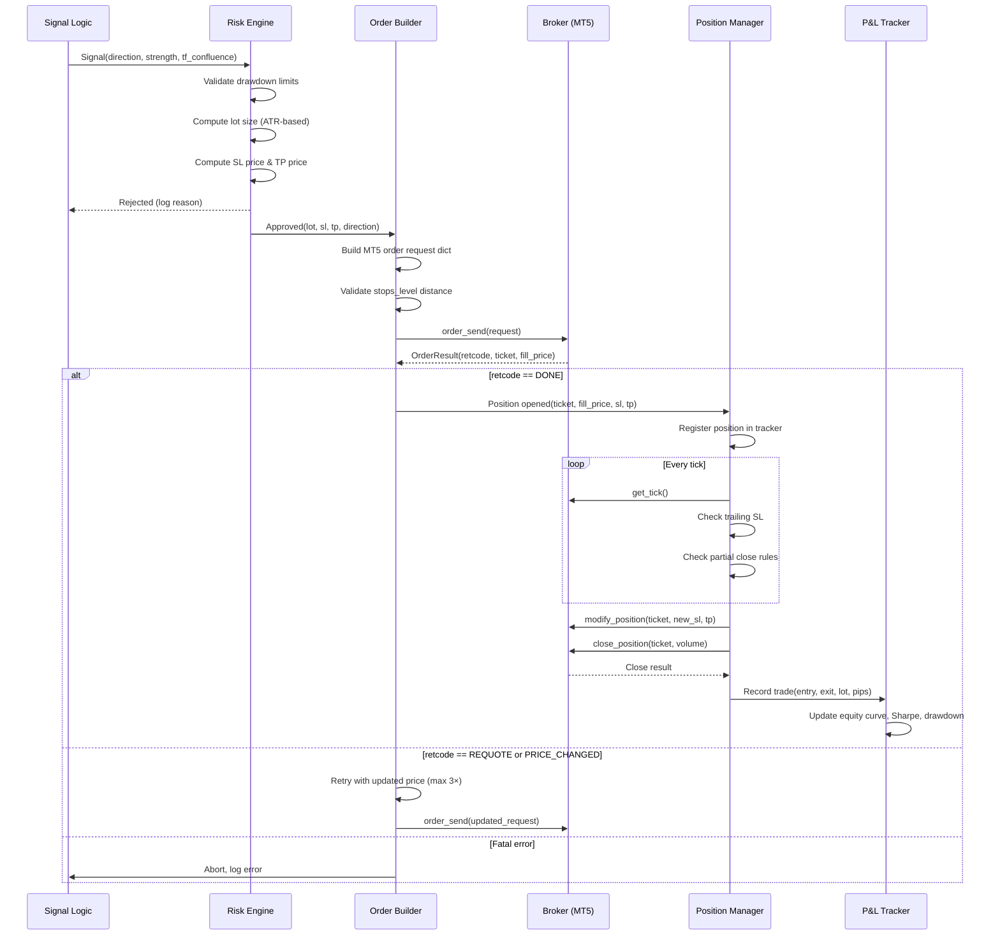
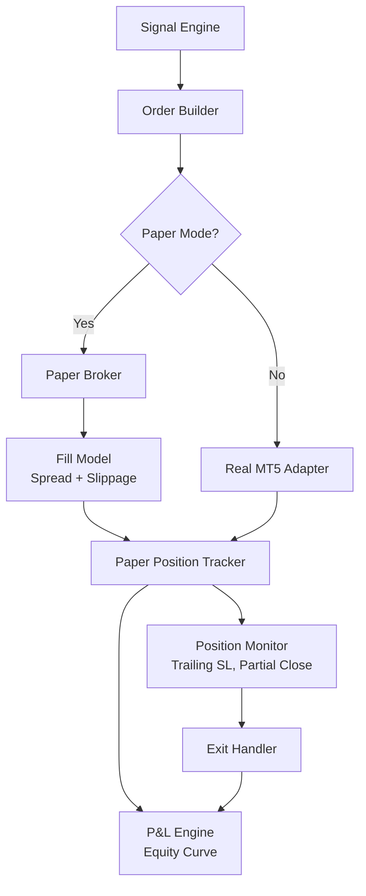

# Trading Engine — Comprehensive Technical Documentation

> **Project:** Trading-Gold Algorithmic Trading System  
> **Scope:** MetaTrader 5 (MT5) Integration, Signal Pipeline, Order Lifecycle, Risk Management  
> **Audience:** Developers, Quants, DevOps Engineers  
> **Last Updated:** 2026-10-08

---

## Table of Contents

1. [Trading Engine Overview](#1-trading-engine-overview)
2. [MT5 Adapter Design](#2-mt5-adapter-design)
3. [Connection Lifecycle](#3-connection-lifecycle)
4. [Data Fetching](#4-data-fetching)
5. [Bar Formation Detection](#5-bar-formation-detection)
6. [Indicator Pipeline](#6-indicator-pipeline)
7. [Multi-Timeframe Architecture](#7-multi-timeframe-architecture)
8. [Caching Strategy](#8-caching-strategy)
9. [Session Detection](#9-session-detection)
10. [Spread Monitoring](#10-spread-monitoring)
11. [Order Lifecycle](#11-order-lifecycle)
12. [Order Types](#12-order-types)
13. [Error Handling](#13-error-handling)
14. [Paper Trading Mode](#14-paper-trading-mode)

---

## 1. Trading Engine Overview

The Trading Engine is the central orchestration layer of the Trading-Gold system. It is responsible for fetching market data, running the indicator pipeline, generating signals, managing risk, and executing orders through MetaTrader 5.

### 1.1 Architecture Summary

The engine follows a **reactive event-driven loop** model:
- A tight inner loop polls for new bars at every timeframe.
- When a bar closes on any watched timeframe, indicators are recomputed and signal logic is triggered.
- Signals are passed through the risk layer before any execution is attempted.
- All broker communication is mediated through a pluggable **MT5 Adapter** interface, allowing full unit-test coverage via a **MockAdapter**.

### 1.2 Main Trading Loop



### 1.3 Engine Configuration

| Parameter | Type | Default | Description |
|-----------|------|---------|-------------|
| `symbol` | `str` | `XAUUSD` | Trading instrument |
| `magic_number` | `int` | `20240101` | Unique identifier for engine orders |
| `poll_interval_ms` | `int` | `200` | Main loop tick in milliseconds |
| `paper_trading` | `bool` | `False` | Enable paper trading mode |
| `max_spread_points` | `float` | `30.0` | Maximum tolerated spread in points |
| `max_retries` | `int` | `5` | Reconnect retry limit |
| `backoff_base_s` | `float` | `2.0` | Base for exponential backoff |
| `heartbeat_interval_s` | `int` | `30` | Seconds between heartbeat checks |

---

## 2. MT5 Adapter Design

The adapter layer abstracts all broker I/O behind a clean interface. This decouples the trading logic from the MT5 Python library, allowing the engine to be unit-tested without a live MetaTrader 5 terminal.

### 2.1 Adapter Interface (Abstract Base)

```python
from abc import ABC, abstractmethod
from dataclasses import dataclass
from typing import Optional, List
import numpy as np

@dataclass
class Candle:
    time: int          # UNIX timestamp (seconds)
    open: float
    high: float
    low: float
    close: float
    tick_volume: int
    spread: int
    real_volume: int

@dataclass
class Tick:
    time: int
    bid: float
    ask: float
    last: float
    volume: int

@dataclass
class AccountInfo:
    balance: float
    equity: float
    margin: float
    free_margin: float
    margin_level: float
    profit: float
    currency: str
    leverage: int

@dataclass
class SymbolInfo:
    name: str
    bid: float
    ask: float
    spread: int           # in points
    point: float
    digits: int
    trade_contract_size: float
    volume_min: float
    volume_max: float
    volume_step: float
    trade_stops_level: int

@dataclass
class OrderResult:
    retcode: int
    order: int
    deal: int
    volume: float
    price: float
    comment: str

class BrokerAdapter(ABC):
    """Abstract base class for all broker adapters."""

    @abstractmethod
    def connect(self) -> bool: ...

    @abstractmethod
    def disconnect(self) -> None: ...

    @abstractmethod
    def is_connected(self) -> bool: ...

    @abstractmethod
    def get_account_info(self) -> AccountInfo: ...

    @abstractmethod
    def get_symbol_info(self, symbol: str) -> SymbolInfo: ...

    @abstractmethod
    def get_candles(
        self,
        symbol: str,
        timeframe: int,
        count: int
    ) -> List[Candle]: ...

    @abstractmethod
    def get_tick(self, symbol: str) -> Tick: ...

    @abstractmethod
    def send_order(self, request: dict) -> OrderResult: ...

    @abstractmethod
    def get_positions(self, symbol: str) -> List[dict]: ...

    @abstractmethod
    def get_orders(self, symbol: str) -> List[dict]: ...

    @abstractmethod
    def close_position(self, ticket: int, volume: float) -> OrderResult: ...

    @abstractmethod
    def modify_position(
        self,
        ticket: int,
        sl: float,
        tp: float
    ) -> OrderResult: ...
```

### 2.2 Real MetaTrader 5 Adapter

```python
import MetaTrader5 as mt5

class MT5Adapter(BrokerAdapter):
    """
    Production adapter wrapping the MetaTrader5 Python library.
    All calls are synchronous and blocking; MT5 is not thread-safe
    so all operations must happen from the same OS thread.
    """

    def __init__(self, path: str = None, login: int = None,
                 password: str = None, server: str = None):
        self._path = path
        self._login = login
        self._password = password
        self._server = server

    def connect(self) -> bool:
        kwargs = {}
        if self._path:
            kwargs["path"] = self._path
        if not mt5.initialize(**kwargs):
            return False
        if self._login:
            return mt5.login(self._login, self._password, self._server)
        return True

    def disconnect(self) -> None:
        mt5.shutdown()

    def is_connected(self) -> bool:
        info = mt5.terminal_info()
        return info is not None and info.connected

    def get_candles(self, symbol, timeframe, count) -> List[Candle]:
        rates = mt5.copy_rates_from_pos(symbol, timeframe, 0, count)
        if rates is None:
            return []
        return [
            Candle(r['time'], r['open'], r['high'], r['low'],
                   r['close'], r['tick_volume'], r['spread'], r['real_volume'])
            for r in rates
        ]

    def get_tick(self, symbol) -> Optional[Tick]:
        t = mt5.symbol_info_tick(symbol)
        if t is None:
            return None
        return Tick(t.time, t.bid, t.ask, t.last, t.volume)

    def send_order(self, request: dict) -> OrderResult:
        result = mt5.order_send(request)
        return OrderResult(
            result.retcode, result.order, result.deal,
            result.volume, result.price, result.comment
        )
    # ... (remaining methods follow identical pattern)
```

### 2.3 Mock Adapter for Testing

```python
import time
from collections import defaultdict

class MockMT5Adapter(BrokerAdapter):
    """
    In-memory mock broker adapter for unit and integration testing.
    Simulates realistic order fills, spreads, and position tracking
    without requiring a live MT5 terminal.
    """

    RETCODE_DONE = 10009

    def __init__(self, initial_balance: float = 10_000.0,
                 spread_points: int = 10):
        self._connected = False
        self._balance = initial_balance
        self._spread = spread_points
        self._positions: dict[int, dict] = {}
        self._orders: dict[int, dict] = {}
        self._ticket_seq = 1000
        self._candle_feeds: dict[tuple, List[Candle]] = {}
        self._tick_price = 1900.0   # simulated gold price

    def connect(self) -> bool:
        self._connected = True
        return True

    def disconnect(self) -> None:
        self._connected = False

    def is_connected(self) -> bool:
        return self._connected

    def get_account_info(self) -> AccountInfo:
        equity = self._balance + sum(
            p.get("profit", 0) for p in self._positions.values()
        )
        return AccountInfo(
            balance=self._balance, equity=equity,
            margin=0.0, free_margin=equity,
            margin_level=0.0, profit=equity - self._balance,
            currency="USD", leverage=100
        )

    def inject_candles(self, symbol: str, timeframe: int,
                       candles: List[Candle]) -> None:
        """Test helper: inject synthetic candle data."""
        self._candle_feeds[(symbol, timeframe)] = candles

    def get_candles(self, symbol, timeframe, count) -> List[Candle]:
        feed = self._candle_feeds.get((symbol, timeframe), [])
        return feed[-count:] if len(feed) >= count else feed

    def send_order(self, request: dict) -> OrderResult:
        ticket = self._ticket_seq
        self._ticket_seq += 1
        fill_price = self._tick_price
        # Apply spread for buy orders
        if request.get("type") == 0:  # BUY
            fill_price += self._spread * 0.0001
        self._positions[ticket] = {
            "ticket": ticket,
            "symbol": request["symbol"],
            "type": request["type"],
            "volume": request["volume"],
            "price_open": fill_price,
            "sl": request.get("sl", 0),
            "tp": request.get("tp", 0),
            "profit": 0.0,
            "time": int(time.time()),
        }
        return OrderResult(self.RETCODE_DONE, ticket, ticket,
                           request["volume"], fill_price, "mock fill")
```

---

## 3. Connection Lifecycle

### 3.1 Connect Phase

On startup the engine calls `adapter.connect()` which initializes the MT5 terminal process (or validates an existing session). The connection process:

1. Attempts `mt5.initialize()` with the optional terminal path.
2. If credentials supplied, calls `mt5.login(login, password, server)`.
3. Validates `terminal_info().connected == True`.
4. Fetches initial `AccountInfo` and `SymbolInfo` to confirm data access.

### 3.2 Heartbeat Monitoring

A background coroutine (or a dedicated thread) runs the heartbeat check every `heartbeat_interval_s` seconds:

```python
def _heartbeat_loop(self) -> None:
    while self._running:
        time.sleep(self.config.heartbeat_interval_s)
        if not self.adapter.is_connected():
            self._logger.warning("Heartbeat failed — initiating reconnect")
            self._reconnect()
```

The heartbeat also validates that the last successful data fetch was recent (within 2× the heartbeat interval). A stale data timestamp triggers reconnection even if `is_connected()` returns `True`, guarding against silent data freezes.

### 3.3 Reconnect with Exponential Backoff

```python
def _reconnect(self) -> bool:
    self.adapter.disconnect()
    for attempt in range(1, self.config.max_retries + 1):
        wait = self.config.backoff_base_s ** attempt   # 2, 4, 8, 16, 32 s
        self._logger.info(f"Reconnect attempt {attempt}, waiting {wait:.1f}s")
        time.sleep(wait)
        if self.adapter.connect():
            self._logger.info("Reconnected successfully")
            return True
    self._logger.critical("All reconnect attempts exhausted — engine halting")
    self._running = False
    return False
```

| Attempt | Wait (s) |
|---------|----------|
| 1 | 2 |
| 2 | 4 |
| 3 | 8 |
| 4 | 16 |
| 5 | 32 |

> [!WARNING]
> After the maximum retry limit is exhausted, the engine sets `_running = False` and exits the main loop gracefully. A process supervisor (e.g., `systemd`, `supervisord`, Docker restart policy) should be used to revive the process automatically.

### 3.4 Connection State Diagram



---

## 4. Data Fetching

### 4.1 Candles (OHLCV)

Candle data is fetched via `adapter.get_candles(symbol, timeframe, count)`. The engine maintains a **rolling window** for each active timeframe, fetching the last `N` candles on every poll tick (where N is the maximum indicator lookback period plus a safety buffer).

```python
CANDLE_FETCH_COUNTS: dict[int, int] = {
    mt5.TIMEFRAME_M1:  500,
    mt5.TIMEFRAME_M5:  300,
    mt5.TIMEFRAME_M15: 200,
    mt5.TIMEFRAME_M30: 150,
    mt5.TIMEFRAME_H1:  100,
    mt5.TIMEFRAME_H4:   80,
    mt5.TIMEFRAME_D1:   60,
}
```

OHLCV fields returned per candle:

| Field | Type | Description |
|-------|------|-------------|
| `time` | `int` | Bar open timestamp (UNIX seconds, UTC) |
| `open` | `float` | Opening price |
| `high` | `float` | Highest price during bar |
| `low` | `float` | Lowest price during bar |
| `close` | `float` | Closing price |
| `tick_volume` | `int` | Number of ticks (proxy for real volume in FX) |
| `spread` | `int` | Spread in points at bar open |
| `real_volume` | `int` | Real traded volume (0 for most FX/CFD brokers) |

### 4.2 Live Ticks

Live tick data is fetched each main loop cycle with `adapter.get_tick(symbol)`:

```python
tick = adapter.get_tick("XAUUSD")
current_spread = tick.ask - tick.bid
```

Ticks are used for:
- Real-time spread monitoring.
- Deriving the current bar's running price for paper-trade fill simulation.
- Trailing stop-loss updates between bar closes.

### 4.3 Account Info

`AccountInfo` is refreshed every N ticks and after every order event. Critical fields driving risk decisions:

| Field | Use |
|-------|-----|
| `equity` | Max drawdown check |
| `free_margin` | Margin-available check before order |
| `margin_level` | Safety threshold: halt trading below 120% |
| `balance` | Position size base calculation |

### 4.4 Symbol Info

`SymbolInfo` is fetched once at startup and re-fetched if a reconnect occurs. Key fields:

| Field | Use |
|-------|-----|
| `point` | Convert SL pips → price distance |
| `digits` | Round order prices to correct precision |
| `trade_contract_size` | Lot value calculation |
| `volume_min / max / step` | Sanitize computed lot sizes |
| `trade_stops_level` | Minimum distance from price for SL/TP |

---

## 5. Bar Formation Detection

### 5.1 The Drop-Forming Candle Logic

Detecting a **newly closed bar** is the central event that triggers the indicator pipeline. The engine compares the timestamp of the most-recent candle in the latest fetch against the cached last-seen timestamp:

```python
class BarTracker:
    def __init__(self):
        self._last_bar_time: dict[int, int] = {}   # timeframe → timestamp

    def is_new_bar(self, timeframe: int, candles: List[Candle]) -> bool:
        """
        Returns True if the penultimate candle is new (i.e., a bar has
        closed since the last check). We inspect candles[-2] because
        candles[-1] is always the still-forming (live) candle.
        """
        if len(candles) < 2:
            return False
        closed_bar_time = candles[-2].time
        last_seen = self._last_bar_time.get(timeframe, 0)
        if closed_bar_time > last_seen:
            self._last_bar_time[timeframe] = closed_bar_time
            return True
        return False
```

> [!IMPORTANT]
> Always use `candles[-2]` (the **penultimate** candle) as the last **confirmed closed** bar. `candles[-1]` is the live, still-forming candle and its OHLCV values are incomplete until the bar fully closes.

### 5.2 Multi-Timeframe Bar Event Priority

When multiple timeframes simultaneously register a new bar (e.g., a new H1 bar always coincides with a new M15 bar), they are processed in **ascending timeframe order** so that shorter-timeframe caches are updated before higher-timeframe analysis consumes them.

```python
TIMEFRAME_PRIORITY = [M1, M5, M15, M30, H1, H4, D1]  # ascending

for tf in TIMEFRAME_PRIORITY:
    if bar_tracker.is_new_bar(tf, candle_cache[tf]):
        _recompute_indicators(tf)
        new_bar_events.append(tf)
```

---

## 6. Indicator Pipeline

All indicators operate on the **closed-bar** candle array (i.e., `candles[:-1]` — everything except the forming bar). Computations use **NumPy arrays** for performance. The pipeline is only executed when `is_new_bar()` returns `True`.

### 6.1 Indicator Summary Table

| Indicator | Inputs | Primary Use |
|-----------|--------|-------------|
| EMA | Close, period | Trend direction, signal crossovers |
| SMA | Close, period | Baseline trend, crossover confirmation |
| RSI | Close, period=14 | Momentum / overbought-oversold |
| MACD | Close, fast=12, slow=26, signal=9 | Momentum divergence, trend confirm |
| ADX | High, Low, Close, period=14 | Trend strength (non-directional) |
| ATR | High, Low, Close, period=14 | Volatility / dynamic SL sizing |
| Bollinger Bands | Close, period=20, std=2 | Volatility breakout, mean reversion |
| Stochastic | High, Low, Close, K=14, D=3 | Momentum / reversal |
| CCI | High, Low, Close, period=20 | Cyclical turning points |
| Williams %R | High, Low, Close, period=14 | Overbought/oversold extreme |
| OBV | Close, Volume | Volume-price divergence |
| Keltner Channels | Close, High, Low, EMA_period=20, ATR_period=10, mult=1.5 | Breakout / squeeze context |

---

### 6.2 EMA — Exponential Moving Average

**Formula:** `EMA[t] = Close[t] × k + EMA[t-1] × (1 − k)`, where `k = 2 / (period + 1)`

**Engine use:** Fast EMA (e.g., 9) vs. Slow EMA (e.g., 21) crossovers define the primary trend direction. Confluence of EMA cross on H1 and M15 is required for signal confirmation.

```python
def ema(close: np.ndarray, period: int) -> np.ndarray:
    k = 2.0 / (period + 1)
    result = np.empty_like(close)
    result[0] = close[0]
    for i in range(1, len(close)):
        result[i] = close[i] * k + result[i - 1] * (1 - k)
    return result
```

---

### 6.3 SMA — Simple Moving Average

**Formula:** `SMA[t] = mean(Close[t-period+1 : t+1])`

**Engine use:** 50-SMA and 200-SMA on H4/D1 define the macro trend regime. Trading is only taken in the direction of the 200-SMA slope.

```python
def sma(close: np.ndarray, period: int) -> np.ndarray:
    return np.convolve(close, np.ones(period) / period, mode='valid')
```

---

### 6.4 RSI — Relative Strength Index

**Formula:**  
```
RS = avg_gain / avg_loss  (over period bars)
RSI = 100 − (100 / (1 + RS))
```

**Engine use:** RSI < 30 → oversold (buy bias), RSI > 70 → overbought (sell bias). Used as a filter: signals are suppressed if RSI diverges from the directional bias.

```python
def rsi(close: np.ndarray, period: int = 14) -> np.ndarray:
    delta = np.diff(close)
    gains = np.where(delta > 0, delta, 0.0)
    losses = np.where(delta < 0, -delta, 0.0)
    avg_gain = np.convolve(gains, np.ones(period)/period, mode='valid')
    avg_loss = np.convolve(losses, np.ones(period)/period, mode='valid')
    rs = np.where(avg_loss == 0, np.inf, avg_gain / avg_loss)
    return 100.0 - (100.0 / (1.0 + rs))
```

---

### 6.5 MACD — Moving Average Convergence Divergence

**Formula:**  
```
MACD Line   = EMA(12) − EMA(26)
Signal Line = EMA(MACD Line, 9)
Histogram   = MACD Line − Signal Line
```

**Engine use:** Histogram sign change (zero-line crossover of the MACD line relative to signal) is used as a momentum entry trigger. Histogram divergence from price warns of weakening trends.

```python
def macd(close: np.ndarray, fast=12, slow=26, signal=9):
    macd_line = ema(close, fast) - ema(close, slow)
    signal_line = ema(macd_line, signal)
    histogram = macd_line - signal_line
    return macd_line, signal_line, histogram
```

---

### 6.6 ADX — Average Directional Index

**Formula:**  
```
+DM = High[t] − High[t-1]  (if > |Low[t] − Low[t-1]| and > 0, else 0)
-DM = Low[t-1] − Low[t]    (if > |High[t] − High[t-1]| and > 0, else 0)
TR  = max(High−Low, |High−PrevClose|, |Low−PrevClose|)
ATR = smoothed average of TR
+DI = 100 × smooth(+DM) / ATR
-DI = 100 × smooth(-DM) / ATR
DX  = 100 × |+DI − -DI| / (+DI + -DI)
ADX = EMA(DX, period)
```

**Engine use:** `ADX > 25` indicates a trending market (signals are valid). `ADX < 20` means ranging — trend-following signals are suppressed, and the engine may switch to a mean-reversion sub-strategy.

---

### 6.7 ATR — Average True Range

**Formula:**  
```
TR[t] = max(High[t]−Low[t], |High[t]−Close[t-1]|, |Low[t]−Close[t-1]|)
ATR   = Wilder's smoothed average of TR over period bars
```

**Engine use:** ATR is the cornerstone of the dynamic risk model. Stop-loss distance = `atr_multiplier × ATR` (e.g., 1.5×). Take-profit = `tp_multiplier × ATR` (e.g., 2.5×). This ensures SL/TP scales with current volatility.

```python
def atr(high, low, close, period=14):
    prev_close = close[:-1]
    tr = np.maximum.reduce([
        high[1:] - low[1:],
        np.abs(high[1:] - prev_close),
        np.abs(low[1:]  - prev_close),
    ])
    result = np.empty(len(tr))
    result[0] = tr[:period].mean()
    k = 1.0 / period
    for i in range(1, len(tr)):
        result[i] = tr[i] * k + result[i-1] * (1 - k)
    return result
```

---

### 6.8 Bollinger Bands

**Formula:**  
```
Middle Band = SMA(Close, 20)
Upper Band  = Middle + 2 × std(Close, 20)
Lower Band  = Middle − 2 × std(Close, 20)
Bandwidth   = (Upper − Lower) / Middle
%B          = (Close − Lower) / (Upper − Lower)
```

**Engine use:**
- `%B > 1.0` → price above upper band → potential short (in ranging context).
- `%B < 0.0` → price below lower band → potential long.
- **Squeeze** (bandwidth at multi-period low) anticipates a volatility expansion breakout.

---

### 6.9 Stochastic Oscillator

**Formula:**  
```
%K = 100 × (Close − LowestLow[K]) / (HighestHigh[K] − LowestLow[K])
%D = SMA(%K, D_period)
```

**Engine use:** `%K < 20 and %K crosses above %D` → buy signal in oversold zone. `%K > 80 and %K crosses below %D` → sell signal in overbought zone. Always used in combination with trend filters (EMA, ADX) — not as a standalone trigger.

---

### 6.10 CCI — Commodity Channel Index

**Formula:**  
```
TP[t]  = (High + Low + Close) / 3
SMA_TP = SMA(TP, period)
MD     = mean absolute deviation of TP over period
CCI    = (TP − SMA_TP) / (0.015 × MD)
```

**Engine use:** CCI > +100 confirms strong bullish momentum. CCI < −100 confirms bearish momentum. CCI zero-line crossover acts as an early trend-entry signal.

---

### 6.11 Williams %R

**Formula:**  
```
%R = (HighestHigh[period] − Close) / (HighestHigh[period] − LowestLow[period]) × −100
```

**Engine use:** %R near −100 → oversold (potential long). %R near 0 → overbought (potential short). Notably inverted scale: −80 threshold for oversold, −20 for overbought. Used as a corroborating oscillator alongside RSI.

---

### 6.12 OBV — On-Balance Volume

**Formula:**  
```
OBV[t] = OBV[t-1] + volume  (if Close[t] > Close[t-1])
OBV[t] = OBV[t-1] − volume  (if Close[t] < Close[t-1])
OBV[t] = OBV[t-1]           (if Close[t] == Close[t-1])
```

**Engine use:** OBV divergence from price is a leading indicator of reversals. Rising price with falling OBV signals weakening bullish momentum. Used primarily on H1 for entry confirmation.

```python
def obv(close: np.ndarray, volume: np.ndarray) -> np.ndarray:
    direction = np.sign(np.diff(close))
    vol_signed = direction * volume[1:]
    return np.concatenate([[0], np.cumsum(vol_signed)])
```

---

### 6.13 Keltner Channels

**Formula:**  
```
Middle  = EMA(Close, 20)
ATR_val = ATR(period=10)
Upper   = Middle + 1.5 × ATR_val
Lower   = Middle − 1.5 × ATR_val
```

**Engine use:** Keltner Channels combined with Bollinger Bands identify **squeezes**: when Bollinger Bands narrow inside Keltner Channels, a high-probability volatility breakout is imminent. Breakout direction is confirmed by MACD histogram sign and the prevailing EMA trend.

---

## 7. Multi-Timeframe Architecture

### 7.1 Timeframe Hierarchy

The engine tracks seven timeframes simultaneously:

| Timeframe | MT5 Constant | Role | Candles Fetched |
|-----------|-------------|------|----------------|
| M1 | `TIMEFRAME_M1` | Entry precision, micro-structure | 500 |
| M5 | `TIMEFRAME_M5` | Short-term momentum | 300 |
| M15 | `TIMEFRAME_M15` | Intermediate signals | 200 |
| M30 | `TIMEFRAME_M30` | Session-level context | 150 |
| H1 | `TIMEFRAME_H1` | Primary signal timeframe | 100 |
| H4 | `TIMEFRAME_H4` | Macro trend context | 80 |
| D1 | `TIMEFRAME_D1` | Regime filter (bull/bear) | 60 |

### 7.2 Confluence Requirements

Signals require alignment across at least **three timeframes** to be acted upon:

```
BUY Signal requires:
  D1  : Close > SMA200   (macro uptrend)
  H4  : ADX > 25 AND EMA9 > EMA21   (intermediate trend)
  H1  : MACD histogram positive AND RSI > 50   (primary signal)
  M15 : Stochastic %K crosses %D above 20 (entry trigger)
  M5  : EMA9 > EMA21 (micro confirmation)
```

### 7.3 Timeframe Data Flow



### 7.4 Alignment Strategy

Higher timeframe bars subsume lower timeframe events. The engine aligns on the **lowest common event** using timestamp modulo:

```python
def bars_are_aligned(m1_time: int, target_tf_seconds: int) -> bool:
    """True if the M1 bar time aligns with the start of a higher-TF bar."""
    return m1_time % target_tf_seconds == 0

TF_SECONDS = {M5: 300, M15: 900, M30: 1800, H1: 3600, H4: 14400, D1: 86400}
```

---

## 8. Caching Strategy

### 8.1 On-Demand Recomputation

Indicator computation is **only triggered when a new bar closes** on the relevant timeframe. Between bar closes, the engine reads from the stale-safe cache. This yields a substantial CPU saving — instead of recomputing 12+ indicators every 200 ms poll, computation happens at most once per minute (M1 bar close).

```python
class IndicatorCache:
    def __init__(self):
        self._cache: dict[tuple[int, str], np.ndarray] = {}
        self._last_update: dict[int, int] = {}   # timeframe → bar timestamp

    def is_stale(self, timeframe: int, bar_time: int) -> bool:
        return self._last_update.get(timeframe, 0) < bar_time

    def update(self, timeframe: int, bar_time: int,
               indicators: dict[str, np.ndarray]) -> None:
        for name, values in indicators.items():
            self._cache[(timeframe, name)] = values
        self._last_update[timeframe] = bar_time

    def get(self, timeframe: int, name: str) -> Optional[np.ndarray]:
        return self._cache.get((timeframe, name))
```

### 8.2 Cache Invalidation Rules

| Event | Action |
|-------|--------|
| New bar detected on timeframe T | Recompute all indicators for T |
| Reconnect / data gap detected | Flush all caches, re-fetch all timeframes |
| Symbol change at runtime | Full cache flush + re-initialization |
| Config reload (period changes) | Selective invalidation by indicator name |

### 8.3 Memory Footprint

Each indicator array holds `N` float64 values (8 bytes each). For 12 indicators × 7 timeframes × ~200 bars average:

```
12 × 7 × 200 × 8 bytes ≈ 134 KB
```

Memory footprint is negligible; no eviction policy is required.

---

## 9. Session Detection

### 9.1 Major Trading Sessions

The engine detects which Forex market sessions are active in UTC time to apply session-specific filters (e.g., only trade during the London–New York overlap for gold).

| Session | UTC Open | UTC Close | Typical Characteristic |
|---------|----------|-----------|------------------------|
| Tokyo (Asian) | 00:00 | 09:00 | Lower volatility, range-bound |
| London | 08:00 | 17:00 | High volatility, trend initiation |
| New York | 13:00 | 22:00 | High volume, frequent reversals |
| London–NY Overlap | 13:00 | 17:00 | **Peak liquidity for XAUUSD** |

### 9.2 Session Detection Implementation

```python
from datetime import datetime, timezone, time as dtime

class SessionDetector:
    SESSIONS = {
        "tokyo":    (dtime(0,  0), dtime(9,  0)),
        "london":   (dtime(8,  0), dtime(17, 0)),
        "new_york": (dtime(13, 0), dtime(22, 0)),
    }

    def get_active_sessions(self, utc_now: datetime) -> list[str]:
        t = utc_now.time().replace(second=0, microsecond=0)
        return [
            name for name, (start, end) in self.SESSIONS.items()
            if start <= t < end
        ]

    def is_overlap(self, utc_now: datetime) -> bool:
        """True during London–NY overlap (13:00–17:00 UTC)."""
        t = utc_now.time()
        return dtime(13, 0) <= t < dtime(17, 0)

    def is_trading_allowed(self, utc_now: datetime) -> bool:
        """
        For gold (XAUUSD), require at least London or NY session.
        Avoid trading in the thin Asian session unless configured otherwise.
        """
        active = self.get_active_sessions(utc_now)
        return bool({"london", "new_york"} & set(active))
```

### 9.3 Session Significance for XAUUSD



> [!TIP]
> The highest-quality XAUUSD setups occur during the **London–New York overlap (13:00–17:00 UTC)**. Configure `require_overlap = True` in the engine config to restrict entries to this window for the best risk-adjusted returns.

### 9.4 Session-Based Strategy Adjustments

| Session | Spread Tolerance | Strategy Mode | ATR Multiplier Adjustment |
|---------|-----------------|---------------|--------------------------|
| Tokyo (no overlap) | Tight | Range / No trade | +0.5× (wider SL needed) |
| London only | Medium | Trend-following | Baseline |
| NY only | Medium | Trend / Breakout | Baseline |
| London–NY Overlap | Wide OK | Trend-following | −0.2× (tighter SL OK) |

---

## 10. Spread Monitoring

### 10.1 Why Spread Matters

Spread is the immediate cost of entry. For XAUUSD, spreads can spike dramatically during:
- News events (NFP, CPI, FOMC decisions)
- Market open/close transitions
- Low-liquidity periods (Asian session)
- Broker-side issues

Entering with an abnormally high spread significantly increases the breakeven requirement and skews the risk/reward ratio negatively.

### 10.2 Spread Enforcement

```python
class SpreadMonitor:
    def __init__(self, max_spread_points: float, symbol_point: float):
        self.max_spread_points = max_spread_points
        self.symbol_point = symbol_point
        self._spread_history: list[float] = []

    def check(self, tick: Tick) -> tuple[bool, float]:
        spread_points = (tick.ask - tick.bid) / self.symbol_point
        self._spread_history.append(spread_points)
        if len(self._spread_history) > 100:
            self._spread_history.pop(0)
        allowed = spread_points <= self.max_spread_points
        return allowed, spread_points

    def average_spread(self) -> float:
        if not self._spread_history:
            return 0.0
        return sum(self._spread_history) / len(self._spread_history)
```

### 10.3 Spread Thresholds for XAUUSD

| Market Condition | Typical Spread (points) | Engine Threshold |
|-----------------|------------------------|-----------------|
| London–NY Overlap | 5–15 | ≤ 30 |
| London open only | 10–25 | ≤ 30 |
| Asian session | 20–50 | ≤ 30 (often blocked) |
| News event | 50–200+ | Blocked (> 30) |

> [!CAUTION]
> Never disable spread enforcement in live trading. A 100-point spread on a 30-point SL trade creates a negative-expectancy setup regardless of signal quality.

### 10.4 Dynamic Spread Adjustment

Optionally, the engine can compute the rolling 20-bar average spread and dynamically set the threshold to `mean_spread × 2.0`. This self-calibrates to broker conditions while blocking extreme spikes.

---

## 11. Order Lifecycle

### 11.1 Full Pipeline Overview



### 11.2 Risk Engine Detail

```python
class RiskEngine:
    def __init__(self, config: RiskConfig, adapter: BrokerAdapter):
        self.config = config
        self.adapter = adapter

    def evaluate(self, signal: Signal, atr: float) -> Optional[ApprovedOrder]:
        acct = self.adapter.get_account_info()

        # Drawdown guard
        drawdown = (acct.balance - acct.equity) / acct.balance
        if drawdown > self.config.max_drawdown_pct:
            return None   # halt trading

        # Margin guard
        if acct.margin_level < self.config.min_margin_level:
            return None

        # Position sizing: risk N% of balance per trade
        sl_distance = self.config.atr_sl_multiplier * atr
        risk_amount = acct.balance * self.config.risk_per_trade_pct
        sym = self.adapter.get_symbol_info(signal.symbol)
        pip_value = sym.trade_contract_size * sym.point
        raw_lots = risk_amount / (sl_distance / sym.point * pip_value)

        # Sanitize to broker constraints
        lots = max(sym.volume_min,
                   min(sym.volume_max,
                       round(raw_lots / sym.volume_step) * sym.volume_step))

        sl_price = (signal.entry_price - sl_distance if signal.direction == BUY
                    else signal.entry_price + sl_distance)
        tp_price = (signal.entry_price + self.config.atr_tp_multiplier * atr
                    if signal.direction == BUY
                    else signal.entry_price - self.config.atr_tp_multiplier * atr)

        return ApprovedOrder(signal.direction, signal.symbol,
                             lots, signal.entry_price, sl_price, tp_price)
```

---

## 12. Order Types

### 12.1 Market Orders

Executed immediately at the best available price (bid for SELL, ask for BUY). Used for most signal-triggered entries.

```python
request = {
    "action":   mt5.TRADE_ACTION_DEAL,
    "symbol":   "XAUUSD",
    "volume":   0.10,
    "type":     mt5.ORDER_TYPE_BUY,
    "price":    tick.ask,
    "sl":       sl_price,
    "tp":       tp_price,
    "deviation": 10,        # max slippage in points
    "magic":    MAGIC_NUMBER,
    "comment":  "engine-signal",
    "type_time": mt5.ORDER_TIME_GTC,
    "type_filling": mt5.ORDER_FILLING_IOC,
}
```

### 12.2 Pending Orders

Placed at a future price level without immediate execution.

| Order Type | MT5 Constant | Trigger Condition |
|-----------|-------------|-------------------|
| Buy Limit | `ORDER_TYPE_BUY_LIMIT` | Price drops to the specified level (buy cheaper) |
| Sell Limit | `ORDER_TYPE_SELL_LIMIT` | Price rises to the specified level (sell higher) |
| Buy Stop | `ORDER_TYPE_BUY_STOP` | Price rises above level (breakout long) |
| Sell Stop | `ORDER_TYPE_SELL_STOP` | Price falls below level (breakout short) |

```python
request = {
    "action":   mt5.TRADE_ACTION_PENDING,
    "symbol":   "XAUUSD",
    "volume":   0.10,
    "type":     mt5.ORDER_TYPE_BUY_LIMIT,
    "price":    limit_price,
    "sl":       sl_price,
    "tp":       tp_price,
    "magic":    MAGIC_NUMBER,
    "type_time": mt5.ORDER_TIME_GTC,
}
```

### 12.3 Stop-Loss Orders

The SL price is embedded in every order request. After a position is opened, the SL can be modified:

```python
def set_stop_loss(self, ticket: int, new_sl: float) -> bool:
    sym = self.adapter.get_symbol_info(self.symbol)
    # Enforce minimum stops level distance
    tick = self.adapter.get_tick(self.symbol)
    min_dist = sym.trade_stops_level * sym.point
    if abs(tick.bid - new_sl) < min_dist:
        self._logger.warning("SL too close to price, adjusting to stops_level")
        new_sl = tick.bid - min_dist  # for BUY positions
    result = self.adapter.modify_position(ticket, sl=new_sl, tp=0)
    return result.retcode == RETCODE_DONE
```

### 12.4 Take-Profit Orders

TP is set at order creation and can be modified identically to SL. The engine supports two TP modes:

- **Fixed TP:** `entry ± (atr_tp_multiplier × ATR)`.
- **Dynamic TP:** TP is trailed upward (for longs) by keeping it at `close + atr_tp_multiplier × ATR` after each closed bar.

### 12.5 Partial Close

Partial position close is used to lock in profits while letting the remainder run:

```python
def partial_close(self, ticket: int, close_fraction: float) -> OrderResult:
    positions = self.adapter.get_positions(self.symbol)
    pos = next((p for p in positions if p["ticket"] == ticket), None)
    if pos is None:
        raise ValueError(f"Position {ticket} not found")
    close_volume = round(
        pos["volume"] * close_fraction / self._sym.volume_step
    ) * self._sym.volume_step
    close_volume = max(self._sym.volume_min, close_volume)
    return self.adapter.close_position(ticket, close_volume)
```

Partial close rules (example config):

| Trigger | Close Fraction | Action on Remainder |
|---------|---------------|---------------------|
| Price hits 1:1 R:R | 50% | Move SL to breakeven |
| Price hits 1.5:1 R:R | 25% | Trail SL by 0.5 × ATR |
| TP hit | 100% | Close position |

### 12.6 Order Modification

Modify an open order's SL/TP or a pending order's trigger price:

```python
def modify_pending(self, ticket: int, new_price: float,
                   new_sl: float, new_tp: float) -> OrderResult:
    request = {
        "action":  mt5.TRADE_ACTION_MODIFY,
        "order":   ticket,
        "price":   new_price,
        "sl":      new_sl,
        "tp":      new_tp,
    }
    return self.adapter.send_order(request)
```

---

## 13. Error Handling

### 13.1 MT5 Return Codes Reference

| Code | Constant | Meaning | Engine Response |
|------|----------|---------|----------------|
| 10009 | `TRADE_RETCODE_DONE` | Order executed | Continue |
| 10004 | `TRADE_RETCODE_REQUOTE` | Price requoted | Retry with new price |
| 10006 | `TRADE_RETCODE_REJECT` | Order rejected | Log, skip |
| 10007 | `TRADE_RETCODE_CANCEL` | Order cancelled | Log, skip |
| 10010 | `TRADE_RETCODE_PLACED` | Pending order placed | Track |
| 10013 | `TRADE_RETCODE_INVALID` | Invalid request | Log critical, skip |
| 10014 | `TRADE_RETCODE_INVALID_VOLUME` | Bad lot size | Recompute lots, retry |
| 10015 | `TRADE_RETCODE_INVALID_PRICE` | Bad price | Refresh tick, retry |
| 10016 | `TRADE_RETCODE_INVALID_STOPS` | SL/TP too close | Widen stops, retry |
| 10018 | `TRADE_RETCODE_MARKET_CLOSED` | Market closed | Abort, wait for reopen |
| 10019 | `TRADE_RETCODE_NO_MONEY` | Insufficient funds | Abort, alert |
| 10021 | `TRADE_RETCODE_PRICE_CHANGED` | Price changed | Refresh and retry |
| 10024 | `TRADE_RETCODE_TOO_MANY_REQUESTS` | Rate limited | Sleep 2s, retry |
| 10030 | `TRADE_RETCODE_HEDGE_PROHIBITED` | No hedging | Adjust order type |

### 13.2 Requote Handling

Requotes occur when the broker's price has moved between the engine's request and the server's processing time. The engine handles requotes by re-fetching the current tick price and retrying:

```python
MAX_REQUOTE_RETRIES = 3
PRICE_DEVIATION_POINTS = 20   # accept up to 2 pips slippage

def send_with_retry(self, request: dict) -> OrderResult:
    for attempt in range(MAX_REQUOTE_RETRIES):
        result = self.adapter.send_order(request)
        if result.retcode == RETCODE_DONE:
            return result
        if result.retcode in (RETCODE_REQUOTE, RETCODE_PRICE_CHANGED):
            tick = self.adapter.get_tick(request["symbol"])
            if request["type"] == ORDER_TYPE_BUY:
                request["price"] = tick.ask
            else:
                request["price"] = tick.bid
            request["deviation"] = PRICE_DEVIATION_POINTS * (attempt + 1)
            self._logger.warning(f"Requote attempt {attempt+1}, new price={request['price']}")
            time.sleep(0.1 * (attempt + 1))
            continue
        if result.retcode == RETCODE_INVALID_STOPS:
            self._widen_stops(request)
            continue
        break   # unrecoverable error
    return result
```

### 13.3 Timeout Handling

All adapter calls are wrapped with a timeout guard. MT5 calls are synchronous; a frozen terminal can block the engine indefinitely:

```python
import signal as os_signal
from contextlib import contextmanager

@contextmanager
def timeout(seconds: int):
    def _handler(signum, frame):
        raise TimeoutError(f"MT5 call timed out after {seconds}s")
    os_signal.signal(os_signal.SIGALRM, _handler)
    os_signal.alarm(seconds)
    try:
        yield
    finally:
        os_signal.alarm(0)

# Usage
with timeout(5):
    result = adapter.send_order(request)
```

### 13.4 Broker-Side Errors and Circuit Breaker

The engine tracks consecutive errors and implements a **circuit breaker**:

```python
class CircuitBreaker:
    def __init__(self, threshold: int = 5, reset_after_s: int = 60):
        self.threshold = threshold
        self.reset_after_s = reset_after_s
        self._fail_count = 0
        self._open_since: Optional[float] = None

    def record_failure(self) -> None:
        self._fail_count += 1
        if self._fail_count >= self.threshold:
            self._open_since = time.monotonic()

    def record_success(self) -> None:
        self._fail_count = 0
        self._open_since = None

    @property
    def is_open(self) -> bool:
        if self._open_since is None:
            return False
        if time.monotonic() - self._open_since > self.reset_after_s:
            # Half-open: allow one test request
            return False
        return True
```

When `circuit_breaker.is_open` is `True`, the engine skips all order attempts and only runs the monitoring loop until the breaker resets.

### 13.5 Structured Error Logging

All error events are logged with a structured JSON format for downstream log aggregation:

```python
self._logger.error(json.dumps({
    "event":    "order_error",
    "retcode":  result.retcode,
    "comment":  result.comment,
    "symbol":   symbol,
    "direction": direction,
    "lot":      lot,
    "price":    price,
    "attempt":  attempt,
    "ts":       datetime.utcnow().isoformat(),
}))
```

---

## 14. Paper Trading Mode

### 14.1 Overview

Paper trading mode allows the engine to run the **complete signal-to-order pipeline** without submitting real orders to the broker. All positions, fills, P&L, and lifecycle events are simulated in memory. This is used for:
- Strategy validation before live deployment.
- Regression testing of the full engine without a live MT5 terminal.
- Training and onboarding new strategies during development.

### 14.2 Paper Broker Architecture



### 14.3 Paper Fill Simulation

The paper broker simulates realistic fills:

```python
class PaperBroker:
    def __init__(self, adapter: BrokerAdapter,
                 slippage_points: float = 2.0):
        self._adapter = adapter
        self._slippage = slippage_points
        self._positions: dict[int, PaperPosition] = {}
        self._closed_trades: list[ClosedTrade] = []
        self._ticket_seq = 90000

    def send_order(self, request: dict) -> OrderResult:
        tick = self._adapter.get_tick(request["symbol"])
        sym = self._adapter.get_symbol_info(request["symbol"])

        # Simulate spread + slippage
        slip = self._slippage * sym.point
        if request["type"] == ORDER_TYPE_BUY:
            fill_price = tick.ask + slip
        else:
            fill_price = tick.bid - slip

        ticket = self._ticket_seq
        self._ticket_seq += 1
        self._positions[ticket] = PaperPosition(
            ticket=ticket,
            symbol=request["symbol"],
            direction=request["type"],
            volume=request["volume"],
            open_price=fill_price,
            sl=request.get("sl", 0.0),
            tp=request.get("tp", 0.0),
            open_time=int(time.time()),
        )
        return OrderResult(
            retcode=10009, order=ticket, deal=ticket,
            volume=request["volume"], price=fill_price,
            comment="paper-fill"
        )

    def update_positions(self, tick: Tick, sym: SymbolInfo) -> None:
        """Called each tick to check SL/TP hit for paper positions."""
        for ticket, pos in list(self._positions.items()):
            mid = (tick.bid + tick.ask) / 2
            hit_sl = (pos.direction == BUY and mid <= pos.sl) or \
                     (pos.direction == SELL and mid >= pos.sl)
            hit_tp = (pos.direction == BUY and mid >= pos.tp) or \
                     (pos.direction == SELL and mid <= pos.tp)
            if hit_sl or hit_tp:
                exit_price = pos.sl if hit_sl else pos.tp
                pnl = self._calc_pnl(pos, exit_price, sym)
                self._closed_trades.append(ClosedTrade(
                    ticket, pos, exit_price, pnl,
                    "sl" if hit_sl else "tp"
                ))
                del self._positions[ticket]

    def _calc_pnl(self, pos: PaperPosition,
                  exit_price: float, sym: SymbolInfo) -> float:
        price_diff = (exit_price - pos.open_price
                      if pos.direction == BUY
                      else pos.open_price - exit_price)
        return price_diff * pos.volume * sym.trade_contract_size
```

### 14.4 Paper Trading Statistics

The paper broker accumulates performance statistics in real time:

| Metric | Calculation |
|--------|-------------|
| Win Rate | `wins / total_trades × 100` |
| Average R:R | `avg_win_pips / avg_loss_pips` |
| Profit Factor | `gross_profit / gross_loss` |
| Max Drawdown | Peak equity − lowest subsequent equity |
| Sharpe Ratio | `mean_return / std_return × √(bars_per_year)` |
| Total Net P&L | Sum of all closed trade P&L |

### 14.5 Transitioning from Paper to Live

> [!IMPORTANT]
> Before switching to live trading, the following gates must be passed:
>
> 1. **Minimum sample size:** ≥ 100 closed trades in paper mode.
> 2. **Win rate:** ≥ 45% (trend-following strategies).
> 3. **Profit factor:** ≥ 1.4.
> 4. **Max drawdown:** ≤ 15% of starting balance.
> 5. **Live spread check:** Confirm broker spreads align with paper assumptions.
> 6. **Manual review:** Human review of the 10 largest losing trades.

To switch from paper to live, set `paper_trading: false` in the config and restart the engine. All engine code paths remain identical; only the adapter implementation changes.

---

## Appendix A: Configuration Reference

```yaml
engine:
  symbol: "XAUUSD"
  magic_number: 20240101
  poll_interval_ms: 200
  paper_trading: true

connection:
  mt5_path: "C:/Program Files/MetaTrader 5/terminal64.exe"
  login: 123456
  password: "secret"
  server: "BrokerName-Live"
  max_retries: 5
  backoff_base_s: 2.0
  heartbeat_interval_s: 30

risk:
  risk_per_trade_pct: 0.01       # 1% per trade
  max_drawdown_pct: 0.15         # halt at 15% drawdown
  min_margin_level: 120.0
  atr_sl_multiplier: 1.5
  atr_tp_multiplier: 2.5
  require_overlap: true          # only trade London-NY overlap

spread:
  max_spread_points: 30.0
  dynamic_spread_threshold: true
  dynamic_spread_multiplier: 2.0

timeframes:
  active: [M1, M5, M15, H1, H4, D1]
  signal_tf: H1
  entry_tf: M15

indicators:
  ema_fast: 9
  ema_slow: 21
  ema_macro: 200
  rsi_period: 14
  macd_fast: 12
  macd_slow: 26
  macd_signal: 9
  atr_period: 14
  bb_period: 20
  bb_std: 2.0
  stoch_k: 14
  stoch_d: 3
  adx_period: 14
  cci_period: 20
  williams_period: 14
  keltner_ema: 20
  keltner_atr: 10
  keltner_mult: 1.5
```

---

## Appendix B: Glossary

| Term | Definition |
|------|-----------|
| **Bar** | A single OHLCV candlestick representing price action over a fixed time period |
| **Closed Bar** | A bar whose time period has fully elapsed — its OHLCV values are final |
| **Forming Bar** | The current, still-open bar (`candles[-1]`) — values are incomplete |
| **ATR** | Average True Range — a measure of market volatility in price points |
| **EMA** | Exponential Moving Average — weighted toward recent prices |
| **SMA** | Simple Moving Average — equal weight to all prices in period |
| **Confluence** | Agreement of multiple independent signals or timeframes |
| **Requote** | Broker offers a different price than requested |
| **Spread** | Difference between ask and bid price (cost of entry) |
| **Lot** | Standard unit of trade size (1 lot = 100 oz for XAUUSD) |
| **Magic Number** | Unique integer identifying orders placed by this specific engine instance |
| **Paper Trading** | Simulated trading without real money or broker execution |
| **Circuit Breaker** | Automatic halt of trading after a threshold of consecutive errors |
| **Heartbeat** | Periodic connectivity check to detect silent disconnections |
| **Backoff** | Progressively increasing delay between reconnect attempts |

---

*End of Trading Engine Documentation*
